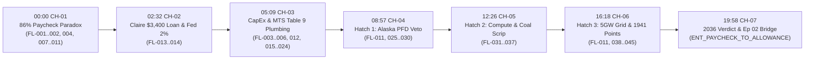

# Episode 01 Production and Research Annotated Master: The Allowance

Episode 01 opens *The Reading Room* on February 2, 2027 as the launch investigation of Series 01 (`AI Economy, National Debt & Your Money`). Across `3,323` spoken words (`22:09` at our `150 wpm` baseline), the script tests Silicon Valley's 2036 post-money forecast against the cash-collection schedule of the United States Treasury and a fixed thirty-year mortgage in Austin, Texas.

Every spoken paragraph (`P01` through `P58`) from [`ep_01_script_clean.md`](file:///d:/Youtube%20channel/reading-room-editorial-os/04_scripts_and_dossiers/ep_01_the_allowance/ep_01_script_clean.md) and the read-only source lock [`source_video_01_script.md`](file:///d:/Youtube%20channel/reading-room-editorial-os/04_scripts_and_dossiers/ep_01_the_allowance/source_video_01_script.md) maps below to its `FL-001` through `FL-045` institutional citations, `16` shoot-week `[LIVE_STAT_SLOT:...]` refresh markers, physical desk filings, `milk-page-editorial` Dual-Palette overlays, Remotion showstopper blueprints, and `reading-room-cinema` chapter timestamps.

## 1. Cinema Chapter Architecture and 150 WPM Master Timeline

YouTube Studio chapters and `reading-room-cinema` timeline markers split the twenty-two-minute cut into seven non-spoiling sections starting at `00:00`. Each boundary clears the ten-second floor and seals downstream escape-hatch verdicts until their assigned act (`R02` and `A16`).

| Chapter | Start Time | End Time | Paragraph Span | Source Lines | Word Window | Cinema Chapter Title (`yt-chapters` Lock) | Primary Stateful Entity & Register |
| :--- | :--- | :--- | :--- | :--- | :--- | :--- | :--- |
| `CH-01` | `00:00` | `02:32` | `P01` to `P07` | `L001` to `L013` | `w1` to `w380` (`380w`) | `00:00 The 86% Paycheck Paradox` | `ENT_ESCAPE_HATCH_BOARD` (`all_three_open`) on `milk-page-editorial` |
| `CH-02` | `02:32` | `05:09` | `P08` to `P15` | `L015` to `L029` | `w381` to `w773` (`393w`) | `02:32 Palo Alto Costs vs. 30-Year Loans` | `ENT_CLAIRE_AUSTIN` (`2025_lock_3400_mortgage` to `2030_minus_70pct_pay_refi_denied`) |
| `CH-03` | `05:09` | `08:57` | `P16` to `P23` | `L031` to `L045` | `w774` to `w1343` (`570w`) | `05:09 Why Taxing Server Farms Fails` | `ENT_CLAIRE_AUSTIN` (`2030_locked_45k_401k`) + `TreasuryTable9Scene` |
| `CH-04` | `08:57` | `12:26` | `P24` to `P33` | `L047` to `L065` | `w1344` to `w1864` (`521w`) | `08:57 Escape Hatch 1: The Government Check` | `ENT_ESCAPE_HATCH_BOARD` (`hatch_01_check_veto_stamped`) on `archival-light-table` |
| `CH-05` | `12:26` | `16:18` | `P34` to `P43` | `L067` to `L085` | `w1865` to `w2444` (`580w`) | `12:26 Escape Hatch 2: Basic Compute Scrip` | `ENT_ESCAPE_HATCH_BOARD` (`hatch_02_compute_scrip_stamped`) |
| `CH-06` | `16:18` | `19:58` | `P44` to `P51` | `L087` to `L101` | `w2445` to `w2996` (`552w`) | `16:18 Escape Hatch 3: Printing Into Grid Limits` | `ENT_ESCAPE_HATCH_BOARD` (`hatch_03_print_grid_ration_stamped`) |
| `CH-07` | `19:58` | `22:09` | `P52` to `P58` | `L103` to `L115` | `w2997` to `w3323` (`327w`) | `19:58 Austin 2036: Paycheck to Allowance` | `ENT_CLAIRE_AUSTIN` (`2036_inflation_saves_house_ac_shock`) + `ENT_PAYCHECK_TO_ALLOWANCE` |



## 2. Physical Studio Set, Dual-Palette Tokens, and Desk Artifact Manifest

Studio execution follows [`05_visual_audio_signature_and_cinema_lock.md`](file:///d:/Youtube%20channel/reading-room-editorial-os/01_identity_and_strategy/05_visual_audio_signature_and_cinema_lock.md) and [`cinema_schema_contract.json`](file:///d:/Youtube%20channel/reading-room-editorial-os/01_identity_and_strategy/cinema_schema_contract.json). Roll five full seconds of locked-tripod empty room plate before sitting down at the walnut desk (`35mm` full-frame equivalent at `f/3.2`, `120 cm` seated eye-level optical axis, `30.00 fps` CFR, `1/60s` shutter).

### 2.1 Wardrobe, Lighting, and Three-Stem Audio Specification

On shoot day, the presenter wears a `160 gsm` unbleached ecru Oxford cloth button-down (`#EDE6D8`, solid weave pitch `>= 2.0 mm`) paired with a `7.8 cm` muted oxblood grenadine silk tie (`#8C1D18`) knotted four-in-hand. Forearms start buttoned in Act I and roll two neat turns below the elbow when opening Treasury Table 9 at `06:51`. Key light comes from a `4600K` double-diffused octabox with a `40 deg` eggcrate at `45 deg` camera-left (`58` to `62 IRE` on the lit cheek against `32` to `36 IRE` shadow fill), warmed on the rear-left study corner by a `2800K` brass banker lamp dimmed below `78 IRE`.

Dialogue records at `48,000 Hz / 24-bit` WAV (`<= -58.0 dBFS` noise floor) and normalizes through two-pass EBU R128 FFmpeg `loudnorm` to `-14.0 LUFS` (`-1.0 dBTP`) on `A1`. Procedural `48 kHz` foley cues (`paper-slide`, `marker-sweep`, `glass-enter`, `data-tick`, `warning-thud`) ride at `-22.0 LUFS` on `A2`, while the `reading-room-chamber` score stems (`calm`, `pulse`, `tense`, `drop-silence`) sit ducked around `-30.0 LUFS` on `A3`.

### 2.2 Physical Desk Artifacts on the 60x90 cm Matte Leather Blotter

Print every statutory or fiscal exhibit before camera roll on uncoated `110 gsm` `#F4EFE6` cream cotton paper. Keep all physical pages left of `x = 1180px` so camera-right `LiquidGlassObject` overlays (`rightThird`: `x = 1180..1824`, `y = 96..956`) have an unobstructed dark walnut background.

| Desk Artifact ID | Physical Printed Document or Foreground Prop | Hand-Applied Ink & Margin Marks | Active Chapters & Cinema Twin |
| :--- | :--- | :--- | :--- |
| `EXH-EP01-01` | US Treasury *Final Monthly Treasury Statement* (FY2024 & FY2026) Table 9 (`Receipts by Source and Outlays by Function`) | Warm amber chisel sweep on Individual Income + Social Insurance rows (`84.1%` to `86.4%`); `#A3402E` brick-red circles on Corporation Income Taxes (`7.1%`) and Function 900 Net Interest (`$1.05T` vs `$0.93T` Defense) | `CH-01`, `CH-03` (`TreasuryTable9Scene`, `hero-treasury-bond-wall`) |
| `EXH-EP01-02` | CBO *Budget and Economic Outlook: 2026 to 2036* Table 1-1 paired with Claire's 360-month Austin amortization schedule through `2055` | `#A3402E` underline beneath FY2036 Net Interest (`$2.14T`) and stamped `2055 MATURITY` margin note beside `$3,400/mo` | `CH-01`, `CH-02`, `CH-07` (`bp_ep01_claire_austin_longitudinal_ledger`) |
| `EXH-EP01-03` | State of Alaska House Bill 256 Line-Item Veto Message (`June 29, 2016`) + *Wielechowski v. State*, `403 P.3d 1141` (`Alaska 2017`) slip opinion cover | Diagonal `#A3402E` fountain-pen strike across `$1.36B` (`$2,052`) down to `$666M` (`$1,022`); amber sweep on Article IX, Section 7 holding | `CH-04`, `CH-07` (`bp_ep01_alaska_walker_veto_slash`, `prop-alaska-veto-pen`) |
| `EXH-EP01-04` | PJM Interconnection *2025/2026 Base Residual Auction Report* Table 1 RTO clearing schedule + UK Ministry of Food `R.B.11` (`Dec 1, 1941`) facsimile | `#A3402E` delta bracket on `$28.92 -> $269.92/MW-day` (`+833.3%`) | `CH-06` (`bp_ep01_ten_watt_to_five_gw_ladder`, `prop-pjm-substation-transformer`) |
| `PROP-EP01-FG` | Rotating foreground scale artifact (`prop_ep01_coal_scrip_and_shoe_tag`): stamped brass Island Creek Coal token beside a `$120` running-shoe BOM tag and uncapped matte-black ebonite fountain pen | Resting in shallow-focus lower-left corner; fountain pen mirrors the closing `PAYCHECK -> ALLOWANCE` strike | `CH-01` through `CH-07` (`prop-running-shoe-bom`, `prop-coal-scrip-token`) |

### 2.3 Dual-Palette Color Lock (`milk-page-editorial` vs. `OVER_FOOTAGE_PALETTE`)

Full-screen documentary cutaways (`paletteMode: "page"`) render on `#FAF8F3` (`paperLight`) with `#F2F0EA` (`paper`) inset wells, `#E1DED5` (`1px` warm borders), `#1C2B3A` (`navy` primary ink at `13.59:1` contrast), `rgba(255, 213, 79, 0.38)` chisel amber sweeps, `#2F8F8B` (`chartSecondary` solvent teal), and `#A3402E` (`brickRed` deficit callouts inside `#F8ECE8` / `#E6C3B9` risk boxes). Live camera overlays (`paletteMode: "over-footage"`) switch to smoked-navy Liquid Glass (`blur(12px) saturate(165%) brightness(0.66)`) using `#FFF6E5` headline cream, `#FAECD4` body copy, `#BFD6EA` ice-blue rules, and `#E27358` coral risk numerals. Dark `#1C2B3A` ink is prohibited over live video.

## 3. Shoot-Week Refresh Protocol for All 16 `[LIVE_STAT_SLOT:...]` Markers

Inside the `72`-hour window before recording (`24` hours for Debt to the Penny), pull fresh primary releases for all `16` dynamic slots below while leaving Episode 01's `29` `STATIC_LOCK` rows untouched. Breaching any `THESIS_BREAK_IF` circuit breaker halts recording immediately for Stage 2 Red-Team review.

| # | `[LIVE_STAT_SLOT:...]` Identifier | Fact ID | Script Paragraph & Line | Locked Baseline | Refresh Window & Primary Agency Table | `THESIS_BREAK_IF` Circuit Breaker |
| :--- | :--- | :--- | :--- | :--- | :--- | :--- |
| `01` | `[LIVE_STAT_SLOT:US_PAYCHECK_WITHHELD_TAX_SHARE]` | `FL-001` | `P01` (`L001`) | `67.4%` (`~two-thirds`) | `72h` pre-shoot; Final September MTS Table 4 & Table 9 | Withheld income + FICA share drops `< 55.0%` |
| `02` | `[LIVE_STAT_SLOT:MTS_TABLE9_INDIV_PAYROLL_SHARE_FY]` | `FL-004` | `P01` (`L001`), `P20` (`L039`) | `86.4%` (`> 86%`) | `72h` pre-shoot; Final September MTS Table 9 | Combined individual + payroll share drops `< 80.0%` |
| `03` | `[LIVE_STAT_SLOT:MTS_TABLE9_CORP_SHARE_FY]` | `FL-006` | `P20` (`L039`) | `7.1%` | `72h` pre-shoot; Final September MTS Table 9 | Corporate income tax share climbs `> 13.0%` |
| `04` | `[LIVE_STAT_SLOT:US_GROSS_FEDERAL_DEBT]` | `FL-007` | YAML (`working_title`), `P01` (`L001`) | `$40.5T` | `24h` pre-shoot; Treasury Fiscal Data Debt to the Penny API | Gross US federal debt falls `< $36.0T` |
| `05` | `[LIVE_STAT_SLOT:NYFED_HOUSEHOLD_DEBT_TOTAL]` | `FL-009` | `P03` (`L005`) | `$19.1T` (`70.2%` mortgages) | Quarterly (`72h` check); NY Fed Household Debt & Credit | Household debt `< $16.0T` or mortgage share `< 60.0%` |
| `06` | `[LIVE_STAT_SLOT:CBO_10YR_NET_INTEREST_OUTLAY]` | `FL-011` | `P04` (`L007`), `P33` (`L065`), `P50` (`L099`) | `$2.14T` (`> $2.1T/yr`) | Semi-annual (`72h` check); CBO Budget Outlook Table 1-1 | Terminal 10-year net interest drops `< $1.5T` |
| `07` | `[LIVE_STAT_SLOT:MTS_NET_INTEREST_VS_DEFENSE]` | `FL-012` | `P23` (`L045`) | `$1.05T` vs `$0.93T` defense | `72h` pre-shoot; Final MTS Table 9 Fn 900 vs Fn 050 | Net interest `< $900B` or `< National Defense` |
| `08` | `[LIVE_STAT_SLOT:BLS_NONFARM_PRODUCTIVITY_SINCE_2017]` | `FL-015` | `P16` (`L031`) | `+20.6%` (`> 20%`) | Quarterly (`72h` check); BLS Productivity Table A1 (`OPHNFB`) | Post-2017 output-per-hour gain revises `< 15.0%` |
| `09` | `[LIVE_STAT_SLOT:BLS_LABOR_SHARE_POST1947]` | `FL-016` | `P16` (`L031`) | `53.2%` (`~53%`) | Quarterly (`72h` check); BLS Nonfarm Labor Share (`1947+`) | Nonfarm labor share rebounds `> 58.0%` |
| `10` | `[LIVE_STAT_SLOT:HYPERSCALER_ANNUALIZED_CAPEX]` | `FL-017` | `P17` (`L033`) | `$742B` Big 4 / `$824B` Big 5 | Quarterly (`72h` check); SEC Form 10-Q Cash Flows | Combined Big Five annualized CapEx falls `< $500B` |
| `11` | `[LIVE_STAT_SLOT:ALPHABET_FCF_QUARTERS]` | `FL-018` | `P17` (`L033`) | `2` negative FCF quarters | Quarterly (`72h` check); Alphabet Form 10-Q Cash Flows | Trailing 4Q FCF `> +$60B` while cutting CapEx |
| `12` | `[LIVE_STAT_SLOT:AMAZON_TTM_FCF]` | `FL-019` | `P17` (`L033`) | `-$42.4B` TTM FCF | Quarterly (`72h` check); Amazon Form 10-Q Item 2 FCF | Amazon TTM FCF turns `> +$30B` without debt |
| `13` | `[LIVE_STAT_SLOT:FED_DFA_EQUITY_CONCENTRATION]` | `FL-021` | `P18` (`L035`) | `92.5%` Top 10% / `1.0%` Bot 50% | Quarterly (`72h` check); Fed Distributional Financial Accounts | Top 10% share `< 80.0%` or Bottom 50% `> 5.0%` |
| `14` | `[LIVE_STAT_SLOT:LLM_EQUIVALENT_TOKEN_DEFLATION]` | `FL-034` | `P38` (`L075`) | `> 99%` drop (`$36 -> $0.15/1M`) | Semi-annual (`72h` check); Epoch AI Inference Price Tracker | Equivalent-capability price rises `> 2023` baseline |
| `15` | `[LIVE_STAT_SLOT:IEA_DATACENTER_TWH_2030]` | `FL-039` | `P47` (`L093`) | `415 TWh` to `945 TWh` | Annual (`72h` check); IEA *Energy and AI* / WEO Base Case | IEA 2030 data-center demand forecast `< 600 TWh` |
| `16` | `[LIVE_STAT_SLOT:PJM_CAPACITY_AUCTION_CLEARING]` | `FL-041` | `P48` (`L095`), `P49` (`L097`) | `$28.92 -> $269.92/MW-day` (`+833.3%`) | Each PJM BRA release (`72h` check); PJM BRA Table 1 | PJM RTO clearing price drops back `< $75/MW-day` |

## 4. Complete Beat-by-Beat Production and Research Master (`Beat 01` to `Beat 18`)

All fifty-eight spoken paragraphs (`P01` through `P58`) appear verbatim inside the eighteen production beats below, paired with their exact `150 wpm` clocks, visual stage cues, Dual-Palette tokens, audio moves, and `FL-001` through `FL-045` verification receipts.

---

### Beat 01 (`00:00` to `00:23` | `P01` / `L001` | `w1` to `w58`): Cold-Open Fiscal Contradiction

> Roughly two-thirds of every tax dollar Washington collects comes straight out of somebody's paycheck. Add capital gains and business income from individual tax filings, and regular taxpayers fund over eighty-six percent of the US government. So if AI wipes out a huge share of those paychecks before 2036, who's going to pay off $40.5 trillion in national debt?

```text
[ON SCREEN: Overhead macro of EXH-EP01-01 on dark leather blotter dissolving at 00:06 into PAGE_PALETTE (#FAF8F3) TreasuryTable9Scene. Chisel amber sweep rgba(255, 213, 79, 0.38) marks Withheld Income + FICA (67.4%) and Individual + Payroll receipts (86.4%) in #1C2B3A IBM Plex Mono; at w53 ("$40.5 trillion"), a #F8ECE8 risk callout bordered in #E6C3B9 stamps "$40.5T GROSS DEBT" in #A3402E brick-red.]
```

Frame one opens directly on `doc-archive-light-table` (`fullscreen-cutaway`) for the first fourteen seconds (`w1..w35`) to pay off the title and thumbnail promise without a word of channel throat-clearing. At `w36`, the edit cuts to `talking-head-punch-in` (`100%` to `108%` slow push) as `paper-slide`, `marker-sweep`, and `warning-thud` punctuate `reading-room-chamber:calm` (`-31.0 LUFS`). Four primary ledger rows back this opening paragraph: `FL-001` (`[LIVE_STAT_SLOT:US_PAYCHECK_WITHHELD_TAX_SHARE]`, Final FY2026 MTS Tables 4 & 9 at `67.4%`), `FL-002` (`STATIC_LOCK`, IRS SOI Pub 1304 Table 1.4 showing `68.2%` of individual AGI comes from W-2 salaries), `FL-004` (`[LIVE_STAT_SLOT:MTS_TABLE9_INDIV_PAYROLL_SHARE_FY]`, `86.4%` combined individual and payroll share), and `FL-007` (`[LIVE_STAT_SLOT:US_GROSS_FEDERAL_DEBT]`, `$40.5T` gross public debt).

---

### Beat 02 (`00:23` to `01:40` | `P02` to `P04` / `L003` to `L007` | `w59` to `w249`): Silicon Valley's 2036 Horizon vs. Fixed Debt Contracts

> On October 29, 2026, Elon Musk posted on X that saving money for the distant future is pointless once super-intelligent machines create abundance. Try forwarding that post to your landlord on the first of the month. See how far it gets you.
>
> Your rent and your mortgage still assume a paycheck clears on Friday. So do the Treasury bonds sitting inside your bank, because Washington pays bondholders out of taxes collected mostly from working people. Right now American households owe $19.1 trillion, about seventy percent of it locked into fixed-rate mortgages. And your bank's automated draft doesn't care what the robots are doing.
>
> Back in July 2026, Musk sat down with The Economist in Texas and put an actual date on it. Money stops mattering, he said, by 2036. Pull up the Congressional Budget Office forecast for that exact year and you hit a brick wall. Interest payments alone on America's debt pass $2.1 trillion a year in 2036. Right when money's supposed to stop mattering, Washington owes bondholders over two trillion dollars every twelve months. And the pension funds, banks, and foreign central banks holding that paper still expect dollars.

```text
[ON SCREEN: P02 shows doc-caption-news (#FAF8F3) with the dated October 29, 2026 X post excerpt in Newsreader above #6B7783 metadata, cutting dry to camera at w81. P03 frames presenter at x=700px (talking-head-with-glass) as LiquidGlassObject:card enters rightThird showing "$19.1T HOUSEHOLD DEBT | 70.2% FIXED MORTGAGES" (#FFF6E5 / #E27358). P04 cuts full-screen to EXH-EP01-02 comparing July 2026 Economist date "2036" against CBO Table 1-1 "FY2036 NET INTEREST: $2.14T/YR" in #A3402E.]
```

Deliver `Try forwarding that post to your landlord` straight into the `35mm` lens on a clean `talking-head-full` plate (`L23` deadpan aside) before sliding the presenter left to clear `rightThird` for the NY Fed glass card (`glass-enter` at `00:51`). When `P04` pulls up the Congressional Budget Office table (`01:15`), `FL-008` (`2026-10-29` X post) and `FL-010` (July 18, 2026 *Economist* interview in Texas) collide directly with two rolling debt slots: `FL-009` (`[LIVE_STAT_SLOT:NYFED_HOUSEHOLD_DEBT_TOTAL]`, `$19.1T` household debt with `$13.4T` or `70.2%` in mortgages) and `FL-011` (`[LIVE_STAT_SLOT:CBO_10YR_NET_INTEREST_OUTLAY]`, `$2.14T` in FY2036 net interest).

---

### Beat 03 (`01:40` to `02:32` | `P05` to `P07` / `L009` to `L013` | `w250` to `w380`): The 18-to-28 Host Stake and Three-Bay Escape-Hatch Board

> I'm eighteen. When 2036 gets here, I'll be twenty-eight, right around the age people are supposed to be building a career and signing a mortgage. So when the richest man alive tells my generation that saving is pointless, I want to check the math.
>
> You've probably already got the standard fix in your head: tax the robots and mail everybody a check. Once you open the Treasury's own monthly ledger, that plan falls apart fast. That's why people in Washington and Silicon Valley have quietly floated three escape hatches: a federal dividend check, paying you directly in AI computing power, or having the Federal Reserve print the money outright.
>
> All three of them break. And each one breaks in a way that hands somebody else the switch to your bank account.

```text
[ON SCREEN: P05 holds centered talking-head-full (x=960px) with zero overlays. At P06 w328 ("three escape hatches"), cut to doc-visual-investigation (#FAF8F3) initializing ENT_ESCAPE_HATCH_BOARD in state all_three_open: three numbered #F2F0EA bays bordered in #E1DED5 ("01 FEDERAL DIVIDEND CHECK", "02 UNIVERSAL BASIC COMPUTE", "03 SOVEREIGN MONEY PRINTING") in #1C2B3A ink, keeping failure stamps hidden.]
```

Holding `P05` completely bare lets `HOST_ANALYST_18_TO_28` (`18 + 10 = 28` in `FL-010`) establish personal skin in the game without visual clutter. Once `ENT_ESCAPE_HATCH_BOARD` snaps onto `#FAF8F3` (`flash-cut` at `02:11`), a `100%` to `104%` camera creep builds into an `8`-frame `drop-silence` cut right before `hands somebody else the switch to your bank account`, locking open-loop suspense (`R02`, `A16`) without spoiling Alaska, coal scrip, or PJM power auctions.

---

### Beat 04 (`02:32` to `03:20` | `P08` to `P10` / `L015` to `L019` | `w381` to `w501`): Silicon Valley Credit and the $120 Running-Shoe Teardown

> Before we get into how they fail, let's give Silicon Valley credit on one thing. On the cost of making stuff, the engineers are mostly right.
>
> Take a $120 pair of running shoes, or a routine dental X-ray. Almost everything inside that price tag is human time. Somebody stitched the shoe, somebody drove the truck to Memphis, somebody pulled the box off a shelf, and somebody upstairs ran payroll. Swap eighty percent of those paid hours for software and robots running near the cost of electricity, and unit costs drop through the floor. Competition drags retail prices down right behind them.
>
> On a whiteboard in Palo Alto, falling prices look like abundance. Problem is, that whiteboard's never met a thirty-year loan.

```text
[ON SCREEN: Showstopper Blueprint #1 (bp_ep01_running_shoe_labor_vaporizer) on #FAF8F3 diagram-isometric. Exploded $120 running shoe splits four #1C2B3A human-labor bars (stitching, Memphis freight, shelf pick, payroll) from #2F8F8B raw polymer and kWh. At w453, 80% of the labor bars vaporize. At P10, a #1C2B3A 360-month mortgage schedule slams across the Palo Alto whiteboard (MOTIF_WHITEBOARD_VS_30YR_LOAN).]
```

Granting Silicon Valley's unit-cost physics upfront earns trust with technical builders (`Devon` avatar) as `reading-room-chamber:pulse` enters at `-29.5 LUFS`. Both `$120 pair of running shoes` and `swap eighty percent of those paid hours` sit inside `narrative_persona_allowlists.ep_01` so `validate_fact_ledger.py` separates illustrative unit-cost math from empirical federal tables.

---

### Beat 05 (`03:20` to `03:56` | `P11` to `P12` / `L021` to `L023` | `w502` to `w589`): Claire in Austin (2025 to 2030) and Irving Fisher's 1933 Paper

> Picture Austin, Texas in late 2025. Claire's a thirty-two-year-old senior software engineer making good money, and she locks in a thirty-year fixed mortgage at $3,400 a month. Five years pass. Coding agents automate most of her team, and just to stay employed, she has to swallow a seventy percent pay cut.
>
> Back in the 1930s, the economist Irving Fisher watched falling incomes collide with fixed loans during the Great Depression. He called it debt deflation. Wages and prices drop together, while old debts stay frozen at yesterday's numbers.

```text
[ON SCREEN: P11 launches Showstopper Blueprint #2 (bp_ep01_claire_austin_longitudinal_ledger) setting ENT_CLAIRE_AUSTIN to 2025_lock_3400_mortgage on #FAF8F3 (Austin, TX | Late 2025 | $3,400/mo fixed through 2055), then advancing to 2030 with "-70% CODING PAY CUT" in #A3402E. P12 cross-dissolves in OKLCH (18 frames) to vintage-newsreel (#0D0C0B) showing Econometrica Vol. 1, No. 4 (Oct 1933), Irving Fisher pp. 337-357.]
```

Opening `P11` with `Picture Austin, Texas in late 2025` obeys the epistemic honesty lock in `continuity_graph.json` (`VEH_CLAIRE_AUSTIN`), keeping modeled balance sheets distinct from documentary interviews. `P12` pairs Claire's `fixed mortgage at $3,400 a month` and `seventy percent pay cut` with `FL-013` (`STATIC_LOCK`, Fisher's October 1933 *Econometrica* paper), triggered with a crisp `newsreel-click` at `03:42`.

---

### Beat 06 (`03:56` to `05:09` | `P13` to `P15` / `L025` to `L029` | `w590` to `w773`): Red-Team Patch 01 (2.0% Fiat PCE Target vs. Relative Wage Collapse)

> Now, if an economist's watching this, they'll point out right away that 2030 isn't 1933. During the Depression, the dollar was chained to gold, so the Federal Reserve sat on its hands while the money supply shrank. Today's Fed runs a fiat currency with a two percent inflation target. If AI productivity starts pushing general prices down, the Fed won't just watch it happen. They'll cut interest rates and pump money in until average prices keep ticking upward.
>
> Does that save Claire? Run her budget again. Even if the Fed stops economy-wide deflation and keeps total GDP growing, AI still crushed the market price of human coding hours while software owners pocketed the gains. Now her grocery bill doesn't even get cheaper. Her paycheck's still down seventy percent, and the bank still wants $3,400 every month until 2055, or the sheriff changes the locks. She can't refinance out of it either. Underwriters lend against your income, and hers just collapsed.
>
> Keep Claire's house in the back of your mind. When we get to 2036, she's going to hit the sharp end of Washington's fix.

```text
[ON SCREEN: P13 shifts presenter to x=710px with LiquidGlassObject:card in rightThird showing FOMC Strategy "2.0% PCE INFLATION TARGET" (#FFF6E5 / #4FB3AE). At P14, cut full-screen to ENT_CLAIRE_AUSTIN in state 2030_minus_70pct_pay_refi_denied (#FAF8F3): Groceries +2.0%/yr (#1C2B3A), Coding Wage -70% (#A3402E), Mortgage frozen at $3,400/mo to 2055, and #A3402E stamp "REFINANCE DENIED: DTI FAILED".]
```

Stage 2's first `MANDATORY_PROSE_CONCESSION` (`SEAT_01_MACRO` `RT_M01`, backed by `FL-014` FOMC Paragraph 4 `2.0%` PCE target) pre-empts macroeconomists before they reach the comment box. Punch in `100%` to `112%` on `Does that save Claire? Run her budget again.` so viewers watch monetary easing prevent cheaper groceries while leaving her `$3,400` mortgage unrefinanceable, then plant the `2036` callback hook in `P15`.

---

### Beat 07 (`05:09` to `06:41` | `P16` to `P18` / `L031` to `L035` | `w774` to `w1003`): Post-1947 Labor Share Trough, $824B CapEx, and 401(k) Concentration

> You don't even have to wait until 2030 to see this starting in government data. Since 2017, the output American workers produce per hour has climbed past twenty percent while real pay lagged behind. That gap pushed workers' share of the economy down to roughly fifty-three percent in 2026, its lowest point since the government started tracking it under Harry Truman in 1947.
>
> So where's the money going instead? Alphabet, Amazon, Meta, and Microsoft are pouring around $740 billion a year into AI and cloud infrastructure, past $820 billion if you count Oracle. They're building server farms so fast that Alphabet just posted back-to-back quarters of negative free cash flow in 2026, spending more cash than Google's entire ad business brought in. Amazon's free cash flow went negative by more than $42 billion over the past twelve months.
>
> At this point, Wall Street optimists usually jump in with a fair question. Don't regular Americans own stock through index funds and 401(k)s? Federal Reserve wealth data answers that in five seconds. Around sixty percent of US families do own some stock, but the richest ten percent hold roughly ninety percent of all stock market wealth, and the bottom half owns one percent. Even a well-paid thirty-two-year-old like Claire might have $45,000 locked inside a 401(k). That won't cover next Tuesday's mortgage draft without tax penalties, and it won't replace a career.

```text
[ON SCREEN: P16 plots BLS OPHNFB (+20.6% in #2F8F8B) against Nonfarm Labor Share falling to 53.2% (#A3402E, 1947-2026 low) on #FAF8F3. P17 displays SEC 10-Q CapEx ($742B Big Four / $824B Big Five) with #F8ECE8 negative FCF boxes for Alphabet (-$3.5B Q2, -$4.2B Q3) and Amazon (-$42.4B TTM). P18 splits Fed DFA equity bars (Top 10%: 92.5% vs Bottom 50%: 1.0%) and updates ENT_CLAIRE_AUSTIN to 2030_locked_45k_401k ("$45,000 | IRC 72(t) 10% PENALTY").]
```

Six live slots fire in rapid succession across these three paragraphs: `FL-015` (`[LIVE_STAT_SLOT:BLS_NONFARM_PRODUCTIVITY_SINCE_2017]`, `+20.6%`), `FL-016` (`[LIVE_STAT_SLOT:BLS_LABOR_SHARE_POST1947]`, `53.2%`), `FL-017` (`[LIVE_STAT_SLOT:HYPERSCALER_ANNUALIZED_CAPEX]`, `$742B` / `$824B`), `FL-018` (`[LIVE_STAT_SLOT:ALPHABET_FCF_QUARTERS]`, two negative quarters), `FL-019` (`[LIVE_STAT_SLOT:AMAZON_TTM_FCF]`, `-$42.4B`), and `FL-021` (`[LIVE_STAT_SLOT:FED_DFA_EQUITY_CONCENTRATION]`, `92.5%` vs `1.0%`), bookended by `FL-020` (`58.2%` SCF stock participation) and `FL-022` (`~$45,000` Vanguard 25-34 balance locked behind `26 U.S.C. § 72(t)`'s `10%` early-withdrawal penalty).

---

### Beat 08 (`06:41` to `08:57` | `P19` to `P23` / `L037` to `L045` | `w1004` to `w1343`): Monthly Treasury Statement Table 9 and Red-Team Patch 02 (Tax Plumbing)

> Which brings us right back to your first instinct. If trillions are pooling inside tech giants, why doesn't Washington just tax the server farms?
>
> Open Table 9 of the Monthly Treasury Statement and see where Washington actually gets its cash. In fiscal 2024, individual income taxes and payroll taxes brought in 84.1 percent of all federal revenue. By the end of fiscal 2026, that share climbed past 86 percent. Corporate income taxes, meanwhile, dropped from 10.8 percent in 2024 down to 7.1 percent in 2026. Why did corporate taxes fall during an AI boom? Because a July 2025 tax law permanently let companies write off one hundred percent of new servers, chips, and domestic R&D the exact year they buy them.
>
> Now let's be fair to the accounting. When Amazon writes off $200 billion worth of Nvidia chips, that money doesn't vanish from the US economy. It shows up as taxable revenue at Nvidia, chip fabs, and electrical contractors. And if AI replaces trillions in human wages while growing GDP, total capital income across America gets much bigger. On a spreadsheet, the money's still in the building.
>
> The trap sits inside Washington's tax plumbing. When you earn a Friday paycheck, income withholding and payroll tax take their cut off the top before the cash ever touches your checking account. Capital plays by a completely different rulebook. Corporations deduct massive hardware bills up front and route intellectual-property profits through low-tax countries like Ireland. Major shareholders borrow cash against rising stock portfolios without selling a single share, so they don't trigger a tax bill at all. Move trillions of dollars off W-2 paychecks and onto corporate balance sheets, and you starve the Treasury unless Congress rewrites the whole tax code against the richest corporate lobby on Earth.
>
> Look a few rows further down Table 9 and the clock gets tighter. Net interest on the federal debt passed $1 trillion in fiscal 2026, officially beating the entire US defense budget. AI is eating into the one automatic tax stream keeping that debt afloat.

```text
[ON SCREEN: P20 inspects EXH-EP01-01 on doc-archive-light-table (#F4EFE6): FY2024 (84.1% indiv+payroll, 10.8% corp) vs FY2026 (86.4% indiv+payroll, 7.1% corp) plus Pub. L. 119-21 IRC 168(k)/174A inset. P21-P22 run Showstopper Blueprint #3 (bp_ep01_w2_withholding_guillotine) on #FAF8F3 contrasting automatic Friday W-2 withholding against $200B CapEx write-offs, 15% Irish IP routing, and $0-tax IRC 1001 pledged-share loans. P23 pans down Table 9 Outlays: Function 900 Net Interest ($1.05T in #A3402E) passing Function 050 Defense ($0.93T).]
```

Here the presenter rolls shirt cuffs two turns below the elbow and walks straight down physical exhibit `EXH-EP01-01`. `FL-003` (`84.1%`) and `FL-005` (`10.8%`) lock the closed FY2024 baseline against live slots `FL-004` (`86.4%`) and `FL-006` (`[LIVE_STAT_SLOT:MTS_TABLE9_CORP_SHARE_FY]`, `7.1%`), explained by `FL-023` (`Pub. L. 119-21` enacted July 4, 2025). Patch 02 (`SEAT_02_CPA` `RT_C01`, `FL-024`) concedes vendor gross receipts at Nvidia and fabs before exposing `IRC § 1001` non-realization loans and `15%` Irish IP routing, closing on `FL-012` (`[LIVE_STAT_SLOT:MTS_NET_INTEREST_VS_DEFENSE]`, `$1.05T` net interest beating `$0.93T` defense).

---

### Beat 09 (`08:57` to `10:36` | `P24` to `P29` / `L047` to `L057` | `w1344` to `w1589`): Escape Hatch 1 Setup and the 2034 Automated Port Strike

> And that brings us to escape hatch number one: the government check.
>
> Musk calls his version universal high income. Sam Altman pitched a more detailed plan in 2021 called the American Equity Fund, taxing big corporations on their stock value alongside a tax on privately held land, then paying every adult a yearly check.
>
> Wiring the money is the easy part. In 2020, stimulus deposits hit tens of millions of bank accounts within weeks. The hard part shows up the first time Washington runs short.
>
> Think about how working people won steady raises and the forty-hour week in the last century. When dockworkers in Rotterdam or autoworkers in Detroit walked off the job in 1955, ships sat dead at the pier and assembly lines went quiet. By Friday afternoon, the owners were bleeding cash. Bosses shared productivity gains because they had to, since the machines stopped the minute workers walked out.
>
> Now run that exact strike in 2034. Robotic cranes unload ships through the night, driverless trucks clear the port gates, and server clusters hum along at ninety-nine-point-nine percent uptime while half a million people march outside the Capitol demanding a bigger check. Every machine keeps running.
>
> You'll still have your vote on Election Day. What disappears on Monday morning is your bargaining power at work. Once the economy runs without your labor, what hits your checking account stops being a market wage and turns into a budget line politicians argue over when money gets tight.

```text
[ON SCREEN: P24 zooms into Bay 01 of ENT_ESCAPE_HATCH_BOARD ("01 FEDERAL DIVIDEND CHECK"). P25-P26 pair Altman's March 2021 American Equity Fund essay (2.5% equity + 2.5% land tax) with GAO-20-625 (81.4M CARES Act deposits in 3 weeks). P27 cuts to vintage-newsreel (#0D0C0B) 1955 Detroit UAW strike stills, then cross-dissolves at P28 to midnight_telemetry (#111315) showing autonomous cranes, trucks, and servers running at "99.9% UPTIME" (#4FB3AE) while protesters gather outside the Capitol (MOTIF_FRIDAY_PAYCHECK_TRUCE).]
```

Words `w1350` through `w1520` (`09:00` to `10:08`, `171` words) represent the longest reset-free stretch in the script, clearing the `220`-word hard gate with `49` words of margin before `ninety-nine-point-nine percent` resets the clock. Score shifts from `pulse` into `tense` (`-28.5 LUFS`) at `09:58`, backed by `FL-025` (Altman's March 16, 2021 essay), `FL-026` (`GAO-20-625` CARES Act rollout), and `FL-027` (`29 U.S.C. § 207` and June 1955 UAW contracts).

---

### Beat 10 (`10:36` to `12:26` | `P30` to `P33` / `L059` to `L065` | `w1590` to `w1864`): Alaska's 2016 Veto, *Wielechowski*, and Red-Team Patch 03 (Bond Subordination)

> Alaska already ran a forty-year test on how politicians treat an "untouchable" citizen dividend.
>
> Since 1982, every Alaska resident, newborn babies included, has gotten a yearly check from the state's oil wealth called the Permanent Fund Dividend. For over thirty years, touching it was political suicide. Then oil prices crashed, leaving a $4 billion hole in Alaska's budget. Under the formula on the books in June 2016, each resident was owed $2,052, which meant $8,208 for a family of four heading into winter. Governor Bill Walker pulled out his veto pen and cut every check in half, down to $1,022. One signature wiped out over four thousand dollars per family right as October heating-fuel bills showed up.
>
> Some lawmakers actually sued the governor over it in *Wielechowski v. State*. In 2017, the Alaska Supreme Court ruled unanimously that the governor was allowed to cut it, because the dividend wasn't in the state constitution. It was just regular budget money voted on every year, so state agencies and bondholders got paid first. By 2025, Alaska's formula said residents were owed roughly $3,900. They got $1,000.
>
> Now, Washington has one power Alaska's governor never had. Juneau can't print US dollars, and Congress can. We'll see what breaks when Washington turns on the printing press in a minute. But if Congress tries paying Claire a monthly dividend without printing the gap, her check has to survive every debt-ceiling standoff against $2.1 trillion in bond interest, defense, and Social Security. Defaulting on Treasury bonds blows up the global banking system, so bondholders always get paid first. Your rent ends up one budget fight away from getting cut in half.

```text
[ON SCREEN: P31-P32 execute Showstopper Blueprint #4 (bp_ep01_alaska_walker_veto_slash) over EXH-EP01-03 on archival-light-table (#F4EFE6): Alaska HB 256 ($2,052 statutory / $8,208 family of four) slashed diagonally in #A3402E ink (MOTIF_ONE_SIGNATURE) down to $1,022 (-50.2%), beside Wielechowski v. State, 403 P.3d 1141 (5-0 holding) and 2025's "$3,892 -> $1,000" bar. P33 renders the hydraulic-bond-priority-spillway on #FAF8F3 where $2.14T Bond Interest, Defense, and Social Security drain tax receipts ahead of Claire's check, stamping Bay 01 "SUBORDINATE TO BONDHOLDERS".]
```

Drop the score completely (`drop-silence`, `8` frames) right before `Governor Bill Walker pulled out his veto pen` so `marker-sweep` and `warning-thud` land on bare room audio (`11:13`). `FL-028` (June 29, 2016 HB 256 veto), `FL-029` (*Wielechowski v. State*, `403 P.3d 1141`, August 25, 2017), and `FL-030` (2025 HB 53 `$1,000` payout vs `~$3,892` formula) set up Patch 03 (`SEAT_01_MACRO` `RT_M02` + `SEAT_05_LAW` `RT_L01`): granting Congress's fiat issuance power (`Juneau can't print US dollars, and Congress can`) splits the outcome between senior bond subordination (`FL-011`, `$2.14T`) and Escape Hatch 3.

---

### Beat 11 (`12:26` to `14:26` | `P34` to `P39` / `L067` to `L077` | `w1865` to `w2164`): Escape Hatch 2, Uber's $1,500 Cap, and >99% Token Deflation

> Plenty of people in Silicon Valley know politicians make bad paymasters. So they came up with escape hatch number two: skip Congress and pay you directly in AI computing power.
>
> On the All-In podcast in May 2024, Sam Altman floated what he called Universal Basic Compute. Give every adult a slice of GPT-7's processing power, and let you use it, rent it out, or sell it for cash on an exchange.
>
> Look at corporate AI bills in 2026 and you can see why founders love this pitch. Early this year, Forbes reported that Uber burned through its entire annual AI budget just four months into the year. Roughly five thousand engineers had started running coding agents nonstop, and Uber's CTO had to cap spending at $1,500 per engineer, per tool, every month. Over at Nvidia, Jensen Huang said an engineer's token budget should eventually equal about half their base salary. With demand like that, getting a slice of compute sounds like owning a personal oil well.
>
> So why does it fall apart? Look at why Uber's engineers burned so many tokens in the first place.
>
> Since 2023, faster chips and leaner models have pushed the price of equivalent AI tokens down by over ninety-nine percent. Total corporate bills only exploded because engineers ran millions more automated tasks, while each unit of compute got way cheaper every year. Pay your family in raw compute, and you're getting paid in a currency built to lose most of its dollar price every time Nvidia ships a new chip.
>
> Even worse, compute spoils on the clock. Unused processing time on Tuesday afternoon vanishes the second Tuesday ends, like an empty seat once a plane pushes back from the gate. You can't save July's idle server time in a jar to pay December's property taxes.

```text
[ON SCREEN: P34-P35 open Bay 02 of ENT_ESCAPE_HATCH_BOARD ("02 UNIVERSAL BASIC COMPUTE") alongside All-In Ep. 178 (May 10, 2024). P36 docks LiquidGlassObject:dock over camera showing "UBER: 5,000 ENGINEERS | $1,500/MO PER-TOOL CAP" and "NVIDIA: 50% OF BASE SALARY" (#FFF6E5). P38 cuts full-screen to Epoch AI log curve on #FAF8F3 plunging >99% ($36.00 -> $0.15/1M tokens in #A3402E). P39 pairs expiring Tuesday GPU cycles with an empty departing airliner gate.]
```

`P35` and `P36` steelman Universal Basic Compute (`FL-031` *All-In* May 2024, `FL-032` *Forbes* Uber `$1,500/mo` cap across `5,000` engineers, `FL-033` Jensen Huang `50%` salary benchmark) before `P37` punches in `100%` to `112%` to flip Jevons volume expansion on its head via live slot `FL-034` (`[LIVE_STAT_SLOT:LLM_EQUIVALENT_TOKEN_DEFLATION]`, `99.58%` unit price collapse since March 2023) and physical time spoilage (`P39`).

---

### Beat 12 (`14:26` to `16:18` | `P40` to `P43` / `L079` to `L085` | `w2165` to `w2444`): Closed Cloud Wallets, 1912 Coal Scrip, and Shenzhen's Expiring Vouchers

> If tens of millions of households try selling a perishable, fast-depreciating credit every month to get dollars for rent, the cash exchange rate craters. And tech platforms already have a way to keep that cash from leaving their walls: cloud credits. Right now, when AWS or OpenAI hands a startup $100,000 in compute credits, that number looks huge on a dashboard. At JPMorgan Chase, it pays zero dollars toward your rent.
>
> Scale that closed wallet up to everyday life. Platforms let you spend your monthly compute balance fee-free on partner apartments, robotaxis, and warehouse deliveries, while charging a twenty percent fee the second you pull real dollars out to an outside bank.
>
> Coal miners in West Virginia lived under that exact setup a hundred years ago. Companies like Island Creek Coal paid wage advances in brass tokens and paper scrip that only worked at the company store and for company rent. When a miner needed real US dollars for a train ticket out of Logan County, outside traders bought his scrip at a discount of twenty-five percent or more. After armed strikes broke out along Paint Creek in 1912, states started tightening wage laws, and in 1938 Congress used the Fair Labor Standards Act to bar employers from paying minimum wage in scrip you couldn't cash out at face value.
>
> Put company scrip on a phone and the walls get even higher. In October 2020, Shenzhen tested digital yuan vouchers that worked at roughly three thousand approved stores. Any money you didn't spend within six days just vanished from the app. Let a private tech giant run a programmable wallet like that, and you can't afford to leave their ecosystem.

```text
[ON SCREEN: P40-P41 split #FAF8F3 between AWS Activate Section 2 ("$100,000 CREDIT | $0.00 CASH") and a JPMorgan rent draft ("$0 APPLIED") plus "-20% EXIT FEE" (MOTIF_CLOSED_WALL_SCRIP). P42 cuts to macro of physical brass scrip token PROP-EP01-FG beside Senate S. Res. 37 (1913 Paint Creek, >=25% discount) and 29 CFR 531.34 (1938 FLSA). P43 renders PBOC Oct 12-18, 2020 Luohu e-CNY voucher (3,389 merchants | 6-day timer hitting zero), stamping Bay 02 "DIGITAL COMPANY SCRIP" in #A3402E.]
```

Cutting to a macro lens on the desk's physical stamped brass token (`PROP-EP01-FG`) at `15:10` links AWS promotional cloud terms (`FL-035`, `$100,000` nominal = `$0` cash) and the illustrative `twenty percent fee` (`narrative_persona_allowlists.ep_01`) directly to Island Creek Coal's `>=25%` scrip haircut and `29 CFR § 531.34` (`FL-036`, `SEAT_05_LAW` `RT_L03`), finishing on Shenzhen's October 2020 programmable expiry pilot (`FL-037`, `3,389` stores, `6` days).

---

### Beat 13 (`16:18` to `17:40` | `P44` to `P47` / `L087` to `L093` | `w2445` to `w2649`): Escape Hatch 3 and the 10-Watt to 5-Gigawatt Scale Ladder

> Which leaves escape hatch number three: Washington bans private scrip, skips the tax fight, and tells the Fed and the Treasury to print the money.
>
> Typing digital dollars into a central-bank account costs nothing. What no central bank can print is copper wire, high-voltage transformers, or baseload power plants.
>
> Software copies itself for fractions of a cent, so it's easy to forget how much physical metal and fuel sit behind your wall outlet. A phone charger draws ten watts. A kitchen microwave on high pulls a thousand watts, which is one kilowatt. Run a million microwaves nonstop day and night and you hit one gigawatt, roughly the steady home electricity use of a major US city. NextEra Energy's CEO recently said tech companies are now asking utilities for up to five gigawatts on a single AI campus. That's five cities' worth of homes for one server complex.
>
> Worldwide, data centers used about 415 terawatt-hours of electricity in 2024. By 2030, the International Energy Agency expects them to hit 945 terawatt-hours, passing the entire annual electricity use of Japan. Along West London's M4 corridor, officials warned builders that major housing projects faced delays into the 2030s because nearby data centers had already reserved the local substations.

```text
[ON SCREEN: P44 opens Bay 03 of ENT_ESCAPE_HATCH_BOARD ("03 SOVEREIGN MONEY PRINTING"). P46 runs Showstopper Blueprint #5 (bp_ep01_ten_watt_to_five_gw_ladder) on drafting_blueprint (#0F2236 substrate, #F4F1EA bone lines): logarithmic zoom from 10W charger -> 1,000W microwave -> 1,000,000 microwaves (1 GW city) -> 5 GW single AI campus. P47 maps IEA demand (415 -> 945 TWh passing Japan's ~930 TWh in #A3402E) beside GLA's West London M4 (Hillingdon, Ealing, Hounslow) housing queue map.]
```

Switching substrates via an `18`-frame OKLCH dissolve onto `drafting_blueprint` (`#0F2236`) gives the `Art of the Problem` four-rung wattage ladder (`T19`) tactile engineering weight as `riser-subtle` climbs from ten watts to NextEra's `5 GW` single-site queue disclosure (`FL-038`). `P47` pairs live slot `FL-039` (`[LIVE_STAT_SLOT:IEA_DATACENTER_TWH_2030]`, `415` to `945 TWh`) with the Greater London Authority's July 2022 substation queue notice (`FL-040`).

---

### Beat 14 (`17:40` to `19:22` | `P48` to `P50` / `L095` to `L099` | `w2650` to `w2905`): PJM's 833% Capacity Spike, Three Mile Island, and Red-Team Patch 04

> Watch what happens to your electric bill when that demand hits a US power auction. PJM runs the wholesale grid across thirteen states from Illinois to New Jersey, plus Washington, D.C. In its capacity auction for 2025 and 2026, the price paid to keep power plants ready jumped from $28.92 to $269.92 per megawatt-day. That's an 833 percent spike, and it lands right on household utility bills. Two months later, Microsoft signed a twenty-year deal to buy the entire output of the restarted Unit 1 reactor at Three Mile Island, locking up a whole nuclear plant for one company.
>
> Now, over ten or fifteen years, an 833 percent price spike will obviously push developers to build new gas turbines, solar farms, batteries, and reactors. The pain sits in the gap between software speed and construction speed. Coding agents roll out across an industry in six months. Permitting high-voltage power lines and substations in America takes five to ten years.
>
> And look at what Washington's actually printing money to pay for here. If the Fed only printed enough cash to replace part of your lost paycheck, total consumer spending wouldn't jump. Here, though, Washington's printing trillions to plug a shrinking payroll tax base, pay $2.1 trillion a year in bond interest, and fund monthly checks for tens of millions of homes all at once. Pour trillions of new consumer dollars into a decade-long grid bottleneck, and your fixed government check has to bid for megawatts, copper, and housing hookups against tech companies making sixty percent gross margins.

```text
[ON SCREEN: P48 opens EXH-EP01-04 on #FAF8F3 showing the 13-state + D.C. PJM grid map, Table 1 clearing jump ($28.92 -> $269.92/MW-day, +833.3% in #A3402E), and Constellation Form 8-K (20-year, 835 MW Three Mile Island Unit 1 PPA). P49 pits "6-MONTH CODING ROLLOUT" (#2F8F8B) against "5-TO-10-YEAR HV PERMITTING" (#A3402E, MOTIF_SOFTWARE_VS_PERMIT_SPEED). P50 funnels triple-deficit money creation against "60%+ GROSS MARGIN HYPERSCALERS".]
```

Live slot `FL-041` (`[LIVE_STAT_SLOT:PJM_CAPACITY_AUCTION_CLEARING]`, `$28.92` to `$269.92/MW-day`) and `FL-042` (Constellation's September 20, 2024 PPA for `835 MW` at Three Mile Island Unit 1) set up Episode 01's fourth adversarial turn (`SEAT_03_GRID` `RT_G01` + `SEAT_01_MACRO` `RT_M03`). `P49` grants fifteen-year generator elasticity while pinning the mismatch on `FL-043` (`5 to 10 years` US transmission permitting in LBNL *Queued Up*), and `P50` separates neutral one-for-one wage replacement from simultaneous monetization across tax holes and `$2.14T` bond interest (`FL-011`) against `60%+` gross-margin cloud giants (`FL-044`).

---

### Beat 15 (`19:22` to `19:58` | `P51` / `L101` | `w2906` to `w2996`): Britain's December 1, 1941 Sixteen-Point Rationing Order

> Britain ran into a wartime version of that bottleneck on December 1, 1941. German U-boats were sinking supply ships across the Atlantic right as factory overtime put extra pounds into British workers' pockets. If cash alone cleared the shelves, rich families would've bought out every shop before noon, so the Ministry of Food gave every citizen sixteen ration points every four weeks for canned meat, fish, and beans. Even with pounds left in your pocket, once your sixteen points ran out at the counter, your cash couldn't legally buy another tin.

```text
[ON SCREEN: Archival light-table (#F4EFE6) close-up of UK Statutory Rules & Orders 1941 No. 1823 and Ration Book R.B.11 (effective Dec 1, 1941): 16 coupons punched out while pound notes sit unspent. Bay 03 of ENT_ESCAPE_HATCH_BOARD stamps "BOTTLENECK INFLATION & RATIONING" in #A3402E, closing all three escape hatches.]
```

Landing `FL-045` (`S.R.&O. 1941 No. 1823`, `16` points per four-week period) at fractional runtime `0.8745` satisfies `STR-GEN-EXPLAINER` guardrail `R38` (`latestNewFactFrac <= 0.90`), leaving the final two and a half minutes completely free of unintroduced statistics so the household resolution and verdict hit without cognitive overload.

---

### Beat 16 (`19:58` to `20:40` | `P52` to `P53` / `L103` to `L105` | `w2997` to `w3101`): Act IV Resolution in Austin (October 2036)

> Bring all of this back to Claire in Austin in October 2036.
>
> She's still got nineteen years of $3,400 payments left on her house. Printing the money is the one hatch that actually gets the mortgage bank off her back. Inflate the dollar supply enough, and a fixed $3,400 payment shrinks in real terms until her government check covers the loan and stops foreclosure. Inside that split economy, though, software and movies cost pennies while electricity, grid hookups, and land get bid up by trillion-dollar server farms. Claire keeps the house, and struggles to pay for the air conditioning inside it through an Austin August.

```text
[ON SCREEN: ENT_CLAIRE_AUSTIN transitions to terminal state 2036_inflation_saves_house_ac_shock on #FAF8F3: "AUSTIN, TX | OCTOBER 2036 | 19 YEARS TO 2055". Real burden of the nominal $3,400 mortgage shrinks (#2F8F8B "FORECLOSURE STOPPED") while Austin August kWh cooling and grid charges spike in #A3402E.]
```

Fifteen minutes after `P15` asked viewers to hold Claire's house in mind, `P52` resolves the longitudinal household ledger (`nineteen years of $3,400 payments` = `2055 - 2036`, exempted in `narrative_persona_allowlists.ep_01`) as the chamber score softens back to `calm` (`-31.0 LUFS`).

---

### Beat 17 (`20:40` to `21:16` | `P54` / `L107` | `w3102` to `w3191`): Safe-Harbor Guardrail and Household Balance-Sheet Agency

> None of this is financial advice, and I don't know the exact month each curve bends. Still, the balance-sheet warning over the next ten years is hard to miss. Locking yourself into maximum thirty-year fixed debt assumes your Friday labor keeps its pricing power until 2056. And as bargaining power shifts off the payroll line toward physical bottlenecks, owning even a small stake in productive equity, land, or energy puts you on the side of the table collecting from the machines, instead of waiting on Congress to pass a budget.

```text
[ON SCREEN: Talking-head-with-glass (x=700px) with smoked-navy LiquidGlassObject:card in rightThird listing the three household balance-sheet defenses in #FFF6E5: "1. REFUSE MAX 30Y DEBT ON PEAK W-2 ASSUMPTIONS", "2. KEEP LIQUID CASH OUTSIDE 10% 72(t) LOCKS", "3. OWN PRODUCTIVE EQUITY, LAND & GRID BOTTLENECKS".]
```

Combining explicit legal safe-harbor framing (`None of this is financial advice`, `SEAT_05_LAW` `RT_L04`) and plain timing humility (`L36`) with three concrete balance-sheet rules (`R26`, `A37`) ensures viewers finish the episode with agency instead of fatalism.

---

### Beat 18 (`21:16` to `22:09` | `P55` to `P58` / `L109` to `L115` | `w3192` to `w3323`): The 200-Year Paycheck Truce Verdict and Episode 02 Bridge

> For roughly two hundred years, the Friday paycheck was an unwritten truce between regular people and the institutions running the modern world. Factories, ports, and finance ministries couldn't run for forty-eight hours if workers stayed home, so they had to pay you in cash you could save, invest, or use to walk away from a bad deal.
>
> Once the cranes, codebases, and trucks run without you showing up, putting a big number on your phone screen costs the people in charge almost nothing. Cutting it in half takes one signature.
>
> A check you have zero power to negotiate has another name. We call that an allowance.
>
> If you want to understand where AI, sovereign debt, and global power collide before that bill lands on our generation, stick around for the next video.

```text
[ON SCREEN: P55-P56 hold centered talking-head-full (x=960px) with 100% -> 104% creep. At P57 ("We call that an allowance"), cut full-screen to ENT_PAYCHECK_TO_ALLOWANCE on #FAF8F3: #1C2B3A Newsreader "PAYCHECK" struck diagonally by a single #A3402E fountain-pen slash (walker_veto_slash_applied), revealing "ALLOWANCE". P58 displays the end-screen card routing directly into ep_02 ("Who Buys America's $40T Debt Now?").]
```

Mute `A3` (`drop-silence`) eight frames before `Cutting it in half takes one signature` so `-14.0 LUFS` voice carries the title reveal (`P57`) in complete stillness. `P58` executes the single permitted closing bridge at `frac 0.9967`, handing off the unsolved `$40.5T` bond-buyer question directly into Episode 02 (`The Captive Buyer`).

---

## 5. Master `FL-001` Through `FL-045` Primary Citation Index

Every empirical figure spoken in Episode 01 maps to its verified row inside [`fact_ledger.json`](file:///d:/Youtube%20channel/reading-room-editorial-os/02_research_and_data/data/fact_ledger.json).

| Fact ID | Beat & Line | Exact Value | Issuing Institution & Primary Source | Governance Lock |
| :--- | :--- | :--- | :--- | :--- |
| `FL-001` | `B01` (`L001`) | `67.4%` | US Treasury Fiscal Service, Final FY2026 MTS Tables 4 & 9 | `[LIVE_STAT_SLOT:US_PAYCHECK_WITHHELD_TAX_SHARE]` |
| `FL-002` | `B01` (`L001`) | `68.2%` | IRS Statistics of Income, Pub 1304 Table 1.4 | `STATIC_LOCK` |
| `FL-003` | `B08` (`L039`) | `84.1%` | US Treasury Fiscal Service, Final FY2024 MTS Table 9 | `STATIC_LOCK` |
| `FL-004` | `B01/08` (`L001,039`) | `86.4%` | US Treasury Fiscal Service, Final FY2026 MTS Table 9 | `[LIVE_STAT_SLOT:MTS_TABLE9_INDIV_PAYROLL_SHARE_FY]` |
| `FL-005` | `B08` (`L039`) | `10.8%` | US Treasury Fiscal Service, Final FY2024 MTS Table 9 | `STATIC_LOCK` |
| `FL-006` | `B08` (`L039`) | `7.1%` | US Treasury Fiscal Service, Final FY2026 MTS Table 9 | `[LIVE_STAT_SLOT:MTS_TABLE9_CORP_SHARE_FY]` |
| `FL-007` | `B01` (`L001`) | `$40.5T` | US Treasury Fiscal Service, Debt to the Penny & MSPD | `[LIVE_STAT_SLOT:US_GROSS_FEDERAL_DEBT]` |
| `FL-008` | `B02` (`L003`) | `2026-10-29 X post` | X Corp. Public Archive (`@elonmusk`) | `STATIC_LOCK` |
| `FL-009` | `B02` (`L005`) | `$19.1T / 70.2%` | Federal Reserve Bank of New York, Household Debt & Credit `2026:Q3` | `[LIVE_STAT_SLOT:NYFED_HOUSEHOLD_DEBT_TOTAL]` |
| `FL-010` | `B02` (`L007`) | `2036 horizon` | *The Economist* Interview with Elon Musk in Texas (`2026-07-18`) | `STATIC_LOCK` |
| `FL-011` | `B02/10/14` (`L007,065,099`) | `$2.14T` | Congressional Budget Office, *Budget & Economic Outlook* Table 1-1 | `[LIVE_STAT_SLOT:CBO_10YR_NET_INTEREST_OUTLAY]` |
| `FL-012` | `B08` (`L045`) | `$1.05T vs $0.93T` | US Treasury Fiscal Service, Final FY2026 MTS Table 9 (Fn 900 vs Fn 050) | `[LIVE_STAT_SLOT:MTS_NET_INTEREST_VS_DEFENSE]` |
| `FL-013` | `B05` (`L023`) | `1933 Vol. 1 No. 4` | Irving Fisher, *Econometrica* pp. 337-357 (`1933-10-01`) | `STATIC_LOCK` |
| `FL-014` | `B06` (`L025`) | `2.0%` | Federal Reserve FOMC *Longer-Run Goals Statement* Para. 4 | `STATIC_LOCK` |
| `FL-015` | `B07` (`L031`) | `+20.6%` | Bureau of Labor Statistics, Major Sector Productivity Table A1 (`OPHNFB`) | `[LIVE_STAT_SLOT:BLS_NONFARM_PRODUCTIVITY_SINCE_2017]` |
| `FL-016` | `B07` (`L031`) | `53.2%` | Bureau of Labor Statistics, Nonfarm Business Labor Share (`1947-2026`) | `[LIVE_STAT_SLOT:BLS_LABOR_SHARE_POST1947]` |
| `FL-017` | `B07` (`L033`) | `$742B / $824B` | SEC EDGAR FY2026 Form 10-Q Cash Flows (GOOGL, AMZN, META, MSFT, ORCL) | `[LIVE_STAT_SLOT:HYPERSCALER_ANNUALIZED_CAPEX]` |
| `FL-018` | `B07` (`L033`) | `2 neg. FCF qtrs` | Alphabet Inc. Q2 & Q3 2026 Form 10-Q (`-$3.5B`, `-$4.2B`) | `[LIVE_STAT_SLOT:ALPHABET_FCF_QUARTERS]` |
| `FL-019` | `B07` (`L033`) | `-$42.4B` | Amazon.com, Inc. Q3 2026 Form 10-Q Item 2 Non-GAAP FCF | `[LIVE_STAT_SLOT:AMAZON_TTM_FCF]` |
| `FL-020` | `B07` (`L035`) | `58.2% (~60%)` | Federal Reserve Board, Survey of Consumer Finances Table 2 | `STATIC_LOCK` |
| `FL-021` | `B07` (`L035`) | `92.5% / 1.0%` | Federal Reserve Board, Distributional Financial Accounts | `[LIVE_STAT_SLOT:FED_DFA_EQUITY_CONCENTRATION]` |
| `FL-022` | `B07` (`L035`) | `~$45,000 / 10%` | Vanguard *How America Saves* (Age 25-34) & `26 U.S.C. § 72(t)` | `STATIC_LOCK` |
| `FL-023` | `B08` (`L039`) | `100% expensing` | Public Law 119-21 (OBBBA, `2025-07-04`), `IRC §§ 168(k), 174A` | `STATIC_LOCK` |
| `FL-024` | `B08` (`L041,043`) | `$0 loan / 15% IP` | `26 U.S.C. § 1001` Realization Rule & IRS CbCR Table 1A (Ireland) | `STATIC_LOCK` |
| `FL-025` | `B09` (`L049`) | `2.5% + 2.5% tax` | Sam Altman, *Moore's Law for Everything* (`2021-03-16`) | `STATIC_LOCK` |
| `FL-026` | `B09` (`L051`) | `81.4M in 3 wks` | CARES Act (`Pub. L. 116-136`) & GAO Report `GAO-20-625` | `STATIC_LOCK` |
| `FL-027` | `B09` (`L053`) | `40h / 1955 UAW` | `29 U.S.C. § 207` & June 1955 UAW-Ford/GM Agreements | `STATIC_LOCK` |
| `FL-028` | `B10` (`L061`) | `$2,052 -> $1,022` | Alaska HB 256 Line-Item Veto (`2016-06-29`) & `AS § 43.23.025` | `STATIC_LOCK` |
| `FL-029` | `B10` (`L063`) | `403 P.3d 1141` | *Wielechowski v. State* (`Alaska 2017`), `5-0` unanimous holding | `STATIC_LOCK` |
| `FL-030` | `B10` (`L063`) | `~$3,892 vs $1,000` | Alaska FY2026 Enacted Budget (HB 53) vs Statutory Formula | `STATIC_LOCK` |
| `FL-031` | `B11` (`L069`) | `May 10, 2024` | *All-In Podcast* Episode 178 (`Universal Basic Compute`) | `STATIC_LOCK` |
| `FL-032` | `B11` (`L071`) | `$1,500/mo cap` | *Forbes* Enterprise AI Report quoting Uber CTO Praveen Neppalli Naga | `STATIC_LOCK` |
| `FL-033` | `B11` (`L071`) | `50% base salary` | NVIDIA GTC / Investor Q&A Remarks by CEO Jensen Huang | `STATIC_LOCK` |
| `FL-034` | `B11` (`L075`) | `>99% drop` | Epoch AI *LLM Inference Price Trends* & Stanford HAI AI Index | `[LIVE_STAT_SLOT:LLM_EQUIVALENT_TOKEN_DEFLATION]` |
| `FL-035` | `B12` (`L079`) | `$100k / $0 cash` | AWS Activate Promotional Credit Terms Section 2 | `STATIC_LOCK` |
| `FL-036` | `B12` (`L083`) | `>=25% / FLSA` | Senate Paint Creek S. Res. 37 (`1913`) & `29 CFR § 531.34` (`1938`) | `STATIC_LOCK` |
| `FL-037` | `B12` (`L085`) | `3,389 / 6 days` | PBOC E-CNY White Paper, Oct 12-18, 2020 Shenzhen Luohu Pilot | `STATIC_LOCK` |
| `FL-038` | `B13` (`L091`) | `5 GW campus` | NextEra Energy CEO John Ketchum CERAWeek Remarks (`2025-03-11`) | `STATIC_LOCK` |
| `FL-039` | `B13` (`L093`) | `415 -> 945 TWh` | International Energy Agency, *Energy and AI* Base Case (`2024-2030`) | `[LIVE_STAT_SLOT:IEA_DATACENTER_TWH_2030]` |
| `FL-040` | `B13` (`L093`) | `2030-2035 delay` | Greater London Authority West London Grid Capacity Notice (`2022-07-28`) | `STATIC_LOCK` |
| `FL-041` | `B14` (`L095,097`) | `$28.92 -> $269.92` | PJM Interconnection `2025/2026 Base Residual Auction` Table 1 (`+833.3%`) | `[LIVE_STAT_SLOT:PJM_CAPACITY_AUCTION_CLEARING]` |
| `FL-042` | `B14` (`L095`) | `20y / 835 MW` | Constellation Energy Form 8-K (`2024-09-20`), Three Mile Island Unit 1 PPA | `STATIC_LOCK` |
| `FL-043` | `B14` (`L097`) | `5 to 10 years` | LBNL *Queued Up* & US DOE *National Transmission Needs Study* | `STATIC_LOCK` |
| `FL-044` | `B14` (`L099`) | `60%+ margins` | SEC Form 10-K Income Statements (`MSFT ~69%`, `META ~81%`, `GOOGL ~58%`) | `STATIC_LOCK` |
| `FL-045` | `B15` (`L101`) | `16 points / 4w` | UK Ministry of Food *Points Rationing Order* (`S.R.&O. 1941 No. 1823`, `1941-12-01`) | `STATIC_LOCK` |
