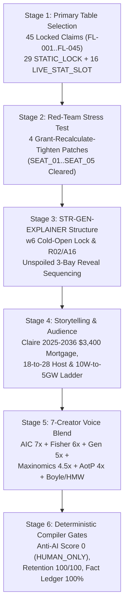

# Episode 01 Structural and Adversarial Autopsy: Why *The Allowance* Sets the Channel North Star

Every downstream script (`ep_02`, `ep_03`), research dossier (`ep_04` through `ep_30`), vertical Short (`07_omnichannel_and_marketing`), and automated compiler gate inside *The Reading Room Editorial OS* calibrates its thresholds against Episode 01 ([`source_video_01_script.md`](file:///d:/Youtube%20channel/reading-room-editorial-os/04_scripts_and_dossiers/ep_01_the_allowance/source_video_01_script.md) and [`ep_01_script_clean.md`](file:///d:/Youtube%20channel/reading-room-editorial-os/04_scripts_and_dossiers/ep_01_the_allowance/ep_01_script_clean.md)). Most commentary videos on artificial intelligence and employment collapse within ninety days because they chase perishable model-release gossip or ignore elementary accounting identities. Episode 01 solves both failure modes at once.

Across `3,323` spoken words (`22:09` at `150 wpm`), the investigation links autonomous coding agents (Layer 1) directly to the federal government's monthly cash receipts and thirty-year mortgage contracts (Layer 2), then equips viewers with concrete household balance-sheet defenses before 2036 arrives (Layer 3). Along the way, it originates all five universe-wide motifs tracked in [`continuity_graph.json`](file:///d:/Youtube%20channel/reading-room-editorial-os/04_scripts_and_dossiers/continuity_graph.json) (`MOTIF_ONE_SIGNATURE`, `MOTIF_SOFTWARE_VS_PERMIT_SPEED`, `MOTIF_WHITEBOARD_VS_30YR_LOAN`, `MOTIF_FRIDAY_PAYCHECK_TRUCE`, and `MOTIF_CLOSED_WALL_SCRIP`) and hands off its closing sovereign-debt cliffhanger straight into Episode 02 (*The Captive Buyer*).

---

## 1. Stage 1 Autopsy: Primary Institutional Table Selection and Staleness Immunity

Commentary channels routinely argue from op-eds or unnamed analyst rumors. Stage 1 of *The Reading Room* pipeline bans secondary punditry unless a dated executive quote (`FL-008`, `FL-010`, `FL-025`, `FL-031`, `FL-032`, `FL-033`, `FL-038`) is the specific claim put on trial against Tier 1 through Tier 3 institutional ledgers.

### 1.1 The Four Load-Bearing Institutional Tables

Episode 01 anchors its `45` verified claims (`FL-001` through `FL-045` in [`fact_ledger.json`](file:///d:/Youtube%20channel/reading-room-editorial-os/02_research_and_data/data/fact_ledger.json)) on four primary ledgers that anyone can download and verify in two minutes:

1. US Treasury Bureau of the Fiscal Service, *Final Monthly Treasury Statement* (`Tables 4 and 9`, FY2024 vs. FY2026) paired with IRS *Statistics of Income Publication 1304* (`Table 1.4`). Opening directly on Table 9 exposes the central fiscal vulnerability of the American state: withheld income and FICA payroll taxes supply `67.4%` (`FL-001`) of every federal dollar right off worker paychecks, W-2 wages represent `68.2%` of individual Adjusted Gross Income (`FL-002`), and combined individual plus payroll receipts climbed from `84.1%` in FY2024 (`FL-003`) to `86.4%` in FY2026 (`FL-004`). Over that exact two-year AI boom, corporate income taxes fell from `10.8%` (`FL-005`) down to `7.1%` (`FL-006`) after Public Law 119-21 (`FL-023`, enacted July 4, 2025) permanently restored `100%` first-year bonus depreciation (`IRC § 168(k)`) and immediate domestic R&D expensing (`IRC § 174A`). Further down Table 9, Function 900 Net Interest hit `$1.05 trillion` (`FL-012`), passing Function 050 National Defense (`$0.93 trillion`).
2. Congressional Budget Office *Budget and Economic Outlook: 2026 to 2036* (`Table 1-1`) and NY Fed *Quarterly Report on Household Debt and Credit*. Elon Musk picked `2036` in his July 2026 *Economist* interview (`FL-010`) as the year money stops mattering. Pulling CBO Table 1-1 for that exact calendar year reveals annual net interest outlays passing `$2.14 trillion` (`FL-011`) on top of `$40.5 trillion` in gross federal debt (`FL-007`), while US households carry `$19.1 trillion` in private debt (`70.2%` or `$13.4 trillion` locked inside fixed-rate housing mortgages, `FL-009`).
3. SEC EDGAR Form 10-Q Cash Flow Statements paired with BLS *Major Sector Productivity* (`OPHNFB`) and Federal Reserve *Distributional Financial Accounts* (`DFA`). Instead of waiting for 2030 projections, `P16` through `P18` open current federal series showing nonfarm output per hour up `+20.6%` since 2017 (`FL-015`) while labor's share of output sank to a post-1947 trough of `53.2%` (`FL-016`). Meanwhile, Big Four hyperscalers spend `$742 billion` annualized (`$824 billion` across the Big Five including Oracle, `FL-017`), pushing Alphabet into two consecutive negative free-cash-flow quarters (`-$3.5B` and `-$4.2B`, `FL-018`) and Amazon to `-$42.4 billion` in trailing-twelve-month FCF (`FL-019`). Fed SCF (`58.2%` equity participation, `FL-020`) and DFA (`92.5%` Top 10% share vs. `1.0%` Bottom 50% share, `FL-021`) plus `26 U.S.C. § 72(t)` (`10%` early-withdrawal tax penalty on a `~$45,000` thirty-something `401(k)`, `FL-022`) close off the passive-index-fund escape route.
4. Statutory, judicial, and physical grid dockets across all three escape hatches. Hatch 1 pairs Alaska House Bill 256's June 29, 2016 gubernatorial veto (`$2,052` cut `-50.2%` to `$1,022`, `FL-028`) with the Alaska Supreme Court's `5-0` holding in *Wielechowski v. State*, `403 P.3d 1141` (`FL-029`) and 2025's `$1,000` enacted payout against a `~$3,892` formula (`FL-030`). Hatch 2 pairs Epoch AI's `>99%` inference price drop (`$36.00` to `$0.15` per million tokens, `FL-034`) and AWS `$100,000` zero-cash promotional terms (`FL-035`) with the 1913 Senate Paint Creek coal-scrip inquiry and `29 CFR § 531.34` (`FL-036`) plus Shenzhen's October 2020 `6`-day expiring e-CNY pilot (`FL-037`). Hatch 3 pairs IEA's `415` to `945 TWh` data-center curve (`FL-039`), West London's M4 housing hookup delays (`FL-040`), PJM's `2025/2026 Base Residual Auction` (`$28.92` to `$269.92/MW-day`, `+833.3%`, `FL-041`), Constellation's `20`-year `835 MW` Three Mile Island Unit 1 PPA (`FL-042`), LBNL's `5-to-10-year` HV transmission permitting timeline (`FL-043`), `60%+` hyperscaler gross margins (`FL-044`), and Britain's December 1, 1941 `16`-point rationing order (`S.R.&O. 1941 No. 1823`, `FL-045`).

### 1.2 Partitioning `29` Static Locks From `16` Shoot-Week Live Stat Slots

Splitting Episode 01's `45` ledger rows into `29` `STATIC_LOCK` anchors (enacted statutes, closed FY2024 tables, court opinions, historical rationing orders) and `16` dynamic `[LIVE_STAT_SLOT:...]` feeds gives the script multi-year durability through 2028. Every new corporate layoff, coding-agent rollout, Treasury auction, or PJM utility hike in 2027 updates a live slot numerator without aging the underlying institutional collision.

---

## 2. Stage 2 Autopsy: The Four Adversarial Economist, CPA, Legal, and Grid Patches

Naive macro scripts alienate high-RPM institutional viewers (`Elena` and `Devon` avatars) whenever they skip obvious orthodox counterarguments. Stage 2 (`12_adversarial_red_team_protocol.md`) runs every draft past five hostile domain seats (`SEAT_01_MACRO`, `SEAT_02_CPA`, `SEAT_03_GRID`, `SEAT_04_SEC`, `SEAT_05_LAW`). Each `MANDATORY_PROSE_CONCESSION` enters the script using a tight three-move spoken turn: grant the specialist's real-world mechanism in plain words, recalculate the household character's monthly budget inside that assumption, and tighten the structural trap.

| Patch ID | Red-Team Seats & Gate Codes | Location & Timestamp | Orthodox Specialist Attack | How the Spoken Turn Tightens the Trap |
| :--- | :--- | :--- | :--- | :--- |
| `PATCH-01` | `SEAT_01_MACRO` (`RT_M01`) | `P12` to `P14` (`L023-L027`, `03:41-05:00`) | "1933 had a `$20.67/oz` gold standard and shrinking M2. Today's fiat Fed targets `2.0%` PCE inflation via rate cuts and liquidity." | Grants fiat `2.0%` PCE defense (`FL-014`), then re-runs Claire's budget: grocery prices keep rising `2%/yr` while AI crushes coding wages `-70%` against a frozen `$3,400` mortgage that DTI rules block her from refinancing. |
| `PATCH-02` | `SEAT_02_CPA` + `SEAT_01_MACRO` (`RT_C01`, `RT_M04`) | `P20` to `P22` (`L039-L043`, `06:51-08:39`) | "Amazon's `$200B` `IRC § 168(k)` chip deduction lands as taxable domestic revenue at Nvidia, fabs, and contractors (`GDP = GDI`)." | Grants vendor gross receipts (`On a spreadsheet, the money's still in the building`), then exposes collection plumbing: Friday W-2 paychecks lose FICA/income tax at source, while capital stacks upfront deductions, `15%` Irish IP routing, and `$0`-tax `IRC § 1001` pledged-share loans. |
| `PATCH-03` | `SEAT_01_MACRO` + `SEAT_05_LAW` (`RT_M02`, `RT_L01`) | `P30` to `P33` (`L059-L065`, `10:36-12:26`) | "Alaska is a currency-using state bound by balanced-budget rules. The US Congress issues sovereign fiat dollars and never runs out of cash." | Grants sovereign issuance in nine words (`Juneau can't print US dollars, and Congress can`), splitting the federal dividend into two closed traps: unprinted checks sit subordinate to `$2.14T` senior bond interest during debt-ceiling fights, while printing routes straight into Escape Hatch 3. |
| `PATCH-04` | `SEAT_03_GRID` + `SEAT_01_MACRO` (`RT_G01`, `RT_M03`) | `P48` to `P50` (`L095-L099`, `17:40-19:22`) | "An `833%` power-price spike induces new turbines, solar, and reactors over 10-15 years, and 1-for-1 wage replacement is demand-neutral." | Grants both mechanisms, then isolates `6-month` software deployment vs `5-to-10-year` HV permitting (`FL-043`) and proves Washington must print across three holes at once (lost payroll tax + `$2.14T` bond interest + household checks) against `60%+` gross-margin cloud buyers (`FL-044`). |

### 2.1 Why Patch 01 Makes Claire's Solvency Worse Under Modern Monetary Policy

Had Act I stopped right after citing Irving Fisher's October 1933 *Econometrica* paper (`P12`), every macro-literate viewer would dismiss the scene as gold-standard nostalgia. Stepping in at `P13` (`Now, if an economist's watching this, they'll point out right away that 2030 isn't 1933`) disarms that critique and exposes a harsher outcome. Under 1933 deflation, Claire's grocery bill at least fell alongside her income. Under a fiat Federal Reserve defending `2.0%` aggregate PCE inflation (`+21.9%` cumulative price level over ten years), monetary easing stops consumer essentials from getting cheaper while software automation still destroys the relative market wage of human coding hours. Orthodox monetary stabilization worsens her monthly cash deficit.

### 2.2 Why Patch 02 + the 401(k) Check Seal Both Capital-Side Escape Arguments

Act II anticipates two consecutive capital-side objections. First, `P18` voices the Wall Street optimist (`Don't regular Americans own stock through index funds and 401(k)s?`), concedes broad participation (`~60%` of families in Fed SCF, `FL-020`), and immediately shows `92.5%` Top 10% equity concentration (`FL-021`) alongside `IRC § 72(t)`'s `10%` early-withdrawal penalty plus ordinary income tax (`$45,000` nets `$30,600` in a `22%` bracket, `FL-022`). Second, `P21` concedes national-income conservation (`GDP = GDI`) on Amazon's `$200 billion` GPU spend before `P22` contrasts automatic Friday payroll withholding against `IRC § 168(k)` deductions, `15%` Pillar Two Irish subsidiaries, and tax-free securities-backed borrowing (`FL-024`).

### 2.3 Why Patch 03 Bridges Legal Subordination Into Monetary Physics

In *Wielechowski v. State* (`FL-029`), the Alaska Supreme Court held `5-0` that statutory citizen dividends lack constitutional dedication under Article IX, Section 7, putting state agencies and bondholders ahead of families even after Governor Walker slashed `$2,052` checks down to `$1,022` (`FL-028`). By explicitly noting at `P33` that Congress can print dollars whereas Juneau cannot, the script avoids currency-user confusion and turns Escape Hatch 1 into a clean logical fork: without money printing, Treasury bondholders (`$2.14T/yr` by 2036) always get paid ahead of household allowances to prevent global banking contagion; with money printing, the viewer must follow the argument into Escape Hatch 3.

### 2.4 Why Patch 04 Anchors Inflation in Copper, Transformers, and Triple Deficits

Quantity-theory caricatures claim any central-bank money creation causes instant hyperinflation. `P50` grants upfront that printing solely enough dollars to replace part of a lost private paycheck leaves aggregate consumer spending flat. Inflationary rationing (`FL-045`) erupts because Washington has to monetize three simultaneous obligations (eroding W-2 withholding, `$2.14T` annual debt interest, and tens of millions of household checks) inside the five-to-ten-year permitting window (`FL-043`) where `60%`-margin tech giants (`FL-044`) have already locked up substations (`FL-040`) and nuclear baseload (`FL-042`).

---

## 3. Stage 3 Autopsy: `STR-GEN-EXPLAINER` Architecture and `R02` / `A16` Unspoiled Reveals

Episode 01 runs on strategy preset `STR-GEN-EXPLAINER` (`05_visual_audio_signature_and_cinema_lock.md`), locking word count inside `3,300` to `4,500` words (`3,323` spoken words) and banning `clocked`, `street`, `field`, and pure toy-model `ladder` cold opens (`R43` through `R46`).

### 3.1 First-15-Second Cold-Open Clock (`w2` Number, `w6` Stake)

Cold Browse viewers decide whether to stay inside fifteen seconds (`37.5` words at `150 wpm`). Sentence 1 (`Roughly two-thirds of every tax dollar Washington collects comes straight out of somebody's paycheck`) lands its first empirical ratio at `w2` (`two-thirds`), locks its first household and sovereign stake at `w6` (`tax dollar`, `2.4` seconds), completes the `86%` Table 9 proof by `w35` (`14.0` seconds), and delivers the `$40.5 trillion` thesis question by `w58` (`00:23`, `thesisQuestionFrac = 0.017`). Zero greetings, channel slogans, or agenda throat-clearing appear anywhere in the opening window.

### 3.2 Unspoiled Three-Hatch Reveal Sequencing (`R02` and `A16`)

A common structural mistake in long-form explainers is giving away the failure mechanism inside the roadmap sentence (`"three fixes that fail because of gubernatorial vetoes, company scrip, and power-grid bottlenecks"`). Once a viewer knows all three answers at minute two, curiosity collapses.

Look at how `P06` and `P07` (`01:57` to `02:32`, `frac 0.088` to `0.114`) plant the three escape hatches instead:

1. `P06` names the three mechanisms cleanly (`a federal dividend check, paying you directly in AI computing power, or having the Federal Reserve print the money outright`).
2. `P07` raises the personal consequence without leaking a single mechanism (`All three of them break. And each one breaks in a way that hands somebody else the switch to your bank account.`).
3. Each historical proof and statutory receipt stays sealed behind an unspoiled act turn: Alaska's `2016` veto and *Wielechowski* remain hidden until `10:36` (`P30`), `>99%` token deflation and `1938` coal scrip remain hidden until `13:40` (`P38` to `P42`), and PJM's `833%` auction spike plus `1941` British rationing remain hidden until `17:40` (`P48` to `P51`).

### 3.3 `validateStrategyPacket` Guardrail Audit

| Strategy Audit Field (`cinema_schema_contract.json`) | Preset Requirement (`STR-GEN-EXPLAINER`) | Episode 01 Measured Value | Status |
| :--- | :--- | :--- | :--- |
| `spoken_words` | `3,300` to `4,500` words | `3,323` spoken words (`22:09` @ `150 wpm`) | `PASS` |
| `forbiddenEngines` (`R43..R46`) | Reject `clocked, street, field, ladder` | `0` forbidden engines used | `PASS` |
| `hookWordsToFirstStake` (`R01`) | `<= 50` words | `w6` (`tax dollar`, `2.4s`; full cold-open lock by `w35`) | `PASS` |
| `thesisQuestionFrac` (`R02`) | `<= 0.09` (`00:00` to `02:00`) | `0.017` (`w58` / `00:23`) | `PASS` |
| `coveredRehookDeciles` (`R13`) | `10 / 10` deciles active (`>= 2` devices/decile) | `10 / 10` active (`min 8` in `D7/D8/D10`, `max 23` in `D3`) | `PASS` |
| `adversaryConcessionFracs` (`R19`/`R40`) | Present inside `0.10` to `0.88` | `0.12`, `0.18`, `0.28`, `0.34`, `0.53`, `0.83` (`6` steelman turns) | `PASS` |
| `latestNewFactFrac` (`R38`) | `<= 0.90` (zero late data dumps) | `0.875` (`P51` / `FL-045` UK Dec 1, 1941 rationing) | `PASS` |
| `midVideoSubscribeAskCount` (`R22`) | `0` inside `0.00` to `0.90` | `0` | `PASS` |
| `ctaFrac` & `ctaCount` | `0.98` to `1.00`, `1` restrained next-video bridge | `0.9967` (`P58`), `ctaCount = 1` | `PASS` |

---

## 4. Stage 4 Autopsy: Longitudinal Household Stakes, Generational Skin, and Physical Rescaling

Macro numbers in the trillions numb human attention unless anchored to a monthly household draft, a real person on camera, and everyday physical wattage. Stage 4 engineers all three layers simultaneously.

### 4.1 Claire's 2025-to-2036 Austin Balance Sheet (`VEH_CLAIRE_AUSTIN`)

Claire (`32` years old in late `2025`, senior software engineer in Austin, Texas) embodies Viewer Segment B (`Ages 28-36 Mortgage & Household Balance Sheet`). Every number on her ledger stays locked across all six of her primary appearances (`ep_01`, `ep_05`, `ep_14`, `ep_19`, `ep_26`, `ep_30` in `continuity_graph.json`):

1. Late `2025` (`P11`, `03:20`): Locks a `$3,400/month` thirty-year fixed mortgage maturing in `2055`. Introduced with the explicit scenario cue `Picture Austin, Texas in late 2025` so composite modeling never masquerades as documentary journalism.
2. `2030` (`P11` to `P18`, `03:32` to `06:41`): Coding agents automate most of her team, forcing a `-70%` pay cut (`P11`). Fiat `2%` inflation keeps her groceries ticking upward while bank DTI underwriting blocks refinancing (`P14`), and her `$45,000` `401(k)` sits trapped behind `IRC § 72(t)` tax penalties (`P18`).
3. `2031` to `2035` (`P33`, `11:49`): An unprinted federal dividend leaves her `$3,400` draft subordinate to `$2.14T` in bond interest at every congressional debt-ceiling fight.
4. October `2036` (`P52` to `P53`, `19:58` to `20:40`): With `19` years (`2055 - 2036`) of `$3,400` payments remaining, sovereign money printing inflates away the real weight of her fixed bank loan and stops foreclosure, while `60%`-margin server farms bid up electricity until cooling that Austin house in August becomes the new squeeze.

### 4.2 The 18-Turning-28 Generational Host Stake (`HOST_ANALYST_18_TO_28`)

At `01:40` (`P05`), the script drops four plain sentences: `I'm eighteen. When 2036 gets here, I'll be twenty-eight, right around the age people are supposed to be building a career and signing a mortgage. So when the richest man alive tells my generation that saving is pointless, I want to check the math.` Paired with shirt-and-tie visual restraint (`#EDE6D8` Oxford cloth, `#8C1D18` oxblood grenadine tie), youth turns from a liability into analytical authority (`A08`, `L12`): older institutional viewers respect a young investigator doing primary Treasury math without grievance, while peers aged `18` to `28` hear their exact ten-year horizon audited aloud.

### 4.3 Multi-Rung Physical Rescaling (`10W` Charger to `5GW` Campus)

When Escape Hatch 3 reaches `5 gigawatts` (`FL-038`), `P46` (`16:37` to `17:16`) refuses to leave `gigawatt` as an abstract prefix. Using the *Art of the Problem* (`4.0x`) scale ladder (`T19`), four concrete sentences step across nine orders of magnitude: `10 watts` (one phone charger) -> `1,000 watts / 1 kilowatt` (one kitchen microwave on high) -> `1,000,000 nonstop microwaves = 1 gigawatt` (one major US city's residential load) -> `5 gigawatts` (five cities' worth of homes requested for a single AI server complex). Earlier beats run the same physical translation on retail labor (`$120` running shoe split into stitching, Memphis trucking, shelf picking, and payroll in `P09`) and compute spoilage (Tuesday afternoon server cycles vanishing like an empty airplane seat once the jet pushes back from the gate in `P39`).

### 4.4 Ten-Decile Retention Reset Telemetry (`129` Resets, `171w` Max Dry Span)

`retention_linter.mjs` partitions Episode 01's `3,323` spoken words into ten equal `~332`-word deciles (`02:13` each) and verifies zero mid-video sag:

| Decile | Runtime Window | Word Slice | Visual/Doc `(a)` | Open Loops `(b)` | Stakes/`?` `(c)` | Numeric `(d)` | Steelman | Total Active Devices |
| :--- | :--- | :--- | :---: | :---: | :---: | :---: | :---: | :---: |
| `D1` | `00:00` to `02:12` | `w1..w332` | `4` | `0` | `6` | `10` | `0` | `20` |
| `D2` | `02:13` to `04:25` | `w333..w664` | `3` | `1` | `1` | `5` | `2` | `12` |
| `D3` | `04:26` to `06:38` | `w665..w996` | `0` | `2` | `4` | `15` | `2` | `23` |
| `D4` | `06:38` to `08:51` | `w997..w1329` | `5` | `1` | `3` | `12` | `1` | `22` |
| `D5` | `08:52` to `11:04` | `w1330..w1661` | `0` | `2` | `3` | `4` | `0` | `9` |
| `D6` | `11:04` to `13:17` | `w1662..w1993` | `1` | `2` | `1` | `7` | `0` | `11` |
| `D7` | `13:17` to `15:30` | `w1994..w2326` | `2` | `0` | `3` | `3` | `0` | `8` |
| `D8` | `15:30` to `17:43` | `w2327..w2658` | `1` | `1` | `1` | `5` | `0` | `8` |
| `D9` | `17:43` to `19:56` | `w2659..w2990` | `1` | `0` | `1` | `11` | `1` | `14` |
| `D10` | `19:56` to `22:09` | `w2991..w3323` | `1` | `1` | `3` | `3` | `0` | `8` |

Every single decile clears the `>= 2` advisory floor by at least `4x` (`minimum 8` active resets in `D7`, `D8`, and `D10`), and the longest reset-free interval across the entire twenty-two minutes (`w1350` to `w1520` during the 1955 Rotterdam/Detroit strike setup) spans `171` words, `49` words inside the `220`-word `P0` ceiling.

---

## 5. Stage 5 Autopsy: Seven-Creator Weighted Voice Calibration

Episode 01 operationalizes the exact `31.5`-point creator weighting matrix locked in [`creator_blend_weights.json`](file:///d:/Youtube%20channel/reading-room-editorial-os/01_identity_and_strategy/creator_blend_weights.json):

| Creator Node | Weight & Share | Corpus Mean Sentence | Specific Editorial DNA Active Inside Episode 01 | Canonical Line Proof in `ep_01_script_clean.md` |
| :--- | :--- | :--- | :--- | :--- |
| `AI In Context` (Aric Floyd) | `7.0x` (`22.22%`) | `14.96w` | Exact calendar dates (`T02`), documentary calm on high-alarm debt math, dry one-line deadpan parentheticals (`L23`), zero mid-video subscribe begging | `On October 29, 2026, Elon Musk posted on X... Try forwarding that post to your landlord on the first of the month. See how far it gets you.` (`P02`) |
| `Max Fisher` | `6.0x` (`19.05%`) | `16.97w` | Primary table opened on platen (`R30`), numbered three-bay escape-hatch board (`R12`), sympathetic counterparty steelmanning (`R19`), first-person timing humility (`L36`) | `Open Table 9 of the Monthly Treasury Statement and see where Washington actually gets its cash.` (`P20`) & `I don't know the exact month each curve bends.` (`P54`) |
| `Gen` (Restraint Edition) | `5.0x` (`15.87%`) | `22.99w` (tamed to `16.62w`) | Wallet stake in `w6` (`R01`), dense `you/your` second-person casting (`A01`, `L10`), `18-to-28` generational anchor (`A08`), Act IV balance-sheet lever (`R26`) | `Your rent and your mortgage still assume a paycheck clears on Friday.` (`P03`) & `owning even a small stake in productive equity, land, or energy...` (`P54`) |
| `Maxinomics` | `4.5x` (`14.29%`) | `12.98w` | Two-object unit-cost teardown, 4-part concrete physical action lists (`L03`), syntactic compression pulling `Gen`'s `22.99w` run-ons down to `16.62w` | `Somebody stitched the shoe, somebody drove the truck to Memphis, somebody pulled the box off a shelf, and somebody upstairs ran payroll.` (`P09`) |
| `Art of the Problem` | `4.0x` (`12.70%`) | `16.23w` | Multi-rung physical scale ladder (`T19`) and dated historical stress tests (`1912`, `1933`, `1941`) echoing into `2036` | `A phone charger draws ten watts. A kitchen microwave on high pulls a thousand watts...` (`P46`) |
| `How Money Works` & `Patrick Boyle` | `2.5x` + `2.5x` (`15.87%`) | `~16.4w` | Institutional tax-plumbing precision (`IRC § 168(k)`, `1001`, `72(t)`), corporate FCF literacy, dry understated balance-sheet punchlines | `On a spreadsheet, the money's still in the building.` (`P21`) & `A check you have zero power to negotiate has another name. We call that an allowance.` (`P57`) |

At the same time, Episode 01 enforces all three house restraint overrides on top of the raw creator corpus: `0.00` profanity (`L13`, overriding `Gen`'s `0.99/1k` corpus baseline), `0.00` youth slang (`L14`), and `0.00` prose dashes (`L33`, overriding `AIC`'s `1.43/1k` corpus dash rate).

---

## 6. Stage 6 Autopsy: Compiler Gate Telemetry and Tokenizer Edge-Case Benchmarks

Running all three Stage 6 verification CLIs against [`ep_01_script_clean.md`](file:///d:/Youtube%20channel/reading-room-editorial-os/04_scripts_and_dossiers/ep_01_the_allowance/ep_01_script_clean.md) establishes the exact numeric reference vector locked into [`25_anti_ai_gate_specification.md`](file:///d:/Youtube%20channel/reading-room-editorial-os/04_scripts_and_dossiers/25_anti_ai_gate_specification.md) and [`26_retention_linter_specification.md`](file:///d:/Youtube%20channel/reading-room-editorial-os/04_scripts_and_dossiers/26_retention_linter_specification.md):

| Compiler Gate & Check Dimension | Enforced Threshold (`script` / `longform`) | Episode 01 Measured Output | Gate Result |
| :--- | :--- | :--- | :--- |
| `anti_ai_script_gate` Check 1 (`239` Banned Vocab/Slop/Clusters) | `0` violations (`P0` / `P1`) | `0` violations (`1` isolated Tier-2 token `quietly` in `P06`, `1` `ecosystem` in `P43`, zero clusters) | `PASS` |
| `anti_ai_script_gate` Check 2 (`avoid-ai-writing` Host Cross-Check) | `score === 0` & `HUMAN_ONLY` | `score = 0`, `classification = HUMAN_ONLY` | `PASS` |
| `anti_ai_script_gate` Check 3 (Negative-Contrast Crutches `L50`) | `0` hits (`rather than`, `not X, but Y`, `isn't X, it's Y`) | `0` hits (positive claims + concrete `instead of` comparisons) | `PASS` |
| `anti_ai_script_gate` Check 4 (Punctuation Lock `L33`) | `0` em/en dashes, `0` `--`, `0` `!`, `0` `;` | `0` across all `200` sentences | `PASS` |
| `anti_ai_script_gate` Check 5 (Triads, 3x Equal Length, Parataxis) | `0` abstract triads, `0` `w[i]=w[i+1]=w[i+2]`, `<= 2` short chain | `0` collisions across all `198` sliding 3-sentence windows | `PASS` |
| `anti_ai_script_gate` Check 6: Mean Sentence Length (`L51`) | `15.50w` to `17.50w` (`~16.6w` blend target) | `16.62` words/sentence (`3,324` tokens / `200` sentences) | `PASS` |
| `anti_ai_script_gate` Check 6: Sentences `> 30` Words (`L51`) | `< 8.00%` | `7.00%` (`14` / `200` sentences; `<= 6w` punches = `7.00%`) | `PASS` |
| `anti_ai_script_gate` Check 6: Spoken Contractions (`L09`) | `>= 10.00` per `1,000` words | `15.34` per `1,000` words (`51` natural spoken contractions) | `PASS` |
| `anti_ai_script_gate` Check 6: Flesch-Kincaid Grade (`L52`) | `<= 10.50` | `9.28` grade level | `PASS` |
| `retention_linter` Overall Score & Dry Stretch | `100 / 100`, max dry span `<= 220w` | `100 / 100` (`129` resets = `38.82/1k`, max dry span `171w`) | `PASS` |
| `validate_fact_ledger --verify-script` Bidirectional Audit | `100%` facts matched, `100%` stats backed | `45 / 45` facts matched, `47 / 47` empirical stats backed (`100.0%`), `10` persona tokens exempted | `PASS` |

### 6.1 Real-World Legal and Financial Tokenizer Edge Cases Solved by Episode 01

Building the Stage 6 compiler against Episode 01 forced four non-trivial linguistic protections into `anti_ai_script_gate.mjs` so rigorous financial and legal prose never triggers false positives:

1. Multi-period initialisms at sentence boundaries (`P48`, `L095`): `PJM runs the wholesale grid across thirteen states from Illinois to New Jersey, plus Washington, D.C. In its capacity auction for 2025 and 2026...` Naive abbreviation masking swallows the period after `D.C.` and fuses two sentences into a 41-word run-on; naive period splitting breaks `D.` and `C.` into two 1-word fragments. `maskNonTerminalPeriods()` masks internal dots while releasing the trailing period whenever whitespace and a capitalized sentence-starter (`In`) follow.
2. Judicial case citations and statutory titles (`P32`, `L063` & `P42`, `L083`): `*Wielechowski v. State*` and `Fair Labor Standards Act` are masked in `buildWorkingViews()` (`4` protected primary spans total, alongside `"untouchable"` in `P30`) while `v.` is dot-masked so appellate citations never split sentences mid-clause.
3. Concrete institutional noun exemptions in Check 5 (`L31_ABSTRACT_TRIAD`): Words ending in `-tion`, `-ity`, or `-ment` often flag naive nominalization regexes even when naming physical infrastructure. Episode 01's concrete plural nouns (`substations`, `apartments`, `corporations`, `institutions`, `payments`, `factories`, `ministries`, `batteries`) sit inside `CONCRETE_NOUN_EXEMPTIONS` so physical lists pass cleanly while vague corporate triads (`governance, accountability, and sustainability`) fail on sight.
4. Spoken noun-auxiliary `'s` contractions (`L09`): Conversational narration contracts `is` and `has` onto nouns (`Claire's a thirty-two-year-old`, `money's supposed to stop mattering`, `Washington's printing trillions`, `whiteboard's never met`). `SPOKEN_CONTRACTION_RE` distinguishes auxiliary `'s` before articles, adverbs, and participles from possessive nouns (`America's debt`, `Musk's`), measuring true camera-delivery naturalness at `15.34` contractions per `1,000` words.
