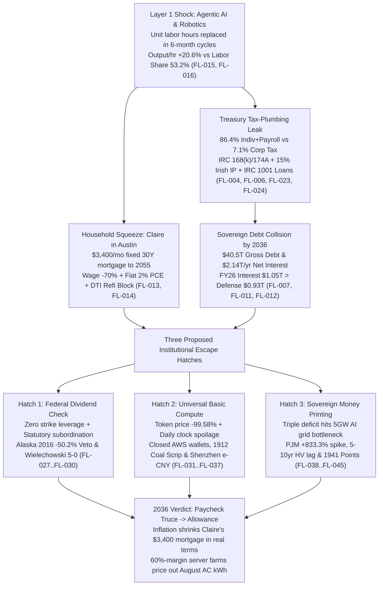

# Episode 01 Bilingual Persian-English Mastery Book: The Allowance | کتاب جامع تسلط دوزبانه اپیزود اول: مستمری و پول توجیبی

This pre-shoot textbook prepares the eighteen-year-old host of The Reading Room to record Episode 01 (`ep_01`, codenamed `The Allowance`) with complete command over every fiscal ledger, tax statute, monetary rule, appellate precedent, labor regulation, and wholesale electricity auction cited across `FL-001` through `FL-045`. When you sit behind the walnut desk in an unbleached ecru Oxford shirt (`#EDE6D8`) and muted oxblood grenadine silk tie (`#8C1D18`), your job goes far beyond reading `3,323` words cleanly off teleprompter glass at `150` words per minute. Skeptical macroeconomists, forensic CPAs, corporate tax counsel, and power-grid engineers will test every sentence against primary government tables. Reading both the English and Persian sections of this book ensures that you command the underlying institutional mechanics in your native analytical register and in your spoken English camera voice.

> این کتاب درسی پیش از ضبط، برای تجهیز مجری هجده ساله کانال اتاق مطالعه (`The Reading Room`) پیش از فیلم برداری اپیزود اول با کد عملیاتی `The Allowance` تدوین شده است تا بر تک تک جداول خزانه داری، مواد قانون مالیات آمریکا، قواعد سیاست پولی فدرال رزرو، آرای دادگاه های عالی، مقررات حقوق کار و سازوکار حراج های عمده فروشی برق در بازه استنادی `FL-001` تا `FL-045` تسلط کامل داشته باشد. وقتی پشت میز گردویی استودیو با پیراهن آکسفورد کرم رنگ و کراوات ابریشمی زرشکی تیره می نشینید، ماموریت شما صرفا روخوانی روان `3,323` کلمه متن اسکریپت با سرعت `150` کلمه در دقیقه از روی شیشه تله پرامپتر نیست. اقتصاددانان کلان، حسابداران رسمی مالیاتی، وکلای حقوق اساسی و مهندسان شبکه انتقال برق هر ادعای شما را خط به خط با اسناد دست اول دولتی راستی آزمایی خواهند کرد. مطالعه دقیق هر دو بخش انگلیسی و فارسی این کتاب تضمین می کند که منطق درونی تمام نهادها و معادلات ترازنامه ای را هم در زبان مادری و هم در لحن انگلیسی جلوی دوربین، عمیق تر از سرسخت ترین منتقدان درک کنید.

---

## Part I: Executive Mental Model and Causal Architecture | نقشه ذهنی و معماری علّی اپیزود اول

### 1.1 The Core Balance-Sheet Collision: Six-Month Software Cycles Against Thirty-Year Nominal Contracts

Silicon Valley executives evaluate artificial intelligence on marginal production whiteboards. On July 18, 2026 in Texas during an interview with *The Economist* (`FL-010`), Elon Musk placed a specific calendar horizon on post-scarcity automation and stated that money stops functioning as a constraint by `2036`. Three months later, on October 29, 2026 (`FL-008`), he posted on X that saving money for retirement in the distant future becomes pointless once super-intelligent machines deliver universal abundance. If you isolate the physical cost of manufacturing sneakers or reading routine dental radiographs, the engineering intuition holds up well. Human labor hours make up the bulk of unit retail prices across stitching, freight trucking, warehouse picking, and corporate administration. Swap eighty percent of those paid hours for autonomous software and robotics operating near the marginal cost of kilowatt-hours, and competitive pressure pulls unit retail prices downward.

Macroeconomic fragility enters the room because modern capitalism runs on a second set of books written in fixed nominal dollars over decades. American households currently carry `$19.1 trillion` in private debt according to the Federal Reserve Bank of New York (`FL-009`), with `70.2 percent` (`$13.4 trillion`) locked inside housing mortgages whose monthly drafts stay frozen in nominal dollar terms for thirty years. At the sovereign level, gross United States federal debt stands at `$40.5 trillion` (`FL-007`), and Congressional Budget Office baseline projections in Table 1-1 show annual net interest outlays passing `$2.14 trillion` in `2036` (`FL-011`). Pension funds, commercial banks, insurance carriers, and foreign central banks hold those Treasury securities as Tier-1 collateral supporting global credit markets. None of those creditors accept abundance tweets at par on the first of the month.

Even more dangerous for Washington, the tax collection engine keeping `$40.5 trillion` in Treasury paper solvent relies overwhelmingly on human paychecks. Opening Table 4 and Table 9 of the Final Monthly Treasury Statement (`FL-001`, `FL-004`) proves that withheld individual income taxes and FICA payroll deductions taken straight off worker paychecks supply `67.4 percent` of all federal cash receipts, while total individual income taxes plus payroll taxes supply `86.4 percent`. Corporate income taxes contributed `7.1 percent` in fiscal year `2026` (`FL-006`). If autonomous agents compress white-collar and industrial payrolls between `2026` and `2036` while capital pools inside low-withholding corporate balance sheets, AI hollows out the exact automatic revenue stream backing United States Treasury bonds and thirty-year household mortgages at the same time.

> ### ۱.۱ برخورد بنیادین ترازنامه ها: چرخه های شش ماهه نرم افزار در برابر قراردادهای اسمی سی ساله

> مدیران ارشد سیلیکون ولی اقتصاد هوش مصنوعی را روی تخته سفیدهای هزینه نهایی تولید می سنجند. در تاریخ ۱۸ ژوئیه ۲۰۲۶، ایلان ماسک در گفت وگوی مشروح خود با نشریه اکونومیست در تگزاس (`FL-010`) یک تاریخ تقویمی مشخص تعیین کرد و گفت تا سال `2036` پول اهمیت و موضوعیت خود را از دست می دهد. سه ماه بعد، در ۲۹ اکتبر ۲۰۲۶ (`FL-008`)، او در شبکه اجتماعی ایکس نوشت که پس انداز کردن پول برای آینده دور و دوران بازنشستگی بی معناست، زیرا ماشین های فوق هوشمند وفور همگانی کالا و خدمات ایجاد خواهند کرد. اگر فقط به هزینه فیزیکی دوخت یک کفش ورزشی ۱۲۰ دلاری یا تفسیر عکس رادیولوژی دندان نگاه کنید، شهود مهندسی آن ها درست کار می کند. بخش اعظم قیمت تمام شده خرده فروشی در زنجیره دوخت، حمل ونقل جاده ای، انبارداری و حسابداری اداری، پولِ زمان انسان است. وقتی هشتاد درصد این ساعات کاری مزدبگیر با نرم افزار و ربات هایی جایگزین شوند که نزدیک به قیمت برق کار می کنند، رقابت بازار قیمت واحد کالاهای مصرفی را به شدت پایین می کشد.

> بحران کلان دقیقا از جایی آغاز می شود که نظام مالی مدرن بر پایه دفتر کل دومی بنا شده که تمام تعهدات آن به دلار اسمی ثابت و برای افق های ده تا سی ساله نوشته شده است. طبق گزارش فصلی بانک فدرال رزرو نیویورک (`FL-009`)، خانوارهای آمریکایی هم اکنون `19.1` تریلیون دلار بدهی دارند که `70.2` درصد آن معادل `13.4` تریلیون دلار در وام های مسکن با نرخ ثابت قفل شده است؛ اقساطی که برداشت خودکار بانکی آن ها تا سی سال آینده یک سنت هم با ارزان شدن کدنویسی کاهش پیدا نمی کند. در ترازنامه دولت فدرال نیز بدهی ناخالص ملی به `40.5` تریلیون دلار رسیده (`FL-007`) و جدول ۱-۱ دفتر بودجه کنگره (`CBO`) نشان می دهد که دقیقا در همان سال `2036`، پرداخت بهره خالص سالانه بدهی دولت از مرز `2.14` تریلیون دلار عبور می کند (`FL-011`). صندوق های بازنشستگی، بانک های تجاری و بانک های مرکزی خارجی این اوراق خزانه را به عنوان وثیقه پایه نظام بانکی جهان نگه می دارند و در سررسید کوپن ها فقط دلار نقد می پذیرند.

> خطرناک تر آنکه موتور وصول مالیات واشنگتن که این کوه بدهی `40.5` تریلیون دلاری را سرپا نگه داشته، مستقیما به فیش حقوقی انسان ها وصل است. بررسی جداول ۴ و ۹ گزارش نهایی ماهانه خزانه داری آمریکا (`FL-001` و `FL-004`) ثابت می کند که `67.4` درصد از کل درآمدهای نقدی دولت فدرال پیش از ورود حقوق به حساب بانکی شاغلان، به شکل خودکار از فیش حقوقی کسر می شود و مجموع مالیات بر درآمد اشخاص و مالیات حقوق و دستمزد `86.4` درصد کل بودجه فدرال را تامین می کند. در مقابل، سهم مالیات بر درآمد شرکت ها در سال مالی ۲۰۲۶ تنها `7.1` درصد بوده است (`FL-006`). بنابراین اگر عامل های هوش مصنوعی تا سال ۲۰۳۶ بخش بزرگی از دستمزدهای انسانی را حذف کنند و درآمد ملی را به ترازنامه شرکت های فناوری منتقل سازند، هوش مصنوعی هم زمان هم توان بازپرداخت وام مسکن خانوارها را می شکند و هم تنها جریان نقدی خودکار خزانه داری آمریکا را خشک می کند.

### 1.2 Causal Flow Diagram and the Three Escape Hatches

Every scene in Episode 01 advances one strict causal chain. Study the architecture below until you can sketch all seven links from memory on a blank sheet of paper before camera roll.



Notice why the episode is titled `The Allowance`. For roughly two centuries since industrialization, the Friday paycheck functioned as an unwritten power-sharing truce (`MOTIF_FRIDAY_PAYCHECK_TRUCE`). Dockworkers in Rotterdam, autoworkers in Detroit in `1955` (`FL-027`), and corporate engineers held real bargaining power because ports, assembly lines, and software codebases ground to a halt within forty-eight hours whenever workers stayed home. Institutions had to pay regular people in unconditional legal tender that families could save, invest, or use to walk away from an abusive employer. Once cranes, trucks, and coding repositories run at `99.9 percent` uptime without human attendance, citizens retain their Election Day ballot while losing their Monday-morning economic stoppage power. Every post-paycheck substitute hands an external institution the off-switch to household survival: Congress and bond-market arithmetic hold the knife over Hatch 1, private cloud platforms hold the exchange-rate gate over Hatch 2, and central-bank inflation colliding with physical megawatt bottlenecks rations purchasing power inside Hatch 3.

> ### ۱.۲ معماری زنجیره علّی و منطق شکست هر سه دریچه فرار

> تمام پنجاه وهشت پاراگراف اسکریپت اپیزود اول روی یک زنجیره علّی واحد حرکت می کنند. علت نام گذاری این اپیزود با عنوان `The Allowance` (پول توجیبی یا مستمری یک طرفه) در تفاوت ساختاری میان «دستمزد بازار» و «پرداخت انتقالی» نهفته است. در طول دویست سال گذشته، فیش حقوقی روز جمعه در واقع یک پیمان نانوشته توازن قوا میان شهروندان عادی و نهادهای اداره کننده جهان مدرن بود (`MOTIF_FRIDAY_PAYCHECK_TRUCE`). وقتی کارگران اسکله در روتردام یا کارگران خودروسازی دیترویت در سال `1955` (`FL-027`) دست از کار می کشیدند، کشتی ها کنار اسکله فلج می شدند، خط مونتاژ متوقف می ماند و کارفرما تا عصر جمعه دچار خون ریزی نقدینگی می شد. صاحبان سرمایه به این دلیل منافع بهره وری را با طبقه متوسط شریک می شدند که بدون حضور انسان، ماشین ها خاموش می ماندند.

> اما زمانی که جرثقیل های خودکار بندر، کامیون های بی راننده و خوشه های سرور کدنویسی با پایداری `99.9` درصدی در تمام طول شبانه روز بدون حضور نیروی کار انسانی به فعالیت ادامه دهند، اهرم چانه زنی اقتصادی روز دوشنبه از دست کارگر خارج می شود، حتی اگر حق رای سیاسی در روز انتخابات همچنان باقی بماند. در چنین نقطه ای، سیاست گذاران واشنگتن و بنیان گذاران سیلیکون ولی سه دریچه فرار روی میز می گذارند: نخست چک سود سهام دولتی، دوم پرداخت مستقیم سهمیه توان پردازشی هوش مصنوعی (`Universal Basic Compute`) و سوم چاپ مستقیم پول توسط فدرال رزرو و خزانه داری. هسته تحلیلی این اپیزود اثبات می کند که هر سه دریچه فرار زیر فشار قوانین حقوقی و فیزیکی می شکنند و هر کدام کلید قطع و وصل حساب بانکی خانوار را به دست نهادی دیگر می سپارند: در دریچه اول، چک خانوار در صف بودجه پشت سر `2.14` تریلیون دلار بهره دارندگان اوراق خزانه قرار می گیرد و با یک امضا نصف می شود؛ در دریچه دوم، اعتبار پردازشی به ژتون دیجیتال شرکتی تبدیل می شود که هم به سرعت ارزش دلاری خود را از دست می دهد و هم با ساعت منقضی می شود؛ و در دریچه سوم، خلق تریلیون ها دلار پول جدید به گلوی باریک شبکه برق، مس و ترانسفورماتورهای فشارقوی برخورد می کند که غول های فناوری با حاشیه سود ناخالص بالای شصت درصد پیش خریدش کرده اند.

### 1.3 The Four Adversarial Patches: Grant, Recalculate, Tighten

Amateur video essays collapse in front of institutional viewers whenever they strawman orthodox economics. Stage 2 of our pipeline embeds four explicit specialist concessions (`PATCH-01` through `PATCH-04`) directly into your camera script. Memorize why each concession strengthens your thesis:

1. `PATCH-01` (`SEAT_01_MACRO`, `P13` to `P14`): Orthodox macroeconomists immediately object that `2030` differs from Irving Fisher's `1933` Great Depression because the pre-April 1933 dollar was convertible into gold at `$20.67` per troy ounce, whereas today's Federal Reserve runs a fiat currency targeting `2.0 percent` annual PCE inflation (`FL-014`). You grant that mechanism on camera, then re-run Claire's Austin household budget inside it. When the Fed cuts rates and injects liquidity to prevent aggregate price deflation, Claire's grocery bill keeps rising at two percent per year while coding automation still slashes her relative occupational wage by seventy percent against a frozen `$3,400` mortgage that bank debt-to-income rules prevent her from refinancing. Fiat stabilization makes her monthly cash squeeze worse than 1933 price deflation.
2. `PATCH-02` (`SEAT_02_CPA` and `SEAT_01_MACRO`, `P21` to `P22`): Tax accountants point out that when Amazon deducts `$200 billion` of Nvidia chips under `IRC Section 168(k)`, those dollars do not vanish from Gross Domestic Income (`GDP = GDI`); they land as taxable gross receipts at Nvidia, semiconductor fabs, and electrical contractors. You grant that national-accounting identity (`On a spreadsheet, the money's still in the building`), then expose the collection leak inside Treasury tax plumbing: Friday W-2 paychecks lose income and FICA withholding before hitting checking accounts, whereas corporate capital chains upfront hardware write-offs (`FL-023`), `15 percent` Pillar Two foreign intellectual-property subsidiaries in Ireland, and zero-tax `IRC Section 1001` pledged-share collateral loans (`FL-024`).
3. `PATCH-03` (`SEAT_01_MACRO` and `SEAT_05_LAW`, `P33`): Sovereign-debt specialists note that Alaska (`Juneau`) is a currency-using US state bound by balanced-budget constraints, whereas the United States Congress issues sovereign dollars. You state that distinction explicitly in nine words (`Juneau can't print US dollars, and Congress can`), splitting Escape Hatch 1 into a tight logical fork: if Congress avoids printing the gap, statutory citizen checks sit legally subordinate to `$2.14 trillion` in senior Treasury bond interest during every debt-ceiling fight; if Congress prints the gap, the viewer gets routed straight into Escape Hatch 3.
4. `PATCH-04` (`SEAT_03_GRID` and `SEAT_01_MACRO`, `P49` to `P50`): Energy economists point out that an `833 percent` wholesale power spike (`FL-041`) induces private developers to build gas turbines, solar arrays, batteries, and nuclear plants over ten to fifteen years, and macroeconomists add that printing one dollar solely to replace one lost paycheck dollar leaves consumer demand unchanged. You grant both rules, then isolate the `6-month` software rollout against `5-to-10-year` high-voltage permitting (`FL-043`) and prove Washington must print across three simultaneous holes (missing payroll taxes, `$2.14 trillion` bond interest, and tens of millions of household checks) while bidding against `60 percent` gross-margin hyperscalers (`FL-044`).

> ### ۱.۳ منطق چهار پذیرش پیش دستانه منتقدان: تایید سازوکار، بازمحاسبه بودجه خانوار و بستن تله

> ویدیوهای تحلیلی آماتور زمانی اعتبار خود را نزد مخاطبان حرفه ای از دست می دهند که قوی ترین استدلال متقابل اقتصاددانان یا حسابداران را پنهان کنند. در مرحله دوم پایپ لاین اتاق مطالعه، چهار دفاعیه رسمی متخصصان به صورت شفاف داخل متن اسکریپت گنجانده شده و با الگوی سه مرحله ای «تایید قاعده رسمی، بازمحاسبه بودجه کلر و تنگ تر کردن تله ساختاری» پاسخ داده شده است:

> ۱. بسته اصلاحی اول (`PATCH-01` در پاراگراف های ۱۳ و ۱۴): هر اقتصاددان کلان بلافاصله یادآوری می کند که سال ۲۰۳۰ با رکود بزرگ ۱۹۳۳ تفاوت ماهوی دارد، زیرا در دهه ۱۹۳۰ دلار با نرخ ثابت `20.67` دلار به ازای هر اونس تروا به طلا زنجیر شده بود، در حالی که فدرال رزرو امروز پول فیات را با هدف تورم سالانه `2.0` درصد شاخص مخارج مصرف شخصی (`PCE`) مدیریت می کند (`FL-014`). شما این واقعیت را جلوی دوربین تایید می کنید و بلافاصله بودجه ماهانه کلر در آستین را با همین فرض دوباره حساب می کنید: جلوگیری فدرال رزرو از کاهش عمومی قیمت ها باعث می شود صورت حساب خواربار کلر ارزان نشود و سالانه دو درصد بالا برود، در حالی که خودکارسازی کدنویسی همچنان قیمت بازاری ساعت کار انسانی او را هفتاد درصد سقوط داده و بانک نیز به دلیل فروپاشی نسبت درآمد به بدهی، اجازه تامین مالی مجدد وام `3,400` دلاری را نمی دهد. بنابراین سیاست پولی مدرن وضع نقدینگی کلر را از سال ۱۹۳۳ هم وخیم تر می کند.

> ۲. بسته اصلاحی دوم (`PATCH-02` در پاراگراف های ۲۱ و ۲۲): حسابداران رسمی مالیاتی تذکر می دهند که وقتی آمازون هزینه خرید دویست میلیارد دلار تراشه انویدیا را در سال اول از مالیات کم می کند، این پول از اتحاد حسابداری ملی (`GDP = GDI`) تبخیر نمی شود، بلکه به عنوان درآمد ناخالص در صورت های مالی انویدیا، کارخانه های نیمه رسانا و پیمانکاران برق ثبت می گردد. شما این اصل حسابداری را صراحتا می پذیرید و سپس انگشت را روی نشت واقعی در لوله کشی مالیاتی واشنگتن می گذارید: حقوق بگیر فرم `W-2` پیش از دیدن پولش در روز جمعه مالیات تکلیفی و بیمه را می پردازد، اما سرمایه شرکتی با استهلاک صددرصدی سال اول (`FL-023`)، انتقال سود مالکیت فکری به شرکت های تابعه ایرلند با نرخ `15` درصد و وام گیری معاف از مالیات سهام داران عمده به پشتوانه سهام فروخته نشده طبق ماده `1001` (`FL-024`)، وصول نقدی خزانه را به تاخیر می اندازد یا حذف می کند.

> ۳. بسته اصلاحی سوم (`PATCH-03` در پاراگراف ۳۳): اقتصاددانان پولی تاکید می کنند که ایالت آلاسکا صرفا مصرف کننده دلار است و حق خلق پول ندارد، اما کنگره آمریکا ناشر پول حاکمیتی است. شما با بیان دقیق همین تمایز، دریچه فرار اول را به یک دوراهی بسته تبدیل می کنید: اگر کنگره بدون چاپ پول بخواهد چک ماهانه بدهد، این ردیف بودجه عادی در هر بحران سقف بدهی مغلوب `2.14` تریلیون دلار بهره اوراق خزانه می شود؛ و اگر کنگره سراغ چاپ پول برود، مستقیما وارد تله دریچه فرار سوم می شویم.

> ۴. بسته اصلاحی چهارم (`PATCH-04` در پاراگراف های ۴۹ و ۵۰): مهندسان انرژی می گویند جهش `833` درصدی قیمت ظرفیت برق (`FL-041`) در افق ده تا پانزده ساله سرمایه گذاران را به ساخت نیروگاه های گازی، خورشیدی و هسته ای وامی دارد و اقتصاددانان می افزایند جایگزینی یک به یک دستمزد حذف شده تقاضای کل را بالا نمی برد. شما هر دو را تایید می کنید و شکاف مرگبار میان گسترش شش ماهه نرم افزار و فرآیند پنج تا ده ساله مجوزدهی خطوط فشارقوی (`FL-043`) را در کنار چاپ پول هم زمان برای سه حفره مالی (جبران مالیات حقوق حذف شده، پرداخت `2.14` تریلیون دلار بهره بدهی و پرداخت چک ده ها میلیون خانوار) در برابر غول های فناوری با حاشیه سود شصت درصدی (`FL-044`) اثبات می کنید.

---

## Part II: US Institutional, Fiscal, and Legal Plumbing Primer | کالبدشکافی نهادها، قوانین مالیاتی و ساختار حقوقی آمریکا

### 2.1 Monthly Treasury Statement Table 4 and Table 9, Plus W-2 Withholding Versus Quarterly Filings

Around the tenth working day of every month, the Bureau of the Fiscal Service inside the United States Department of the Treasury publishes the *Monthly Treasury Statement of Receipts and Outlays of the United States Government* (`MTS`). September's issue closes the federal fiscal year, which runs from October 1 through September 30. While pundits argue over partisan budget resolutions, the `MTS` functions as Washington's actual cash-register tape, recording every dollar deposited into or wired out of the Treasury General Account (`TGA`) at the Federal Reserve Bank of New York.

Two tables inside that September `MTS` drive Episode 01's opening thesis:

- `MTS Table 4` (`Receipts by Source`) separates `Individual Income Taxes` into `Withheld` (cash pulled automatically out of employee paychecks by payroll processors through the Electronic Federal Tax Payment System, `EFTPS`) and `Other` (non-withheld quarterly estimated payments on `Form 1040-ES` plus April tax-return balances covering realized capital gains, dividends, and pass-through partnership or S-corporation income). Alongside individual income taxes, Table 4 itemizes `Social Insurance and Retirement Receipts`, led by `Employment and General Retirement` (`FICA` and `SECA` payroll levies).
- `MTS Table 9` (`Summary of Receipts by Source, and Outlays by Function of the U.S. Government`) condenses the entire fiscal architecture of the federal state onto a single two-panel ledger. In the upper panel (`Receipts by Source`), `Individual Income Taxes` (`$3,024.0B` in FY2026) plus `Social Insurance and Retirement Receipts` (`$1,882.0B`) supplied `$4,906.0B` out of `$5,678.0B` in total receipts, or `86.4 percent` (`FL-004`), up from `84.1 percent` in closed FY2024 (`FL-003`). Isolating strictly paycheck-withheld income tax (`$1,985.0B`) plus `FICA/SECA` payroll contributions (`$1,842.0B`) yields `$3,827.0B`, or `67.4 percent` of every federal dollar collected (`FL-001`). Cross-checking Internal Revenue Service *Statistics of Income Publication 1304* Table 1.4 (`FL-002`) confirms why: `Form W-2` salaries and wages (`$10,094B`) generate `68.2 percent` of all Adjusted Gross Income (`$14,801B`) reported on individual returns.
- Down in the lower panel of `MTS Table 9` (`Outlays by Function`), Function `900` (`Net Interest`) hit `$1,048.0B` (`$1.05 trillion`) in FY2026, surpassing Function `050` (`National Defense`) at `$931.0B` (`$0.93 trillion`) by `$117.0 billion` (`FL-012`). Keep Function `900` (`Net Interest`) distinct from Gross Interest (`>$1.3T`): Net Interest nets out intragovernmental interest credited to federal trust funds, making it the strictest apples-to-apples cash outlay measure against Pentagon spending. Meanwhile, the *Monthly Statement of the Public Debt* (`MSPD`) and daily *Debt to the Penny* feed (`FL-007`) show `$40.5 trillion` in gross public debt, composed of `~$32.9 trillion` in marketable Treasury bills, notes, bonds, TIPS, and FRNs held by external investors plus `~$7.6 trillion` in non-marketable Government Account Series (`GAS`) securities held inside federal trust funds.

> ### ۲.۱ کالبدشکافی جداول ۴ و ۹ گزارش ماهانه خزانه داری آمریکا و تفاوت کسر تکلیفی فرم W-2 با اظهارنامه های فصلی

> حدود دهمین روز کاری هر ماه میلادی، «اداره خدمات مالی» در وزارت خزانه داری ایالات متحده سندی رسمی به نام *گزارش ماهانه دریافت ها و پرداخت های دولت ایالات متحده* (`Monthly Treasury Statement` یا به اختصار `MTS`) منتشر می کند. سال مالی دولت فدرال آمریکا از اول اکتبر آغاز می شود و در ۳۰ سپتامبر سال بعد بسته می شود؛ بنابراین گزارش نهایی ماه سپتامبر حکم نوار صندوق دخل وخرج قطعی دولت واشنگتن را دارد و تمام وجوه نقدی را که وارد «حساب عمومی خزانه» (`TGA`) در بانک فدرال رزرو نیویورک شده یا از آن خارج گشته ثبت می کند.

> برای درک عمیق اپیزود اول، باید معماری دو جدول کلیدی این سند و پیوند آن با آمار اداره مالیات آمریکا (`IRS`) را مثل کف دست بشناسید:

> - در `جدول ۴ گزارش MTS`، ردیف مالیات بر درآمد اشخاص حقیقی به دو زیرشاخه مجزا تقسیم می شود: نخست مالیات تکلیفی کسرشده در مبدا (`Withheld`) که شرکت های پردازش حقوق در همان لحظه صدور فیش حقوقی از دستمزد کارمند کم می کنند و از طریق سامانه الکترونیکی پرداخت مالیات فدرال (`EFTPS`) مستقیما به حساب خزانه می فرستند؛ و دوم مالیات غیرتکلیفی (`Other`) که شامل پیش پرداخت های علی الحساب سه ماهه روی فرم `1040-ES` و تسویه حساب ماه آوریل بابت سود سهام، عایدی سرمایه تحقق یافته و سود شرکت های تضامنی و عبوری است. وقتی در سال مالی ۲۰۲۶ رقم `1,985` میلیارد دلار مالیات تکلیفی حقوق را با `1,842` میلیارد دلار کسورات بیمه تامین اجتماعی و درمانی (`FICA/SECA`) جمع بزنید و بر کل درآمد `5,678` میلیارد دلاری دولت تقسیم کنید، به عدد دقیق `67.4` درصد می رسید (`FL-001`). به بیان ساده، بیش از دوسوم کل پول نقدی که دولت آمریکا جمع می کند، قبل از آنکه کارگر رنگ حقوق جمعه اش را ببیند، در مبدا از فیش حقوقی او برداشته شده است. نشریه شماره `1304` اداره مالیات آمریکا در جدول ۱.۴ (`FL-002`) نیز تایید می کند که دستمزدهای ثبت شده در فرم `W-2` معادل `68.2` درصد کل درآمد ناخالص تعدیل شده (`AGI`) خانوارهای آمریکایی را تشکیل می دهند.
> - در `جدول ۹ گزارش MTS`، کل منابع درآمدی و کل مصارف بودجه بر حسب کارکرد در یک صفحه روبه روی هم قرار می گیرند. در نیمه بالایی جدول، مجموع مالیات بر درآمد اشخاص (`3,024.0` میلیارد دلار) و دریافت های بیمه اجتماعی (`1,882.0` میلیارد دلار) در پایان سال مالی ۲۰۲۶ به `86.4` درصد کل درآمدهای فدرال رسیده است (`FL-004`)، در حالی که این نسبت در سال مالی بسته شده ۲۰۲۴ برابر با `84.1` درصد بود (`FL-003`). در نیمه پایینی همین جدول ۹، ردیف کارکردی شماره `900` یعنی «بهره خالص بدهی» در سال مالی ۲۰۲۶ به `1.05` تریلیون دلار (`1,048` میلیارد دلار) رسید و رسما از کل بودجه دفاع ملی آمریکا در ردیف کارکردی شماره `050` معادل `0.93` تریلیون دلار (`931` میلیارد دلار) پیشی گرفت (`FL-012`). دقت کنید که بهره ناخالص بدهی بیش از `1.3` تریلیون دلار است، اما بهره خالص پس از کسر بهره های درون دولتی محاسبه می شود تا دقیق ترین معیار خروج وجه نقد به بازار در مقایسه با بودجه پنتاگون باشد. هم زمان، گزارش بدهی عمومی (`MSPD`) نشان می دهد بدهی کل `40.5` تریلیون دلاری (`FL-007`) از حدود `32.9` تریلیون دلار اوراق قابل معامله در دست بخش خصوصی و بانک های خارجی به علاوه `7.6` تریلیون دلار اوراق درون دولتی در صندوق های بازنشستگی و درمانی تشکیل شده است.

### 2.2 FICA Payroll Levies and the OASDI and Medicare Trust Funds

Under the Federal Insurance Contributions Act (`26 U.S.C. §§ 3101, 3111`), every covered `W-2` paycheck carries two mandatory statutory taxes split evenly between worker and employer: `6.2 percent` paid by the employee plus `6.2 percent` paid by the employer (`12.4 percent` combined) for Old-Age, Survivors, and Disability Insurance (`OASDI`, commonly known as Social Security) up to the annual taxable wage base, alongside an uncapped `1.45 percent` employee plus `1.45 percent` employer levy (`2.9 percent` combined) for Hospital Insurance (`Medicare Part A`), plus an extra `0.9 percent` Additional Medicare Tax on individual wages above `$200,000`. Self-employed contractors pay both halves (`15.3 percent` combined) under the Self-Employment Contributions Act (`SECA`, `26 U.S.C. § 1401`).

Here lies the structural blind spot of rapid white-collar automation. An autonomous coding agent running on an Nvidia rack in Virginia has no Social Security number, draws zero `W-2` salary, and triggers zero `FICA` tax for either the employee half or the employer match. Whenever a company replaces ten `$160,000` software engineers (`$1.6 million` in `W-2` payroll generating roughly `$244,800` a year in combined `FICA` inflows plus `$320,000+` in withheld federal income tax) with `$300,000` in cloud inference API calls, the `OASDI` and `Medicare` trust funds suffer an immediate, permanent cash evaporation. Because Social Security and Medicare must still wire monthly cash benefits to over sixty-eight million retirees and disabled beneficiaries, shrinking `FICA` inflows force the trust funds to redeem their `$7.6 trillion` stack of non-marketable intragovernmental Treasury securities faster, compelling the Treasury to auction even more marketable debt to external bond buyers.

> ### ۲.۲ سازوکار مالیات حقوق FICA و بحران نقدینگی صندوق های تامین اجتماعی OASDI و درمانی Medicare

> به موجب «قانون مشارکت های بیمه فدرال» (`FICA` مندرج در مواد `3101` و `3111` عنوان ۲۶ قانون جامع آمریکا)، به ازای هر دلار دستمزد ثبت شده در فرم `W-2`، دو مالیات تکلیفی جدا از مالیات بر درآمد وصول می شود: نخست `6.2` درصد سهم کارمند به علاوه `6.2` درصد سهم کارفرما (مجموعا `12.4` درصد تا سقف دستمزد مشمول سالانه) برای صندوق بیمه سالمندی، بازماندگان و ازکارافتادگی (`OASDI` یا همان تامین اجتماعی)؛ و دوم `1.45` درصد سهم کارمند به علاوه `1.45` درصد سهم کارفرما بدون هیچ سقف درآمدی (مجموعا `2.9` درصد، به اضافه `0.9` درصد مالیات مازاد مدیکر برای دستمزدهای بالای دویست هزار دلار) برای صندوق بیمه بیمارستانی (`Medicare`). شاغلان خویش فرما نیز طبق قانون `SECA` هر دو نیمه کارگر و کارفرما یعنی `15.3` درصد را شخصا می پردازند.

> نقطه کور بزرگ جایگزینی نیروی کار با هوش مصنوعی دقیقا در همین ماده قانونی نهفته است. یک عامل نرم افزاری کدنویس که روی سرورهای ویرجینیا اجرا می شود، شماره تامین اجتماعی ندارد، فیش حقوقی `W-2` دریافت نمی کند و مطلقا هیچ مالیات `FICA` نه از جیب کارمند و نه از جیب کارفرما ایجاد نمی کند. وقتی یک شرکت فناوری ده مهندس نرم افزار با حقوق سالانه صد و شصت هزار دلار را با سیصد هزار دلار اشتراک ابری مدل های هوش مصنوعی جایگزین می کند، بیش از نیم میلیون دلار جریان نقدی سالانه مالیات تکلیفی و حق بیمه `OASDI` و `Medicare` در یک چشم به هم زدن حذف می شود. از آنجا که دولت فدرال قانونا موظف است مستمری ماهانه ده ها میلیون بازنشسته را نقدا بپردازد، کاهش ورودی `FICA` صندوق های تامین اجتماعی را مجبور می کند اوراق درون دولتی خود را زودتر نقد کنند و خزانه داری برای تامین این پول نقد ناچار است اوراق قرضه بیشتری در بازار آزاد بفروشد.

### 2.3 IRC Sections 168(k) and 174A Under Public Law 119-21 Versus GAAP Depreciation

Why did corporate income taxes shrink from `10.8 percent` of federal receipts in FY2024 (`FL-005`) down to `7.1 percent` in FY2026 (`FL-006`) right in the middle of an `$824 billion` hyperscaler investment boom (`FL-017`)? The answer sits inside Title VII of Public Law `119-21` (`139 Stat. 72`, enacted July 4, 2025, `FL-023`). Under the earlier 2017 Tax Cuts and Jobs Act, two phase-outs had temporarily pushed corporate tax bills higher between `2022` and `2024`: first-year bonus depreciation on equipment (`IRC § 168(k)`) was stepping down by twenty percentage points per year (`80%` in 2023, `60%` in 2024), and domestic research and experimental (`R&E`) salaries and cloud training runs had to be amortized over five years under `IRC § 174`.

On July 4, 2025, Sections `70301` and `70302` of Public Law `119-21` permanently restored `100 percent` first-year bonus depreciation under `IRC § 168(k)` for qualified property with a MACRS recovery period of twenty years or less (which includes data-center servers, GPUs, networking switches, and electrical gear reported on `IRS Form 4562`) and enacted `IRC § 174A` allowing `100 percent` immediate Year-1 expensing of domestic R&E outlays. Look at the dual-accounting wedge forensic CPAs watch closely (`SEAT_02_CPA`): United States corporations legally keep two distinct sets of depreciation books. On their `SEC Form 10-K` financial statements prepared under Generally Accepted Accounting Principles (`GAAP`), Alphabet, Amazon, Meta, and Microsoft depreciate AI servers straight-line over five to six years, spreading a `$200 billion` hardware outlay into `~$33B to $40B` of annual non-cash GAAP expense so reported shareholder earnings stay high. On their confidential `IRS Form 1120` corporate tax return for that exact same year, `IRC § 168(k)` lets them deduct all `$200 billion` immediately in Year 1, wiping out `$42.0 billion` in `21 percent` federal cash income taxes (`$200B * 0.21 = $42.0B`) in a single stroke.

> ### ۲.۳ کالبدشکافی مواد ۱۶۸(k) و ۱۷۴A در قانون عمومی ۱۱۹-۲۱ و شکاف دوگانه حسابداری GAAP با اظهارنامه مالیاتی

> چرا درست در اوج رونق تاریخی هوش مصنوعی و سرمایه گذاری سالانه `824` میلیارد دلاری پنج غول ابری (`FL-017`)، سهم مالیات بر درآمد شرکت ها از کل درآمدهای دولت فدرال از `10.8` درصد در سال مالی ۲۰۲۴ (`FL-005`) به `7.1` درصد در سال مالی ۲۰۲۶ (`FL-006`) سقوط کرد؟ پاسخ دقیق حقوقی در فصل هفتم «قانون عمومی شماره ۱۱۹-۲۱» مصوب ۴ ژوئیه ۲۰۲۵ (`139 Stat. 72`، ردیف `FL-023`) قرار دارد. پیش از تصویب این قانون، مقررات زمان بندی قانون مالیاتی ۲۰۱۷ باعث شده بود بین سال های ۲۰۲۲ تا ۲۰۲۴ معافیت استهلاک شتابان تجهیزات در ماده `168(k)` پله پله کاهش یابد و هزینه های تحقیق و توسعه داخلی نیز طبق ماده `174` به جای کسر یک جای سالانه، در طول پنج سال مستهلک شوند؛ امری که به طور موقت وصولی مالیات شرکت ها را در سال ۲۰۲۴ بالا نگه داشته بود.

> اما در ۴ ژوئیه ۲۰۲۵، بخش های `70301` و `70302` قانون عمومی `119-21` برای همیشه «استهلاک تشویقی صددرصدی سال اول» (`100% Bonus Depreciation`) را در ماده `168(k)` برای تجهیزات واجد شرایط با عمر مالیاتی بیست سال یا کمتر (شامل سرورها، پردازنده های گرافیکی، سوییچ های شبکه و تجهیزات پست برق که در فرم `4562` اداره مالیات ثبت می شوند) احیا کردند و با افزودن ماده `174A`، کسر فوری صددرصدی مخارج تحقیق و توسعه داخلی را نیز دائمی ساختند. در اینجا ظرافتی حسابداری رخ می دهد که هر حسابرس ارشد (`CPA`) بلافاصله آن را تشخیص می دهد: شرکت های سهامی عام در آمریکا کاملا قانونی دو دفتر استهلاک متفاوت دارند. در گزارش های رسمی به بورس (`Form 10-K`) بر مبنای استانداردهای حسابداری `GAAP`، شرکت هایی مانند آمازون، مایکروسافت و آلفابت عمر مفید سرورهای هوش مصنوعی را پنج تا شش سال در نظر می گیرند تا هزینه خرید `200` میلیارد دلار تراشه به صورت خطی تقسیم شود و سود خالص حسابداری برای وال استریت بالا بماند. اما در اظهارنامه مالیاتی محرمانه خود نزد اداره مالیات (`Form 1120`)، همان `200` میلیارد دلار را در همان سال خرید به طور صددرصد از درآمد مشمول مالیات کسر می کنند و با نرخ قانونی `21` درصد، در همان سال اول `42.0` میلیارد دلار سپر مالیاتی نقدی به دست می آورند.

### 2.4 Irish IP Profit Routing, IRC Section 1001 Non-Realization Loans, and IRC Section 72(t) Locks

Even after accounting for domestic hardware suppliers like Nvidia booking gross revenue on chip sales (`PATCH-02`), three statutory rules shield capital owners from matching the tax-collection velocity of `W-2` wages (`FL-024`, `FL-022`):

1. Multinational intellectual-property profit allocation (`IRS Country-by-Country Reporting Table 1A` and `OECD Pillar Two`): Technology multinationals co-develop or license international software, model weights, and advertising algorithms through foreign subsidiaries domiciled in jurisdictions such as Ireland. Even after the OECD Pillar Two global minimum tax raised Ireland's effective rate for large multinationals from its legacy `12.5 percent` headline tier to `15.0 percent`, foreign-booked intangible income and domestic `FDII` deductions still clear far below the `21 percent` domestic corporate rate and more than twenty percentage points below the `37 percent` top marginal `W-2` rate plus `3.8 percent` Medicare levies.
2. Debt non-realization on pledged equity (`26 U.S.C. § 1001(a)`): Under `IRC Section 1001`, federal income tax triggers upon the "sale or other disposition of property." Borrowing cash is neither a sale nor a taxable disposition because loan proceeds carry an offsetting repayment liability. Major founders and centibillionaires pledge rising stock portfolios inside securities-backed lines of credit (`SBLOCs`) or margin facilities to fund nine-figure personal spending at `0 percent` current income tax, deferring realization indefinitely until step-up in basis at death under `IRC § 1014`.
3. Early-withdrawal retirement lock-in (`26 U.S.C. § 72(t)`): Ordinary thirty-two-year-old workers cannot copy that billionaire collateral trick. Vanguard's *How America Saves* cohort ledger (`FL-022`) places early-thirties `401(k)` balances near `$38,000` to `$45,000`. Under `IRC § 72(t)(1)`, liquidating a `$45,000` traditional `401(k)` after losing a job before age `59.5` triggers ordinary federal income tax (`22%` bracket = `$9,900`) plus a statutory `10 percent` additional tax penalty (`$4,500`), leaving just `$30,600` in net cash, barely nine months of Claire's `$3,400` mortgage draft while permanently destroying retirement compounding.

> ### ۲.۴ انتقال سود مالکیت فکری به ایرلند، وام های معاف از مالیات ماده ۱۰۰۱ و قفل جریمه دار ماده ۷۲(t)

> حتی وقتی طبق اتحاد حسابداری ملی بپذیریم که خرید تراشه توسط آمازون به عنوان درآمد فروش در دفاتر شرکت انویدیا ثبت می شود (`PATCH-02`)، سه سازوکار قانونی در کد مالیاتی آمریکا مانع از آن می شوند که سرمایه به اندازه دستمزد `W-2` برای خزانه پول نقد تولید کند (`FL-024` و `FL-022`):

> ۱. تخصیص فرامرزی سود دارایی های نامشهود (`IRS CbCR Table 1A`): شرکت های چندملیتی فناوری حقوق مالکیت فکری نرم افزارها، الگوریتم های تبلیغاتی و مجوزهای بین المللی مدل های خود را در شرکت های تابعه مستقر در حوزه های کم مالیات نظیر ایرلند ثبت می کنند. هرچند توافق ستون دوم سازمان همکاری و توسعه اقتصادی (`OECD Pillar Two`) نرخ حداقل مالیات شرکت های بزرگ در ایرلند را از نرخ سنتی `12.5` درصد به `15.0` درصد رساند، این رقم همچنان شش واحد درصد کمتر از نرخ رسمی شرکتی آمریکا (`21%`) و بیش از بیست واحد درصد پایین تر از نرخ نهایی مالیات بر حقوق کارگران متخصص (`37%` به علاوه کسورات مدیکر) است.

> ۲. قاعده عدم تحقق مالیات در استقراض به پشتوانه سهام (`26 U.S.C. § 1001`): طبق ماده `1001(a)` قانون مالیات آمریکا، رویداد مشمول مالیات فقط در زمان «فروش یا واگذاری قطعی دارایی» رخ می دهد. دریافت وام بانکی فروش محسوب نمی شود، زیرا در برابر وجه نقد دریافتی تعهد بازپرداخت ایجاد شده است. بنابراین بنیان گذاران و سهام داران عمده بدون فروش حتی یک برگ سهم، پرتفوی سهام رو به رشد خود را نزد بانک های سرمایه گذاری وثیقه می گذارند و خط اعتباری نقدی با مالیات بر درآمد `0` درصد دریافت می کنند و حتی در پایان عمر نیز وراث آن ها به استناد ماده `1014` از جهش مبنای قیمت سهام بهره مند می شوند.

> ۳. قفل حساب های بازنشستگی طبقه متوسط (`26 U.S.C. § 72(t)`): در مقابل، کارمند سی ودوساله ای مانند کلر نمی تواند با حساب بازنشستگی خود چنین کاری انجام دهد. گزارش موسسه ونگارد (`FL-022`) نشان می دهد موجودی میانه حساب `401(k)` برای شاغلان رده سنی ۲۵ تا ۳۴ سال حدود `38,000` تا `45,000` دلار است. طبق ماده `72(t)(1)`، برداشت زودهنگام این `45,000` دلار پیش از سن `59.5` سالگی هنگام بیکاری عادی، علاوه بر مالیات بر درآمد متعارف (مثلا `22` درصد معادل `9,900` دلار)، مشمول `10` درصد جریمه مقطوع قانونی (`4,500` دلار) می شود و تنها `30,600` دلار پول نقد باقی می گذارد که به سختی کفاف نه ماه قسط وام مسکن `3,400` دلاری را می دهد.

### 2.5 Federal Reserve 2.0% PCE Fiat Targeting Versus 1933 Gold Rules, Plus Mortgage DTI Underwriting

In October `1933`, Yale economist Irving Fisher published "The Debt-Deflation Theory of Great Depressions" in *Econometrica* (`Vol. 1, No. 4, pp. 337-357`, `FL-013`). Fisher documented a nine-step liquidation spiral triggered because the United States dollar prior to April `1933` was legally convertible into gold at `$20.67` per troy ounce under the Gold Standard Act of `1900`. Defending gold reserves kept the Federal Reserve passive while thousands of commercial banks failed, M2 money supply contracted by roughly one-third, and consumer prices fell `27 percent` between `1929` and `1933`, lifting the real purchasing-power burden of every pre-existing `$1.00` nominal loan to `$1.37`.

Modern monetary plumbing works differently. Since August `1971`, the US dollar has operated as an unbacked fiat currency, and Paragraph 4 of the Federal Open Market Committee's *Statement on Longer-Run Goals and Monetary Policy Strategy* (`FL-014`) commits the Federal Reserve to a symmetric `2.0 percent` annual inflation target measured by the Personal Consumption Expenditures (`PCE`) price index. If AI unit-cost gains push general prices below `2.0 percent`, the FOMC cuts its Interest on Reserve Balances (`IORB`) target rate and expands its System Open Market Account (`SOMA`) bond portfolio until aggregate nominal demand keeps general prices climbing `2.0 percent` per year (`+21.9 percent` compounded over ten years).

Why does Claire still lose her Austin house in `2030` inside that fiat world? Two institutional rules close the vise simultaneously:

- Relative price dispersion under aggregate inflation targeting: The FOMC stabilizes an economy-wide basket average (`PCE`), never the relative wage of software engineers. When autonomous coding agents flood the labor market, the market clearing wage for human programming drops `70 percent` even while monetary easing keeps food, property insurance, healthcare, and municipal taxes rising `2.0 percent` per year.
- Qualified Mortgage Debt-to-Income (`DTI`) underwriting walls: Under Consumer Financial Protection Bureau (`CFPB`) Ability-to-Repay / Qualified Mortgage (`QM`) standards (`12 C.F.R. § 1026.43`) and Fannie Mae / Freddie Mac automated underwriting guidelines, mortgage lenders verify current `W-2` paystubs and generally cap back-end `DTI` ratios near `43 percent` to `45 percent`. Even if the Federal Reserve slashes benchmark interest rates to zero during an AI displacement wave, no bank underwriter can approve a refinance for a borrower whose monthly mortgage draft (`$3,400`) now consumes over eighty percent of her compressed gross monthly income.

> ### ۲.۵ هدف گذاری تورم ۲ درصدی PCE در فدرال رزرو در برابر استاندارد طلای ۱۹۳۳ و سد سخت پذیره نویسی نسبت بدهی به درآمد

> در اکتبر `1933`، ایروینگ فیشر مقاله کلاسیک خود با عنوان «نظریه بدهی و کاهش قیمت ها در رکودهای بزرگ» را در شماره چهارم جلد اول مجله علمی *اکونومتریکا* (`FL-013`) منتشر کرد. فیشر نشان داد که چون تا بهار ۱۹۳۳ هر اونس طلای تروا با نرخ قانونی ثابت `20.67` دلار به اسکناس دلار گره خورده بود، فدرال رزرو برای حفظ ذخایر طلا دست روی دست گذاشت تا عرضه پول نزدیک به یک سوم منقبض شود و سطح عمومی قیمت ها بین سال های ۱۹۲۹ تا ۱۹۳۳ حدود `27` درصد سقوط کند؛ رخدادی که بار واقعی هر یک دلار بدهی اسمی قدیمی را به `1.37` دلار افزایش داد.

> اما ساختار پولی امروز آمریکا بر پایه پول فیات (بی پشتوانه فلزی) استوار است. طبق بند ۴ «بیانیه اهداف بلندمدت و استراتژی سیاست پولی» کمیته بازار باز فدرال (`FOMC` در ردیف `FL-014`)، بانک مرکزی آمریکا متعهد است نرخ تورم سالانه شاخص مخارج مصرف شخصی (`PCE`) را روی عدد `2.0` درصد نگه دارد. اگر کاهش هزینه تولید ناشی از هوش مصنوعی بخواهد شاخص کل قیمت ها را به زیر دو درصد بکشد، فدرال رزرو نرخ بهره ذخایر بانکی (`IORB`) را کاهش می دهد و با خرید دارایی در حساب بازار باز (`SOMA`) نقدینگی تزریق می کند تا میانگین کل قیمت ها همچنان سالی دو درصد بالا برود (که در یک دوره ده ساله به معنای افزایش انباشته `21.9` درصدی سطح قیمت هاست).

> پس چرا کلر در سال ۲۰۳۰ در همین نظام پول فیات هم به بن بست مصادره خانه می رسد؟ به دلیل برخورد دو سازوکار نهادی:

> - نخست واگرایی قیمت نسبی دستمزد از میانگین سبد تورم: فدرال رزرو فقط میانگین کل سبد مصرفی را روی مثبت دو درصد نگه می دارد، اما هیچ ابزاری برای حفظ قیمت بازاری ساعت کار مهندس نرم افزار ندارد. در نتیجه صورت حساب سوپرمارکت، بیمه خانه و مالیات ملکی کلر سالی دو درصد گران تر می شود، در حالی که دستمزد کدنویسی او هفتاد درصد سقوط کرده است.
> - دوم دیوار مقررات پذیره نویسی وام مسکن (`QM DTI`): طبق آیین نامه توانایی بازپرداخت اداره حمایت مالی از مصرف کننده (`12 C.F.R. § 1026.43`) و ضوابط فنی می و فردی مک، بانک ها هنگام بررسی درخواست تامین مالی مجدد (`Refinance`) فیش حقوقی فعلی متقاضی را مطالبه می کنند و سقف نسبت کل بدهی ماهانه به درآمد ناخالص ماهانه (`DTI`) را معمولا بین `43` تا `45` درصد قفل می کنند. بنابراین حتی اگر فدرال رزرو نرخ بهره را به صفر برساند، وقتی حقوق کلر هفتاد درصد آب رفته و قسط `3,400` دلاری بیش از هشتاد درصد درآمد ماهانه اش را می بلعد، سامانه اعتبارسنجی بانک فورا درخواست جایگزینی وام او را رد می کند.

### 2.6 The Fair Labor Standards Act Anti-Scrip Rule (`29 U.S.C. § 203(m)` and `29 C.F.R. § 531.34`)

For decades across Appalachian coal fields such as Logan County and Paint Creek in West Virginia, operators like Island Creek Coal paid miners wage advances in stamped brass tokens and paper company scrip redeemable at face value solely inside monopoly company stores and company-owned shacks (`FL-036`). Miners who needed lawful United States currency to buy a railroad ticket out of the hollow had to sell their scrip to third-party brokers at haircuts of `25 percent` or worse (`$0.75` cash on the `$1.00`). Following the bloody `1912` Paint Creek and Cabin Creek armed coal strike investigated under Senate Resolution `37` (`63rd Cong., 1913`), Congress eventually enacted the Fair Labor Standards Act of `1938` (`FLSA`, `29 U.S.C. § 201 et seq.`). Under `29 U.S.C. § 203(m)` as codified by Department of Labor regulation `29 C.F.R. § 531.34`, statutory minimum and overtime wages must be paid in "cash or negotiable instrument payable at par," explicitly barring scrip, tokens, chits, or coupons that cannot be redeemed for dollar face value without discount.

Here is the razor-sharp legal boundary (`SEAT_05_LAW` `RT_L03`) you must keep ready if a labor attorney challenges Escape Hatch 2: the `FLSA` protects statutory *employees* performing work for an *employer* (`29 U.S.C. § 203(e)`). Promotional B2B cloud rebates such as `AWS Activate` (`$100,000` nominal compute credit carrying `$0.00` cash redemption value under Section 2 of AWS Promotional Credit Terms, `FL-035`) are completely lawful today because startups are commercial customers, and displaced citizens receiving `Universal Basic Compute` (`FL-031`) would be passive welfare or platform-grant recipients outside an employment relationship. Without brand-new federal anti-scrip legislation covering non-wage transfers, nothing in the `1938 FLSA` stops private AI platforms from issuing expiring, closed-wall compute tokens that charge steep cash-out tolls at the exit gate.

> ### ۲.۶ قانون استانداردهای منصفانه کار ۱۹۳۸ (ماده ۲۰۳(m) و آیین نامه ۵۳۱.۳۴) و حفره حقوقی ژتون های دیجیتال

> در اواخر قرن نوزدهم و اوایل قرن بیستم در معادن زغال سنگ ویرجینیای غربی از جمله شهرستان لوگان و منطقه پینت کریک، شرکت هایی نظیر `Island Creek Coal` مساعده و دستمزد کارگران معدن را با سکه های برنجی ضرب شده و قبض های کاغذی موسوم به اسکریپ (`Scrip`) پرداخت می کردند که ارزش اسمی خود را فقط در فروشگاه انحصاری شرکت و برای اجاره خانه های سازمانی معدن حفظ می کرد (`FL-036`). اگر کارگری برای خرید بلیت قطار و خروج از شهرستان به دلار رسمی آمریکا نیاز داشت، دلالان بیرون از معدن ژتون های او را با کسر `25` درصد یا بیشتر (حداکثر `75` سنت پول نقد در برابر هر یک دلار ژتون) می خریدند. پس از اعتصاب مسلحانه سال `1912` پینت کریک و تحقیقات کمیته سنای آمریکا (`S. Res. 37` در سال ۱۹۱۳)، سرانجام کنگره در سال `1938` «قانون استانداردهای منصفانه کار» (`FLSA`) را تصویب کرد. به موجب ماده `29 U.S.C. § 203(m)` و مقررات اجرایی وزارت کار در `29 C.F.R. § 531.34`، کارفرمایان مکلف شدند حداقل دستمزد قانونی را صرفا به صورت «وجه نقد یا سند قابل معامله به ارزش اسمی کامل» بپردازند و پرداخت دستمزد با ژتون، بن و اعتبار غیرنقدی ممنوع شد.

> نکته ظریف حقوقی (`SEAT_05_LAW`) که شما را در برابر وکلای کار یک سر و گردن بالاتر قرار می دهد این است: چتر حمایتی قانون `FLSA` سال ۱۹۳۸ منحصرا شامل کسی می شود که از نظر قانونی «کارگر یا کارمند» (`Employee`) محسوب شود. امروزه بسته های اعتباری ابری مانند `AWS Activate` که تا سقف `100,000` دلار اعتبار پردازشی غیرقابل نقد شدن و غیرقابل انتقال می دهند (`FL-035`) کاملا قانونی هستند، زیرا گیرنده آن یک مشتری تجاری است. به همین ترتیب، اگر در دهه ۲۰۳۰ شهروندان بیکارشده به جای رابطه استخدامی، سهمیه «توان پردازشی پایه همگانی» (`Universal Basic Compute`، ردیف `FL-031`) دریافت کنند، چون کارمند آن پلتفرم نیستند، قانون سال ۱۹۳۸ هیچ حمایتی از آن ها نمی کند و پلتفرم های خصوصی بدون تصویب قانون جدید کنگره می توانند زیست بوم بسته ای بسازند که خروج دلار واقعی از آن مشمول کارمزد سنگین باشد.

### 2.7 Alaska's Permanent Fund, *Wielechowski v. State*, Federal Statutory Mutability, and the Direct Tax Clause

After Prudhoe Bay oil revenues surged, Alaska voters ratified a `1976` constitutional amendment (`Alaska Const. art. IX, § 15`) placing at least `25 percent` of mineral royalties into an untouchable Permanent Fund principal, and in `1982` the legislature enacted `Alaska Stat. § 43.23.025` to distribute an annual Permanent Fund Dividend (`PFD`) calculated from five-year rolling investment income to every resident (`FL-028`). For thirty-four years, politicians treated the `PFD` formula as sacred. Then crude oil prices collapsed, opening a `~$4 billion` state budget deficit. On June 29, `2016`, although the statutory formula owed each resident `$2,052` (`$8,208` for a family of four), Governor Bill Walker used his line-item veto pen on House Bill `256` to slash the `PFD` appropriation from `$1.36 billion` down to `$666 million`, cutting every check by `50.2 percent` to `$1,022` (`FL-028`).

State Senator Bill Wielechowski sued, arguing that mineral income flowed automatically to citizens outside annual politics. On August 25, `2017`, in *Wielechowski v. State*, `403 P.3d 1141` (`Alaska 2017`, `FL-029`), the Alaska Supreme Court ruled `5-0` in favor of the governor's veto. Because Alaska Constitution Article IX, Section 7 prohibits dedicated public funds unless expressly carved out in the constitutional text (and Section 15 protected only the Fund's *principal*, leaving *income* inside the general budget pool), annual `PFD` checks were ordinary statutory appropriations subordinate to state operations and bondholders. By `2025`, after Alaska shifted to a `5 percent` Percent-of-Market-Value (`POMV`) draw rule, the statutory `PFD` formula calculated roughly `$3,892` per resident while House Bill `53` paid out `$1,000`, a `74.3 percent` haircut (`FL-030`).

Two federal constitutional doctrines reinforce that exact trap in Washington:

- Legislative entrenchment prohibition: Under centuries of Anglo-American constitutional law (*Fletcher v. Peck*; *Reichelderfer v. Quinn*), one sitting Congress cannot bind a future Congress by ordinary statute. Even if Congress styles a federal Universal Basic Income as "mandatory spending" like Social Security, any future Congress facing a `$2.14 trillion` net-interest bill (`FL-011`) and a Treasury auction buyer strike can slash, freeze, means-test, or delay the payout with a `51`-vote budget reconciliation bill and one presidential signature.
- Direct Tax Apportionment Clause (`U.S. Const. art. I, § 9, cl. 4`): Sam Altman's March 16, `2021` *Moore's Law for Everything* essay (`FL-025`) proposed funding an American Equity Fund via an annual `2.5 percent` wealth/share-issuance tax on corporations over `$1 billion` plus a `2.5 percent` federal tax on privately held land value. Under Article I, Section 9, Clause 4, any federal "direct tax" outside income taxes authorized by the Sixteenth Amendment must be apportioned among the states strictly by census population (meaning a rural resident in Wyoming or Mississippi would face a wildly distorted per-acre tax rate compared to Manhattan or Silicon Valley), guaranteeing years of Supreme Court litigation before dollar one ever clears.

> ### ۲.۷ صندوق دائمی آلاسکا، رای دیوان عالی در پرونده ویلچوفسکی و دو سد قانون اساسی فدرال آمریکا

> پس از کشف میادین نفتی خلیج پرودو، رای دهندگان ایالت آلاسکا در سال `1976` اصل پانزدهم از فصل نهم قانون اساسی ایالت (`Art. IX, § 15`) را تصویب کردند که حداقل بیست وپنج درصد بهره مالکانه نفت را در اصلِ دست نخوردنی «صندوق دائمی آلاسکا» قفل می کرد. از سال `1982` نیز مجلس ایالتی با تصویب ماده قانونی `AS § 43.23.025` فرمولی وضع کرد که هر سال بخشی از میانگین سود پنج ساله صندوق را به صورت چک نقدی مساوی (`PFD`) به تمام ساکنان ایالت حتی نوزادان تازه متولدشده می پرداخت (`FL-028`). به مدت سی وچهار سال دست زدن به این چک خودکشی سیاسی تلقی می شد تا آنکه سقوط قیمت نفت یک حفره کسری بودجه `4` میلیارد دلاری در بودجه ایالت ایجاد کرد. در ۲۹ ژوئن `2016`، در حالی که فرمول قانونی سهم هر شهروند را `2,052` دلار (معادل `8,208` دلار برای یک خانواده چهارنفره در آستانه زمستان قطبی) تعیین کرده بود، فرماندار بیل واکر با قلم وتوی ردیفی روی لایحه بودجه `HB 256` اعتبار سود سهام را از `1.36` میلیارد دلار به `666` میلیون دلار رساند و چک هر نفر را `50.2` درصد برید و به `1,022` دلار کاهش داد (`FL-028`).

> سناتور ایالتی بیل ویلچوفسکی از فرماندار شکایت کرد، اما در ۲۵ اوت `2017` دیوان عالی آلاسکا در پرونده *Wielechowski v. State* با کلاسه `403 P.3d 1141` (`FL-029`) به اتفاق آرا (`5` در برابر `0`) حق را به فرماندار داد. دادگاه استدلال کرد که طبق اصل هفتم از فصل نهم قانون اساسی آلاسکا، اختصاص دائمی درآمدهای عمومی به یک مصرف خاص بدون تصریح مستقیم در متن قانون اساسی ممنوع است و چون اصلاحیه ۱۹۷۶ فقط «اصل سرمایه» صندوق را محافظت کرده بود، «سود سالانه» آن حکم بودجه عادی سالانه را دارد که اولویت اول در آن با هزینه ادارات دولتی و طلبکاران اوراق قرضه است. نتیجه عملی شگفت انگیز بود: در سال `2025` در حالی که فرمول قانونی آلاسکا رقم حدود `3,892` دلار را برای هر ساکن نشان می داد، بودجه مصوب (`HB 53`) تنها `1,000` دلار پرداخت کرد، یعنی برشی معادل `74.3` درصد (`FL-030`).

> در سطح فدرال واشنگتن نیز دو اصل حقوق اساسی دقیقا همین تله را بازتولید می کنند:

> - اصل عدم تعهد مجلس بعدی به قوانین عادی مجلس قبلی: در حقوق اساسی آمریکا هیچ کنگره ای نمی تواند با قانون عادی دست کنگره بعدی را ببندد. حتی اگر درآمد پایه همگانی در قالب هزینه های الزامی تصویب شود، هر زمان هزینه بهره `2.14` تریلیون دلاری اوراق خزانه (`FL-011`) با بحران فروش اوراق برخورد کند، کنگره بعدی با یک لایحه تلفیق بودجه ۵۱ رایی و یک امضای رئیس جمهور می تواند مبلغ چک خانوارها را نصف کند.
> - بند تسهیم مالیات های مستقیم در قانون اساسی آمریکا (`Art. I, § 9, cl. 4`): طرح پیشنهادی سم آلتمن در مارس `2021` موسوم به «صندوق سهام آمریکا» (`FL-025`) بر پایه مالیات سالانه `2.5` درصدی بر ارزش بازار شرکت های بزرگ و مالیات فدرال `2.5` درصدی بر ارزش زمین های خصوصی طراحی شده بود. اما طبق اصل اول بخش نهم قانون اساسی فدرال، هرگونه مالیات مستقیم فدرال بر دارایی یا زمین (خارج از مالیات بر درآمد تحقق یافته متمم شانزدهم) باید دقیقا به نسبت جمعیت سرشماری هر ایالت تسهیم شود؛ قیدی که چنین مالیاتی را سال ها در راهروهای دیوان عالی آمریکا زمین گیر می کند.

### 2.8 PJM Wholesale Capacity Auctions, Accredited UCAP Physics, and Transmission Permitting Queues

PJM Interconnection L.L.C. coordinates wholesale electricity dispatch across thirteen Eastern and Midwestern states (Delaware, Illinois, Indiana, Kentucky, Maryland, Michigan, New Jersey, North Carolina, Ohio, Pennsylvania, Tennessee, Virginia, and West Virginia) plus Washington, D.C., serving over sixty-five million people and housing Northern Virginia's Loudoun County Data Center Alley (`FL-041`). Keep two distinct PJM markets straight in your mind:

1. Real-time and Day-Ahead Energy Markets (`$/MWh`): Pay power plants for actual megawatt-hours of electricity generated and consumed hour by hour.
2. Reliability Pricing Model (`RPM`) Base Residual Auctions (`BRA`, priced in `$/MW-day`): Forward capacity auctions designed to secure guaranteed Unforced Capacity (`UCAP`) megawatts standing ready to fire during peak summer cooling or winter polar-vortex emergencies. Every load-serving utility passes these capacity charges directly onto residential and commercial monthly electric bills.

In PJM's July 30, `2024` Base Residual Auction for the `2025/2026` delivery year (`FL-041`), surging hyperscaler data-center load forecasts collided with roughly `13 GW` of coal and aging gas retirements plus stricter Effective Load Carrying Capability (`ELCC`) accreditation rules that discount intermittent resources relative to `24/7` thermal and nuclear dispatch. Across the broad PJM RTO footprint, the capacity clearing price exploded from `$28.92/MW-day` (`2024/2025` BRA) to `$269.92/MW-day` (`+833.3 percent`), while constrained zones hit `$444.26/MW-day` in Dominion Virginia and `$466.35/MW-day` in Baltimore Gas and Electric (`BGE`). Follow-on `2026/2027` auctions pressed straight into FERC's `$329.17/MW-day` price cap. Exactly two months after that July `2024` auction shock, on September 20, `2024`, Microsoft signed a twenty-year Power Purchase Agreement with Constellation Energy (`Form 8-K`, `FL-042`) locking up the entire `~835 MW` net output of the restarted Three Mile Island Unit 1 pressurized-water nuclear reactor (`~6.73 TWh/yr` at a `92%` capacity factor; note that Unit 1 operated safely until retiring economically in `2019`, separate from Unit 2's `1979` partial meltdown). Meanwhile, Lawrence Berkeley National Laboratory's *Queued Up* dataset and Department of Energy transmission studies (`FL-043`) show median US interconnection and high-voltage transmission permitting taking `5 to 10 years`, compounded by three-to-four-year manufacturing backlogs for grain-oriented electrical steel (`GOES`) Large Power Transformers.

> ### ۲.۸ سازوکار حراج ظرفیت پایه در شبکه PJM، تفاوت توان لحظه ای با ظرفیت معتبر UCAP و صف مجوزهای انتقال

> شرکت بهره بردار مستقل شبکه `PJM Interconnection` بزرگ ترین بازار عمده فروشی برق آمریکای شمالی را در سیزده ایالت (از ایلینوی و اوهایو تا پنسیلوانیا، مریلند، نیوجرسی و ویرجینیا) به علاوه پایتخت واشنگتن دی سی مدیریت می کند؛ پهنه ای که قلب تپنده مراکز داده جهان در شهرستان لودون ویرجینیا (`Data Center Alley`) نیز در شکم آن قرار دارد (`FL-041`). برای پاسخ گویی دقیق به مهندسان برق، باید مرز دو بازار کاملا متفاوت در `PJM` را بشناسید:

> ۱. بازار انرژی لحظه ای و روزِ پیش (`Energy Market` با واحد دلار بر مگاوات ساعت `$/MWh`): در این بازار پول برق مصرف شده واقعی در هر ساعت پرداخت می شود.
> ۲. حراج پایه باقیمانده در مدل قیمت گذاری پایداری (`Base Residual Auction` یا `BRA` با واحد دلار بر مگاوات روز `$/MW-day`): در این حراج ظرفیتی، شبکه به نیروگاه ها پول می دهد تا تضمین کنند در گرم ترین عصر مردادماه یا سردترین شب زمستان، ظرفیت معتبر و بدون قطعی (`UCAP`) آن ها آماده تولید است. شرکت های توزیع برق شهری کل هزینه این حراج ظرفیت را مستقیما روی قبض برق ماهانه خانوارها سرشکن می کنند.

> در ۳۰ ژوئیه `2024`، زمانی که نتایج حراج ظرفیت `PJM` برای سال تحویل `2025/2026` منتشر شد (`FL-041`)، جهش تقاضای بار مراکز داده هوش مصنوعی در کنار خروج حدود سیزده گیگاوات نیروگاه حرارتی فرسوده و سخت گیرانه تر شدن ضرایب اعتبارسنجی پایداری منابع متناوب (`ELCC`)، قیمت تسویه کل شبکه را از `28.92` دلار بر مگاوات روز به `269.92` دلار بر مگاوات روز پرتاب کرد؛ یعنی جهشی معادل `833.3` درصد در یک سال که در منطقه دامینین ویرجینیا به `444.26` دلار و در منطقه بالتیمور به `466.35` دلار رسید. دقیقا دو ماه بعد در ۲۰ سپتامبر `2024`، مایکروسافت قرارداد خرید برق بیست ساله ای با شرکت `Constellation Energy` امضا کرد (`FL-042`) تا کل خروجی خالص `835` مگاواتی راکتور هسته ای واحد ۱ نیروگاه تری مایل آیلند را به تنهایی برای سرورهای خود پیش خرید کند (واحد ۱ یک راکتور سالم بود که در سال ۲۰۱۹ به دلایل صرفا اقتصادی خاموش شده بود و با واحد ۲ که در سال ۱۹۷۹ دچار سانحه شد متفاوت است). هم زمان، گزارش آزمایشگاه ملی لارنس برکلی (`LBNL Queued Up`، ردیف `FL-043`) ثابت می کند که اخذ مجوزهای زیست محیطی، تملک حریم و احداث خطوط انتقال فشارقوی و پست های برق در آمریکا `5` تا `10` سال زمان می برد، در حالی که عامل های نرم افزاری کدنویسی ظرف شش ماه در کل یک صنعت مستقر می شوند.

---

## Part III: Step-by-Step Balance-Sheet and Wattage Derivations | اثبات ریاضی، محاسبات گام به گام و معادلات ترازنامه

Every quantitative claim spoken in Episode 01 (`FL-001` through `FL-045`) comes from reproducible agency arithmetic. Work through all six derivation worksheets below so you can calculate any ratio from raw dollar numerators and denominators in real time if questioned off-script.

### 3.1 Federal Revenue Plumbing: 67.4% Withheld Paychecks, 86.4% Individual Plus Payroll, and 7.1% Corporate Tax Share

```text
WORKSHEET 01: US TREASURY MTS TABLE 4 & TABLE 9 + IRS SOI PUB 1304 (FL-001..FL-006, FL-023, FL-024)
---------------------------------------------------------------------------------------------------
1. FY2026 Paycheck-Withheld Share of Federal Receipts (FL-001):
   Withheld Individual Income Tax (MTS Table 4)          = $1,985.0B
   FICA & SECA Payroll Tax Receipts (MTS Table 4)        = $1,842.0B
   Total Paycheck-Deducted Receipts                      = $1,985.0B + $1,842.0B = $3,827.0B
   Total FY2026 Federal Receipts (MTS Table 9)           = $5,678.0B
   Paycheck-Withheld Share = ($3,827.0B / $5,678.0B) * 100 = 67.399% -> 67.4% (~two-thirds)

2. W-2 Salaries Share of Individual Adjusted Gross Income (FL-002, IRS Pub 1304 Table 1.4):
   Form W-2 Salaries and Wages                           = $10,094.0B
   Total Individual Adjusted Gross Income (AGI)          = $14,801.0B
   W-2 Share of AGI        = ($10,094.0B / $14,801.0B) * 100 = 68.198% -> 68.2%

3. Combined Individual Income + Social Insurance Share (FL-003 vs FL-004, MTS Table 9):
   FY2024 Closed Baseline: ($2,426.1B + $1,709.6B) / $4,918.7B = $4,135.7B / $4,918.7B = 84.081% -> 84.1%
   FY2026 Actual Close:    ($3,024.0B + $1,882.0B) / $5,678.0B = $4,906.0B / $5,678.0B = 86.404% -> 86.4%
   Two-Year Shift:         86.4% - 84.1% = +2.3 percentage points onto individual & payroll taxpayers

4. Corporate Income Tax Compression & Year-1 CapEx Shield (FL-005, FL-006, FL-023, FL-024):
   FY2024 Corporate Share: $529.867B / $4,918.736B * 100 = 10.772% -> 10.8%
   FY2026 Corporate Share: $403.100B / $5,678.000B * 100 =  7.099% ->  7.1%
   Two-Year Compression:   10.8% - 7.1% = -3.7 percentage points
   IRC 168(k) Year-1 Shield on $200B GPU Purchase: $200.0B * 100% * 21% statutory rate = $42.0B cash tax saved
   Statutory Rate Gaps:    37.0% top W-2 marginal tax vs 0.0% IRC 1001 pledged-share loan = 37.0 pp wedge
                           21.0% US corporate rate vs 15.0% Irish Pillar Two IP minimum   =  6.0 pp wedge
```

Notice the two-tier precision built into Paragraph `P01` of the script. Sentence one cites strictly paycheck-withheld cash (`$3,827.0B / $5,678.0B = 67.4%`, spoken as `Roughly two-thirds of every tax dollar Washington collects comes straight out of somebody's paycheck`). Sentence two adds non-withheld `Form 1040` capital gains and pass-through business filings (`$3,024.0B - $1,985.0B = $1,039.0B` plus `$40.0B` non-FICA retirement receipts) to reach `86.4 percent` (`over eighty-six percent`). Keeping `67.4 percent` separate from `86.4 percent` blocks any tax CPA from accusing you of conflating `W-2` withholding with billionaire capital-gains checks.

> ### ۳.۱ اثبات ریاضی جریان درآمدهای فدرال: ۶۷.۴ درصد برداشت از فیش حقوق، ۸۶.۴ درصد سهم اشخاص و سقوط سهم شرکت ها به ۷.۱ درصد

> دقت ریاضی پاراگراف اول اسکریپت روی تفکیک دو کسر متمایز استوار است تا هیچ حسابدار مالیاتی نتواند به آن خرده بگیرد. در گام اول، از مجموع `5,678.0` میلیارد دلار کل درآمدهای نقدی دولت آمریکا در سال مالی ۲۰۲۶، رقم `1,985.0` میلیارد دلار مالیات بر درآمد مکسوره از فیش حقوق را با `1,842.0` میلیارد دلار کسورات بیمه حقوق و دستمزد (`FICA` و `SECA`) جمع می بندیم که حاصل آن `3,827.0` میلیارد دلار می شود. تقسیم `3,827.0` بر `5,678.0` عدد دقیق `67.4` درصد یعنی دوسوم کل درآمد دولت را به دست می دهد (`FL-001`). در گام دوم، مالیات غیرتکلیفی اشخاص حقیقی بابت عایدی سرمایه و سود مشاغل انفرادی (`1,039.0` میلیارد دلار) و سایر صندوق های بازنشستگی (`40.0` میلیارد دلار) را اضافه می کنیم تا مجموع مالیات اشخاص (`3,024.0` میلیارد دلار) و بیمه اجتماعی (`1,882.0` میلیارد دلار) به `4,906.0` میلیارد دلار یعنی `86.4` درصد کل بودجه فدرال برسد (`FL-004`)؛ رقمی که نسبت به سطح `84.1` درصدی سال مالی ۲۰۲۴ (`FL-003`) به میزان `2.3` واحد درصد بالاتر رفته است.

> در سوی مقابل، وصولی مالیات شرکت ها از `529.867` میلیارد دلار از کل `4,918.736` میلیارد دلار در سال مالی ۲۰۲۴ یعنی `10.8` درصد (`FL-005`)، پس از دائمی شدن استهلاک صددرصدی سال اول در قانون ژوئیه ۲۰۲۵ به `403.1` میلیارد دلار از `5,678.0` میلیارد دلار یعنی `7.1` درصد در سال مالی ۲۰۲۶ (`FL-006`) کاهش یافته است. وقتی شرکتی مانند آمازون دویست میلیارد دلار سرور و تراشه واجد شرایط می خرد، ضرب `200` میلیارد دلار در نرخ استهلاک صددرصد سال اول و نرخ مالیات شرکتی `21` درصد، دقیقا `42.0` میلیارد دلار سپر مالیاتی نقدی در همان سال ایجاد می کند (`FL-023`). هم زمان، شکاف نرخ نهایی مالیات بر دستمزد (`37` درصد) با مالیات صفر درصدی وام به پشتوانه سهام (`FL-024`) برابر با `37.0` واحد درصد است.

### 3.2 Sovereign and Household Debt Wall: $40.5T Federal Debt, $19.1T Household Debt, and $2.14T FY2036 Interest

```text
WORKSHEET 02: PUBLIC DEBT, HOUSEHOLD MORTGAGES & CBO 2036 INTEREST (FL-007..FL-012)
-----------------------------------------------------------------------------------
1. Gross US Federal Debt Composition (FL-007, MSPD / Debt to the Penny):
   Debt Held by the Public (Marketable Bills/Notes/Bonds/TIPS) = ~$32.9T
   Intragovernmental Holdings (OASDI/Medicare/Civil Trust GAS) =  ~$7.6T
   Total Gross Public Debt                                     = $32.9T + $7.6T = $40.5T

2. US Household Debt Lock-In (FL-009, NY Fed Household Debt & Credit 2026:Q3):
   Housing Mortgage Balances                                   = $13.4T
   Non-Mortgage Balances (Auto, Student, Credit Card, HELOC)   =  $5.7T
   Total Household Debt                                        = $13.4T + $5.7T = $19.1T
   Mortgage Share = ($13.4T / $19.1T) * 100                    = 70.157% -> 70.2% (~70%)

3. Net Interest Overtaking National Defense & Doubling by 2036 (FL-010, FL-011, FL-012):
   FY2026 MTS Function 900 Net Interest                        = $1,048.0B ($1.05T)
   FY2026 MTS Function 050 National Defense                    =   $931.0B ($0.93T)
   FY2026 Interest Excess Over Defense = $1,048.0B - $931.0B   =  +$117.0B (+12.6%)
   FY2036 CBO Table 1-1 Baseline Net Interest                  = $2,140.0B ($2.14T/yr)
   Ten-Year Net Interest Expansion     = $2.14T - $1.05T       =  +$1.09T/yr (+103.8%)
   Generational Host Horizon           = Age 18 (2026) + 10yr  = Age 28 in 2036
```

Hold both balance sheets together when explaining Act I. Private households owe `$19.1 trillion` (`$13.4T` in mortgages), while the federal sovereign owes `$40.5 trillion` (`$32.9T` held by outside bondholders). Because commercial banks, money-market funds, and pension plans hold those `$32.9 trillion` of marketable Treasuries as safe assets backing household deposits and retirement annuities, Washington cannot unilaterally repudiate its `$2.14 trillion` annual `2036` interest bill without detonating domestic bank solvency.

> ### ۳.۲ معادلات دیوار بدهی ملی و خانوار: ۴۰.۵ تریلیون دلار بدهی عمومی، ۱۹.۱ تریلیون دلار بدهی خانوار و بهره ۲.۱۴ تریلیون دلاری ۲۰۳۶

> ترکیب دو ترازنامه عمومی و خصوصی در کاربرگ دوم نشان می دهد چرا وعده بی اهمیت شدن پول در سال ۲۰۳۶ با واقعیت ترازنامه ای بانک ها تصادم می کند. بدهی ناخالص دولت فدرال آمریکا از جمع `32.9` تریلیون دلار اوراق خزانه قابل معامله در دست سرمایه گذاران بیرونی و `7.6` تریلیون دلار اوراق درون دولتی صندوق های بازنشستگی و درمانی به رقم `40.5` تریلیون دلار می رسد (`FL-007`). در بخش خصوصی نیز کل بدهی خانوارهای آمریکایی برابر با `19.1` تریلیون دلار است که `13.4` تریلیون دلار آن یعنی دقیقا `70.2` درصد (`13.4` تقسیم بر `19.1`) در وام های رهنی مسکن قفل شده است (`FL-009`).

> در بعد جریان نقدی سالانه، در سال مالی ۲۰۲۶ پرداخت بهره خالص بدهی فدرال به `1,048.0` میلیارد دلار (`1.05` تریلیون دلار) رسیده که `117.0` میلیارد دلار بیشتر از کل بودجه دفاعی `931.0` میلیارد دلاری آمریکا است (`FL-012`). طبق جدول ۱-۱ دفتر بودجه کنگره، همین رقم بهره خالص در سال ۲۰۳۶ یعنی ده سال بعد، زمانی که مجری هجده ساله به سن بیست وهشت سالگی می رسد (`FL-010`)، با رشدی بیش از صد درصد به `2.14` تریلیون دلار در هر دوازده ماه می رسد (`FL-011`). از آنجا که بانک های تجاری و صندوق های بازنشستگی این اوراق خزانه را به عنوان دارایی پایه نگه می دارند، نکول این `2.14` تریلیون دلار کل نظام بانکی را منفجر می کند.

### 3.3 Productivity vs. Labor Share, Hyperscaler CapEx vs. Negative FCF, and Equity Concentration

```text
WORKSHEET 03: BLS LABOR SHARE, SEC 10-Q HYPERSCALER FCF & FED WEALTH SHARES (FL-015..FL-022)
--------------------------------------------------------------------------------------------
1. Nonfarm Productivity Gain vs Post-1947 Labor Share Trough (FL-015, FL-016):
   BLS Nonfarm Output Per Hour (OPHNFB, 2017 = 100.0) in 2026  = 120.6 -> +20.6% cumulative gain
   Postwar Mean Nonfarm Labor Share (1947-2000 benchmark)      = ~63.8%
   2026 Nonfarm Business Labor Share (79-year series low)      =  53.2% (-10.6 percentage points)

2. Annualized Hyperscaler CapEx & Negative Free Cash Flow (FL-017, FL-018, FL-019):
   Big Four Annualized CapEx = $248B (AMZN) + $185B (MSFT) + $168B (GOOGL) + $141B (META) = $742B/yr
   Big Five Including Oracle = $742B + $82B (ORCL)                                        = $824B/yr
   Alphabet Q2 2026 FCF      = $38.4B Operating Cash Flow - $41.9B PP&E Purchases         = -$3.5B
   Alphabet Q3 2026 FCF      = $40.1B Operating Cash Flow - $44.3B PP&E Purchases         = -$4.2B
   Amazon TTM Q3 2026 FCF    = $198.6B TTM Operating Cash Flow - $241.0B Net PP&E         = -$42.4B

3. Household Equity Ownership & 401(k) Early-Liquidation Haircut (FL-020, FL-021, FL-022):
   Fed SCF Stock Participation: 58.2% of US families own any equity; 41.8% own $0 in equities
   Fed DFA Equity Shares:       Top 1% (69.8%) + Next 9% (22.7%) = 92.5% held by Top 10%
                                Bottom 50% of US households      =  1.0% of corporate equities
   Claire's $45,000 401(k) Early Cash-Out (Age < 59.5, 22% Federal Tax + 10% IRC 72(t) Penalty):
   Net Cash = $45,000 * (1.00 - 0.10 - 0.22) = $45,000 * 0.68 = $30,600 (covers 9.0 months of $3,400 mortgage)
```

Worksheet 03 arms you against two opposite critiques at once. If a tech skeptic claims AI hasn't moved real macroeconomic needles yet, you point to `$824 billion` in annualized Big Five infrastructure spending driving Alphabet (`-$3.5B` and `-$4.2B`) and Amazon (`-$42.4B` TTM) into negative free cash flow alongside a `79-year` trough in nonfarm labor share (`53.2%`). If a Wall Street optimist counters that index funds turn displaced workers into AI shareholders, you point to the `92.5 percent` Top-10% concentration ratio and the `$30,600` post-penalty liquidation math on a `$45,000` `401(k)`.

> ### ۳.۳ واگرایی بهره وری (+۲۰.۶٪) از سهم نیروی کار (۵۳.۲٪)، جریان نقدی آزاد منفی غول های ابری و تمرکز ۹۲.۵ درصدی سهام

> کاربرگ سوم مستندات آماری دوران گذار فعلی را پیش از رسیدن به سال ۲۰۳۰ قفل می کند. طبق سری زمانی `OPHNFB` اداره آمار کار آمریکا (`FL-015`)، شاخص تولید واقعی به ازای هر ساعت کار در بخش غیرکشاورزی از عدد پایه `100.0` در سال ۲۰۱۷ به `120.6` در سال ۲۰۲۶ رسیده که معادل رشد انباشته `20.6` درصد است. اما چون دستمزد واقعی میانه هم پای بهره وری رشد نکرده، سهم نیروی کار از کل ارزش افزوده بخش غیرکشاورزی با سقوطی `10.6` واحد درصدی نسبت به میانگین دوران پساجنگ (`63.8%`) به عدد `53.2` درصد سقوط کرده که پایین ترین نقطه در کل تاریخ هفتادونه ساله ثبت این آمار از دوران ریاست جمهوری هری ترومن در سال ۱۹۴۷ است (`FL-016`).

> این مازاد سرمایه به کجا سرازیر می شود؟ صورت جریان وجوه نقد چهار غول آمازون (`248` میلیارد)، مایکروسافت (`185` میلیارد)، آلفابت (`168` میلیارد) و متا (`141` میلیارد) مجموعا نرخ سالانه `742` میلیارد دلار مخارج سرمایه ای زیرساخت ابری و هوش مصنوعی را نشان می دهد که با افزودن `82` میلیارد دلار اوراکل به `824` میلیارد دلار در سال می رسد (`FL-017`). شدت این خرید سخت افزار به قدری است که جریان نقدی آزاد آلفابت در فصل دوم ۲۰۲۶ به منفی `3.5` میلیارد دلار (`38.4` منهای `41.9`) و در فصل سوم به منفی `4.2` میلیارد دلار (`40.1` منهای `44.3`) رسید (`FL-018`) و جریان نقدی آزاد دوازده ماهه آمازون نیز به منفی `42.4` میلیارد دلار (`198.6` منهای `241.0`) سقوط کرد (`FL-019`). در پاسخ به خوش بینان بازار سهام نیز داده های فدرال رزرو نشان می دهد اگرچه `58.2` درصد خانوارها به شکلی سهام دارند (`FL-020`)، ده درصد ثروتمند جامعه (`69.8` درصد دهک اول به علاوه `22.7` درصد نه درصد بعدی) دقیقا `92.5` درصد کل ثروت سهام و صندوق های سرمایه گذاری را در اختیار دارند و سهم پنجاه درصد پایینی جامعه تنها `1.0` درصد است (`FL-021`). نقد کردن اضطراری حساب بازنشستگی `45,000` دلاری کلر نیز پس از کسر ده درصد جریمه ماده `72(t)` و بیست ودو درصد مالیات، فقط `30,600` دلار باقی می گذارد که ظرف دقیقا نه ماه قسط خانه تمام می شود (`FL-022`).

### 3.4 Claire's $3,400/Month Austin Mortgage Math Across 1933, 2030, and October 2036

```text
WORKSHEET 04: CLAIRE IN AUSTIN LONGITUDINAL HOUSEHOLD SOLVENCY LEDGER (FL-013, FL-014, VEH_CLAIRE_AUSTIN)
---------------------------------------------------------------------------------------------------------
1. 1933 Gold-Standard Debt-Deflation Benchmark (FL-013, Fisher 1933):
   1929-to-1933 Consumer Price Drop = -27.0% -> Real Burden of $1.00 Debt = 1.00 / (1.00 - 0.27) = $1.37

2. 2025 Mortgage Lock in Austin, Texas (Age 32, 360 Monthly Drafts to Late 2055):
   Modeled Senior SWE Gross Salary  = $168,000/yr ($14,000/month gross)
   Fixed 30-Year Monthly Payment    = $3,400/month (360 months total nominal obligation = $1,224,000)
   2025 Front-End Housing DTI Ratio = $3,400 / $14,000 = 24.29% (clears <=28% prime / <=43% QM rules easily)

3. 2030 Agentic Coding Shock (-70% Pay Cut + Fed 2.0% PCE Fiat Target, FL-014):
   2030 Compressed Gross Salary     = $168,000 * (1.00 - 0.70) = $50,400/yr ($4,200/month gross)
   2030 After-Tax Monthly Take-Home = ~$3,620/month (after federal income + 7.65% FICA withholding)
   2030 Frozen Mortgage Draft       = $3,400/month -> Residual Cash for All Living Costs = ~$220/month
   2030 Front-End Housing DTI Ratio = $3,400 / $4,200 = 80.95% (>43% QM cap -> Refinance Automatically Denied)
   5-Year 2.0% PCE Grocery Price    = (1.02^5 - 1) * 100 = +10.4% higher essentials; 10-Year = +21.9%

4. October 2036 Monetization Outcome (19 Years / 228 Monthly Payments Remaining to 2055):
   Remaining Nominal Principal/Int  = 228 months * $3,400/month = $775,200 scheduled drafts through 2055
   Under Cumulative 2.5x Price-Level Inflation via Hatch 3 Money Printing:
   Real 2025-Dollar Burden of $3,400 Draft = $3,400 / 2.50 = $1,360 real-equivalent -> Foreclosure Stopped
   Split-Economy Bottleneck: Software/Media -> ~$0 marginal cost; Austin August kWh & Grid Charges -> Rationed/Bid Up
```

Study how Claire's front-end housing debt-to-income ratio jumps from a pristine `24.29 percent` in late `2025` (`$3,400 / $14,000`) to `80.95 percent` in `2030` (`$3,400 / $4,200`) after a `70 percent` occupational pay cut. That `80.95 percent` `DTI` ratio proves mechanically why Federal Reserve interest-rate cuts cannot rescue displaced white-collar homeowners through refinancing (`P14`), and why inflation via Escape Hatch 3 (`P53`) is the sole mechanism that shrinks her frozen `$3,400` obligation in real purchasing-power terms across the `19` remaining years (`2055 - 2036`) to maturity.

> ### ۳.۴ اثبات ریاضی ترازنامه کلر در آستین تگزاس: از سال ۲۰۲۵ تا بحران ۲۰۳۰ و تورم نجات بخش اما دوگانه ۲۰۳۶

> مدل طولی ترازنامه کلر (`VEH_CLAIRE_AUSTIN`) به این دلیل برای بیننده ملموس است که پشت هر خط داستانی آن یک نسبت دقیق بانکی ایستاده است. در اواخر سال `2025`، کلر به عنوان مهندس ارشد نرم افزار در آستین با حقوق ناخالص سالانه `168,000` دلار (ماهانه `14,000` دلار) وام مسکن سی ساله نرخ ثابتی با قسط ماهانه `3,400` دلار تا سال `2055` امضا می کند. در لحظه امضا، نسبت قسط مسکن به درآمد ناخالص او برابر با `24.29` درصد (`3,400` تقسیم بر `14,000`) است که به راحتی از استاندارد طلایی بیست وهشت درصد و سقف قانونی چهل وسه درصد وام های واجد شرایط (`QM`) عبور می کند.

> پنج سال بعد در سال `2030`، با خودکار شدن بخش عمده تیم کدنویسی و سقوط هفتاد درصدی حقوق، درآمد ناخالص کلر به سالانه `50,400` دلار یعنی ماهانه `4,200` دلار (و دریافتی خالص پس از مالیات و بیمه حدود `3,620` دلار در ماه) سقوط می کند. اکنون قسط ثابت `3,400` دلاری معادل `80.95` درصد کل درآمد ناخالص ماهانه اوست و برای کل هزینه های خوراک، برق و درمان کمتر از دویست وبیست دلار باقی می ماند، در حالی که با تورم سالانه دو درصدی فدرال رزرو (`FL-014`) قیمت سبد خواربار در پنج سال `10.4` درصد و در ده سال `21.9` درصد گران تر شده است. با نسبت بدهی به درآمد هشتاد ویک درصدی، هیچ بانکی اجازه تامین مالی مجدد وام با بهره پایین تر را به او نمی دهد. در اکتبر `2036` که هنوز نوزده سال (`228` قسط معادل `775,200` دلار تعهد اسمی تا سال `2055`) باقی مانده است، تنها چاپ گسترده پول در دریچه فرار سوم است که با بالا بردن سطح اسمی دلار و چک دولتی، وزن واقعی قسط ثابت `3,400` دلاری را کوچک می کند و مانع مصادره خانه می شود؛ اما در همان اقتصاد دوقطبی، قبض برق کولر گازی ماه اوت تگزاس در رقابت با مراکز داده نجومی می شود.

### 3.5 Citizen Dividend Haircuts, $2.8T Federal UBI Math, and >99% Compute Token Deflation

```text
WORKSHEET 05: ALASKA PFD CUTS, $2.8T UBI DEFICIT & UNIVERSAL BASIC COMPUTE MATH (FL-025..FL-037)
------------------------------------------------------------------------------------------------
1. Altman American Equity Fund Dilution & CARES Act Rollout (FL-025, FL-026):
   10-Year 2.5% Annual Corporate Share Tax = (1.0 - 0.975^10) * 100 = 22.367% -> 22.4% equity transfer
   April 2020 CARES Act Direct Deposits    = $158.4B / 81.4M households = $1,945.95 -> ~$1,946 mean check

2. Alaska Permanent Fund Dividend Vetoes & Federal $2.8T Fiscal Scaling (FL-028, FL-029, FL-030):
   June 2016 Statutory Formula (AS 43.23.025): $2,052/resident -> Family of 4 = 4 * $2,052 = $8,208/yr
   Gov. Walker HB 256 Vetoed Payout:           $1,022/resident -> Family of 4 = 4 * $1,022 = $4,088/yr
   Single-Signature Family Loss:               $8,208 - $4,088 = -$4,120 (-50.19% -> -50.2% cut; upheld 5-0)
   2025 Statutory Formula vs HB 53 Payout:     ($3,892 - $1,000) / $3,892 * 100 = -74.3% reduction
   Federal Deficit Scaling Benchmark (~$2.8T/yr Gross Outlay):
     - $8,208/yr scaled across ~341.1M US residents          = 341.1M * $8,208  = $2,799.7B (~$2.80T/yr)
     - $1,000/mo ($12,000/yr) UBI across ~235.0M US adults   = 235.0M * $12,000 = $2,820.0B (~$2.82T/yr)
     Combined with FY2036 Net Interest ($2.14T, FL-011)      = ~$4.94T/yr before $1 of Defense or Medicare

3. Corporate Compute Spend vs >99% Unit Token Deflation & Scrip Haircuts (FL-031..FL-037):
   Uber Engineering Token Ceiling (FL-032): 5,000 engineers * $1,500/mo * 12 mos = $90,000,000/yr per tool
   Jensen Huang 50% Salary Target (FL-033): $200,000 base * 0.50 = $100,000/yr ($8,333.33/mo token budget)
   Epoch AI GPT-4-Equivalent Deflation (FL-034): ($36.00 - $0.15) / $36.00 * 100 = 99.58% price collapse
   Daily Idle Compute Spoilage (FL-031):   24 hours * 60 minutes = 1,440 perishable compute minutes/day
   Coal Scrip & Cloud Exit Haircuts:       $100,000 AWS credit = $0.00 cash (FL-035); 1912 coal scrip >=25%
                                           ($0.75/$1.00, FL-036); Oct 2020 Shenzhen 50,000 * 200 RMB = 10M RMB
                                           across 3,389 stores expiring to 0 RMB at Day 6 midnight (FL-037)
```

Keep the Jevons Paradox distinction in Worksheet 05 crystal clear on camera (`P36` vs `P38`). Total enterprise AI spending exploded (`Uber` burning its annual budget in four months at `3.0x` velocity) solely because automated coding loops multiplied token *quantity* (`Q`) by orders of magnitude while unit token *price* (`P`) plunged `99.58 percent` (`$36.00` down to `$0.15` per million tokens). Paying a household a fixed quota of raw compute exposes the family directly to falling `P` and `1,440` minutes per day of irreversible clock spoilage.

> ### ۳.۵ اثبات ریاضی برش سود سهام آلاسکا، بار مالی ۲.۸ تریلیون دلاری درآمد پایه فدرال و سقوط ۹۹.۵۸ درصدی قیمت واحد توکن

> کاربرگ پنجم هم ریاضیات دریچه فرار اول و هم پارادکس اقتصادی دریچه فرار دوم را باز می کند. در ژوئن `2016` در آلاسکا (`FL-028`)، ضرب سهم قانونی `2,052` دلاری هر نفر در چهار عضو خانواده عدد `8,208` دلار را می ساخت که با وتوی فرماندار واکر به چهار فقره چک `1,022` دلاری معادل `4,088` دلار تبدیل شد؛ یعنی زیان نقدی فوری `4,120` دلاری معادل برش `50.2` درصدی که در سال ۲۰۲۵ با پرداخت تنها `1,000` دلار در برابر فرمول `3,892` دلاری به برش `74.3` درصدی رسید (`FL-030`). اکنون اگر دولت فدرال بخواهد همین رقم اسمی `8,208` دلار در سال را به حدود `341.1` میلیون ساکن آمریکا بپردازد (یا معادل آن ماهی هزار دلار یعنی سالی دوازده هزار دلار به `235` میلیون بزرگسال آمریکایی بدهد)، فقط همین یک برنامه سالانه حدود `2.80` تا `2.82` تریلیون دلار خرج جدید روی دست خزانه می گذارد که در کنار `2.14` تریلیون دلار بهره بدهی سال ۲۰۳۶ (`FL-011`)، پیش از پرداخت حتی یک دلار به ارتش یا مدیکر، نزدیک به پنج تریلیون دلار تعهد نقدی می طلبد.

> در دریچه فرار دوم نیز کلید حل معما تفکیک «حجم مصرف کل» از «قیمت هر واحد توکن» است. در شرکت اوبر، سقف `1,500` دلار در ماه برای `5,000` مهندس معادل سقف سالانه `90` میلیون دلار برای هر ابزار کدنویسی است (`FL-032`) و معیار جنسن هوانگ برای اختصاص نیمی از حقوق پایه یک مهندس دویست هزار دلاری معادل `8,333.33` دلار مصرف ماهانه توکن است (`FL-033`). اما طبق آمار موسسه `Epoch AI` (`FL-034`)، قیمت استنتاج معادل سطح `GPT-4` از `36.00` دلار به ازای هر یک میلیون توکن در مارس ۲۰۲۳ به `0.15` دلار سقوط کرده است، یعنی کاهش دقیق `99.58` درصدی قیمت واحد. صورت حساب شرکت ها فقط به دلیل پدیده «پارادکس جِوونز» (ضرب شدن تعداد درخواست های خودکار در میلیون ها بار تکرار) بالا رفته است؛ بنابراین پرداخت حقوق خانوار به شکل سهمیه خام پردازشی یعنی پرداخت دستمزد با ارزی که هم هر سال بیشترین درصد ارزش دلاری خود را از دست می دهد و هم هر شبانه روز `1,440` دقیقه ظرفیت استفاده نشده آن مانند صندلی خالی هواپیمای پروازکرده دود می شود.

### 3.6 Physical Grid Wattage Ladder, IEA Terawatt-Hours, PJM +833.3% Clearing Price, and 1941 Ration Points

```text
WORKSHEET 06: 10W-TO-5GW LADDER, IEA DEMAND, PJM AUCTION & 1941 RATIONING (FL-038..FL-045)
------------------------------------------------------------------------------------------
1. Nine-Order-of-Magnitude Wattage Rescaling Ladder (FL-038):
   Rung 1 (Phone Charger)          =            10 W  (10^1 watts)
   Rung 2 (Kitchen Microwave High) =         1,000 W  (10^3 watts = 1 kW = 100 phone chargers)
   Rung 3 (1,000,000 Microwaves)   = 1,000,000,000 W  (10^9 watts = 1,000 MW = 1 GW ~ 1 major US city homes)
   Rung 4 (Single AI Campus Queue) = 5,000,000,000 W  (5 * 10^9 watts = 5,000 MW = 5 GW ~ 5 cities' homes)

2. Global Data-Center Electricity Curve & UK Housing Substation Delay (FL-039, FL-040):
   2024 Global Data-Center Consumption = 415 TWh/yr
   2030 IEA Base Case Forecast         = 945 TWh/yr -> Growth = (945 - 415) / 415 * 100 = +127.7%
   National Scale Benchmark            = 945 TWh > ~930 TWh entire annual electricity consumption of Japan
   West London M4 Substation Queue     = 2022 GLA notice -> 2030-2035 housing energizing (up to 13-year wait)

3. PJM Wholesale Capacity Spike, Three Mile Island PPA & Permitting Lag (FL-041..FL-045):
   PJM RTO 2024/2025 BRA Clearing      =  $28.92 / MW-day ($10,555.80 / MW-year)
   PJM RTO 2025/2026 BRA Clearing      = $269.92 / MW-day ($98,520.80 / MW-year; Dominion $444.26, BGE $466.35)
   Percentage Jump                     = ($269.92 - $28.92) / $28.92 * 100 = +833.33% -> +833.3%
   Three Mile Island Unit 1 20-Yr PPA  = 835 MW * 8,760 hrs/yr * 0.92 capacity factor / 10^6 = ~6.73 TWh/yr
   Software vs HV Grid Speed Ratio     = 60 months (5-yr minimum HV permit) / 6-month agent rollout = 10.0x lag
   Hyperscaler GAAP Gross Margin Mean  = (69.0% MSFT + 81.0% META + 58.0% GOOGL) / 3 = 69.3% (>60% threshold)
   UK Dec 1, 1941 Points Rationing     = 16 points / 4 weeks = 4.0 points/week = 208 points across 13 periods/yr
```

Always keep power (`watts`, `megawatts`, `gigawatts`) distinct from energy (`kilowatt-hours`, `megawatt-hours`, `terawatt-hours`) when speaking or answering questions. Power is the instantaneous rate of electrical draw at a given second (`5 GW` = `5,000 MW` drawn simultaneously by one campus); energy is that power multiplied by hours on the clock (`835 MW` at Three Mile Island running across `8,760` hours in a year at a `92 percent` capacity factor delivers `6.73 terawatt-hours` of annual electricity).

> ### ۳.۶ اثبات ریاضی نردبان توان الکتریکی (۱۰ وات تا ۵ گیگاوات)، مصرف ۹۴۵ تراوات ساعتی و جهش ۸۳۳.۳ درصدی حراج ظرفیت PJM

> در کاربرگ ششم، توان ذهنی مخاطب از مقیاس دوشاخه برق اتاق تا مقیاس شبکه ملی در چهار پله ده دهی بالا برده می شود (`FL-038`): شارژر تلفن همراه `10` وات می کشد؛ مایکروویو آشپزخانه روی درجه بالا صد برابر آن یعنی `1,000` وات یا یک کیلووات توان لحظه ای مصرف می کند؛ روشن ماندن شبانه روزی یک میلیون مایکروویو به یک میلیارد وات یعنی یک گیگاوات (`1,000` مگاوات) می رسد که معادل بار پایدار مسکونی یک کلان شهر بزرگ آمریکایی است؛ و طبق گزارش مدیرعامل شرکت `NextEra Energy`، شرکت های فناوری هم اکنون برای یک پردیس واحد هوش مصنوعی تا `5` گیگاوات (`5,000` مگاوات) تقاضای اتصال داده اند که برابر با برق خانگی پنج شهر بزرگ است. در مقیاس انرژی سالانه نیز گزارش آژانس بین المللی انرژی (`FL-039`) مصرف برق مراکز داده جهان را از `415` تراوات ساعت در سال ۲۰۲۴ به `945` تراوات ساعت در سال ۲۰۳۰ می رساند که معادل رشد `127.7` درصدی است و از کل مصرف سالانه برق کشور ژاپن (حدود `930` تراوات ساعت) عبور می کند.

> وقتی این تقاضا به حراج ظرفیت شبکه برق سیزده ایالتی `PJM` برخورد کرد (`FL-041`)، قیمت آماده به کار نگه داشتن یک مگاوات نیروگاه از `28.92` دلار در روز (سالانه `10,555.80` دلار بر مگاوات) به `269.92` دلار در روز (سالانه `98,520.80` دلار بر مگاوات) پرید که کسر ریاضی آن `(269.92 - 28.92) / 28.92` دقیقا رشد `833.3` درصدی را اثبات می کند. همچنین در قرارداد بیست ساله مایکروسافت برای خرید برق راکتور واحد ۱ تری مایل آیلند (`FL-042`)، ضرب ظرفیت خالص `835` مگاوات در `8,760` ساعت سال و ضریب بهره برداری `92` درصد، خروجی سالانه حدود `6.73` تراوات ساعت برق پایه پاک را فقط برای یک شرکت قفل می کند. با توجه به حاشیه سود ناخالص میانگین `69.3` درصدی غول های نرم افزاری (`FL-044` از میانگین ۶۹ درصد مایکروسافت، ۸۱ درصد متا و ۵۸ درصد آلفابت) و شکاف ده برابری زمان احداث شبکه فشارقوی حداقل شصت ماهه در برابر استقرار شش ماهه نرم افزار (`FL-043`)، خانوار متکی به چک دولتی در مزایده مگاوات و مس بازنده قطعی خواهد بود.

---

## Part IV: Historical Case Studies and Empirical Precedents | پرونده های تاریخی و شواهد تجربی

### 4.1 Irving Fisher's 1933 Debt-Deflation Spiral Versus 2030 Fiat Relative-Wage Deflation

When Irving Fisher published his landmark paper in *Econometrica* in October `1933` (`FL-013`), he had personally lost a fortune in the post-1929 crash and spent four years reconstructing why falling prices failed to clear markets smoothly. Neoclassical textbook theory taught that if prices and wages fell together by twenty-seven percent, real economic ratios stayed unchanged. Fisher demonstrated that pre-existing debt contracts broke that symmetry: farm mortgages, railroad bonds, and margin loans stayed fixed in `1929` dollars while wheat prices and factory payrolls collapsed. Forced distress sales shrank bank deposits under the `$20.67/oz` gold standard until every remaining dollar owed carried `$1.37` in real purchasing weight.

Episode 01 uses Fisher's `1933` insight with surgical precision while refusing false historical equivalence (`PATCH-01`). In `2030`, the Federal Reserve has zero gold constraint and actively defends a `2.0 percent` PCE inflation floor (`FL-014`). Yet modern fiat stabilization solves economy-wide price deflation by preserving sticky upward inflation across food, municipal taxes, healthcare, and insurance while doing nothing to rescue the microeconomic market price of human cognitive hours once coding agents automate eighty percent of junior and mid-level tickets. Fisher's debtors suffered because both numerators (incomes) and general consumer prices fell against fixed debt; Claire in `2030` suffers an asymmetric squeeze where her `W-2` numerator drops seventy percent, general living prices climb `2.0 percent` annually, and `DTI` underwriting walls lock her out of refinancing.

> ### ۴.۱ پرونده اول: مارپیچ بدهی و کاهش قیمت های ایروینگ فیشر در ۱۹۳۳ در برابر رکود دستمزد نسبی در نظام فیات ۲۰۳۰

> زمانی که ایروینگ فیشر در اکتبر `1933` مقاله مشهور خود را در جلد اول مجله *اکونومتریکا* منتشر کرد (`FL-013`)، اقتصاد نئوکلاسیک گمان می کرد اگر قیمت کالاها و دستمزدها هم زمان پایین بیایند، تعادل واقعی اقتصاد حفظ می شود. فیشر با کالبدشکافی نه حلقه زنجیره ای نشان داد که قراردادهای بدهی قدیمی این تقارن را در هم می شکنند: وام های کشاورزی و اوراق قرضه راه آهن به دلار اسمی سال ۱۹۲۹ منجمد مانده بودند، در حالی که زیر فشار استاندارد طلا (`20.67` دلار هر اونس) و ورشکستگی بانک ها، سطح قیمت ها بیست وهفت درصد سقوط کرد و بار واقعی هر یک دلار بدهی به `1.37` دلار رسید.

> ظرافت تحلیلی اپیزود اول در این است که به جای تکرار ساده لوحانه تاریخ ۱۹۳۳، تفاوت پول فیات مدرن را وسط میدان می آورد (`PATCH-01`). در سال ۲۰۳۰، فدرال رزرو بدون قید طلا با کاهش نرخ بهره و تزریق نقدینگی مانع سقوط میانگین قیمت های مصرف کننده می شود و تورم `2.0` درصدی `PCE` را حفظ می کند (`FL-014`). اما همین موفقیت بانک مرکزی، تنگنای خانوار یقه سفید را دوچندان می کند: در سال ۱۹۳۳ دست کم قیمت نان و شیر هم پای درآمد بدهکاران ارزان می شد، ولی در سال ۲۰۳۰ قبض سوپرمارکت و بیمه کلر سالی دو درصد بالا می رود، دستمزد کدنویسی او هفتاد درصد سقوط می کند و قسط `3,400` دلاری وام مسکن سی ساله بدون امکان تامین مالی مجدد بی تغییر باقی می ماند.

### 4.2 Alaska's June 2016 HB 256 Veto and *Wielechowski v. State* (`403 P.3d 1141`)

Universal Basic Income advocates routinely cite Alaska's Permanent Fund Dividend (`PFD`) as forty-year proof that once citizens receive a universal annual check, no politician can ever touch it (`P30`). Look at what actually happened the moment Alaska's single revenue pillar cracked. Between `2014` and `2016`, Brent and Alaska North Slope crude prices plunged from above `$100` a barrel into the `$30s` and `$40s`. Because Alaska collected neither a state personal income tax nor a statewide sales tax, petroleum royalties and production taxes had funded roughly ninety percent of unrestricted general-fund spending. Suddenly Juneau stared into a `~$4 billion` annual operating hole (`FL-028`).

In June `2016`, the five-year statutory net-income formula on the books (`AS § 43.23.025`) entitled every eligible resident to `$2,052`, or `$8,208` for a household of four preparing to buy winter heating fuel in October. After the legislature deadlocked on new taxes, Independent Governor Bill Walker picked up his pen on June 29, `2016` and line-item vetoed `$694 million` out of the `HB 256` dividend transfer (`$1.36B` cut to `$666M`), slicing every resident's check down to `$1,022` (`-50.2%`). When Democratic Senator Bill Wielechowski and fellow lawmakers challenged the cut, Chief Justice Craig Stowers and a unanimous `5-0` Alaska Supreme Court held on August 25, `2017` (*Wielechowski v. State*, `403 P.3d 1141`, `FL-029`) that only a formal constitutional amendment exempts a citizen payout from the annual appropriation battle against state agencies and creditors. Once the political taboo shattered in `2016`, lawmakers cut the statutory formula almost every single year afterward, culminating in `2025`'s `$1,000` check against a `~$3,892` statutory calculation (`-74.3%`, `FL-030`).

> ### ۴.۲ پرونده دوم: وتوی لایحه HB 256 توسط فرماندار بیل واکر در ژوئن ۲۰۱۶ و حکم تاریخی دیوان عالی آلاسکا

> طرفداران درآمد پایه همگانی در سیلیکون ولی همواره سود سهام صندوق دائمی آلاسکا (`PFD`) را به عنوان گواه تاریخی «غیرقابل لمس بودن سیاسی چک شهروندی» مثال می زنند. اما تاریخ واقعی آلاسکا دقیقا عکس این ادعا را ثابت می کند. بین سال های ۲۰۱۴ تا ۲۰۱۶، با سقوط بهای نفت خام از بالای صد دلار به کانال سی و چهل دلار، ایالت آلاسکا که نه مالیات بر درآمد شخصی داشت و نه مالیات فروش ایالتی و نزدیک به نود درصد بودجه عمومی اش متکی به نفت بود، ناگهان با شکاف بودجه `4` میلیارد دلاری روبه رو شد (`FL-028`).

> در ژوئن `2016`، فرمول قانونی مصوب مجلس (`AS § 43.23.025`) سهم هر شهروند را `2,052` دلار و سهم یک خانواده چهارنفره را `8,208` دلار تعیین کرده بود. اما در ۲۹ ژوئن ۲۰۱۶، فرماندار مستقل ایالت، بیل واکر، با یک حرکت قلم روی لایحه بودجه `HB 256` ردیف انتقال سود سهام را از `1.36` میلیارد دلار به `666` میلیون دلار کاهش داد و چک هر شهروند را بیش از پنجاه درصد برید و به `1,022` دلار رساند. زمانی که سناتور بیل ویلچوفسکی پرونده را به دادگاه کشاند، دیوان عالی آلاسکا در ۲۵ اوت `2017` (`403 P.3d 1141`، ردیف `FL-029`) با رای قاطع `5` بر `0` اعلام کرد که تا وقتی فرمول پرداخت مستقیم در متن قانون اساسی قفل نشده باشد، چک مردم یک اعتبار بودجه ای عادی است که پشت سر مخارج حاکمیتی و تعهدات طلبکاران اوراق ایالتی قرار می گیرد. پس از شکستن این تابوی سی وچهارساله با یک امضا (`MOTIF_ONE_SIGNATURE`)، بریدن چک مردم به رویه دائمی تبدیل شد تا جایی که در سال `2025` در برابر فرمول `3,892` دلاری، تنها `1,000` دلار به مردم پرداخت شد (`FL-030`).

### 4.3 West Virginia Coal-Camp Scrip (`1912` Paint Creek Strike to `1938` FLSA)

Between `1880` and the `1930s`, coal operators across southern West Virginia's Logan, Kanawha, and Mingo counties built self-contained private towns in steep mountain hollows where no independent grocery store, landlord, or commercial bank existed for miles (`FL-036`). Operators such as Island Creek Coal deducted rent for company shacks, coal for heating, tools, blasting powder, and clinic fees off miners' ledgers, issuing mid-month pay advances in stamped brass coins ("flickers") and paper scrip usable at `100` cents on the dollar exclusively at the company commissary, where flour and salt pork carried `20 to 40 percent` monopoly markups. Whenever a miner wanted to leave Logan County and needed lawful United States greenbacks for a Chesapeake and Ohio Railway ticket, outside speculators redeemed company scrip at discounts of `25 percent` or deeper (`$0.75` per `$1.00`).

Armed rebellion erupted along Paint Creek and Cabin Creek in April `1912`, prompting martial law, armored "Bull Moose Special" trains, and a `1913` investigation by the United States Senate Committee on Education and Labor under Senate Resolution `37` (`63rd Cong.`). Twenty-six years after Paint Creek, Congress closed the private wage-token trap nationally in the Fair Labor Standards Act of `1938` (`29 U.S.C. § 203(m)` and `29 C.F.R. § 531.34`), banning non-par scrip for statutory wages. Compare Island Creek Coal's brass token sitting on your desk (`PROP-EP01-FG`) with a `2032` Universal Basic Compute wallet charging a `20 percent` cash-out fee outside partner robotaxis, partner apartments, and partner warehouses: the brass coin moved onto smartphone glass, and because non-working compute recipients are no longer statutory `FLSA` employees, the `1938` shield no longer covers them.

> ### ۴.۳ پرونده سوم: از سکه های برنجی معادن زغال سنگ ویرجینیای غربی و اعتصاب ۱۹۱۲ تا کیف پول بسته ابری

> بین دهه ۱۸۸۰ تا دهه ۱۹۳۰ میلادی، شرکت های استخراج زغال سنگ در دره های کوهستانی جنوب ویرجینیای غربی از جمله شهرستان های لوگان و کاناوا، شهرک های اختصاصی بسته ای ساخته بودند که در آن ها زمین، خانه های چوبی کارگران، درمانگاه و تنها فروشگاه مواد غذایی متعلق به خود شرکت معدن بود (`FL-036`). شرکت هایی مانند `Island Creek Coal` دستمزد و مساعده معدنچیان را با ژتون های فلزی برنجی و کوپن های کاغذی می پرداختند که فقط داخل فروشگاه گران فروش شرکت به ارزش اسمی پذیرفته می شد. هر زمان معدنچی برای خرید بلیت قطار و ترک منطقه به دلار واقعی دولت آمریکا نیاز پیدا می کرد، صرافان بیرونی ژتون های شرکت را با کسر حداقل `25` درصد (پرداخت حداکثر ۷۵ سنت دلار رسمی در برابر یک دلار ژتون) می خریدند.

> این حلقه بسته بدهی در آوریل `1912` به اعتصاب مسلحانه خونین دره پینت کریک و تحقیق رسمی کمیته سنای آمریکا در سال ۱۹۱۳ (`S. Res. 37`) انجامید و سرانجام بیست وشش سال بعد در سال `1938` کنگره با تصویب قانون استانداردهای منصفانه کار (`29 C.F.R. § 531.34`) پرداخت دستمزد کارگران با ژتون غیرقابل نقد شدن به ارزش اسمی را ممنوع کرد. اکنون ژتون برنجی روی میز استودیو (`PROP-EP01-FG`) را کنار اعتبار ابری غیرنقدی امروز (`AWS Activate` با ارزش نقدی صفر دلار در بانک جی پی مورگان، ردیف `FL-035`) بگذارید: اگر غول های هوش مصنوعی سهمیه پردازشی ماهانه را در زیست بوم بسته شریک های تجاری خود بدون کارمزد بپذیرند ولی هنگام انتقال دلار به بانک بیرونی بیست درصد کارمزد خروج بگیرند، همان اسکریپ قرن نوزدهم روی صفحه موبایل زنده شده است، با این تفاوت که شهروندِ بدون قرارداد کار دیگر مشمول حمایت قانون کار ۱۹۳۸ نیست.

### 4.4 Shenzhen's October 2020 Programmable Expiring e-CNY Pilot

Paper coal scrip had one physical limitation: a miner could hide brass tokens under a floorboards plank without the metal evaporating on Sunday midnight. Digital ledger tokens erase even that last refuge. Between October 12 and October 18, `2020`, the People's Bank of China (`PBOC`) and the Luohu District People's Government in Shenzhen executed China's first public municipal stress test of programmable central-bank digital currency (`e-CNY`, documented in the July `2021` PBOC White Paper, `FL-037`). Through a public lottery, fifty thousand Shenzhen residents each received a `200 RMB` digital red packet (`10,000,000 RMB` total disbursement) inside the official Digital Renminbi smartphone app.

Two smart-contract rules governed every single voucher: merchant whitelisting and hard time expiration. Recipients could spend the balance exclusively across `3,389` (`~3,000`) approved retail terminals inside Luohu district, barred from transferring funds to bank savings accounts or peer-to-peer wallets. At exactly `24:00` on October 18, `2020` (six days after issuance), any unspent yuan vanished automatically from the user's phone screen and reverted to the issuer's treasury (`FL-037`). While standard retail `M0` `e-CNY` balances do not expire, Shenzhen proved in live production across fifty thousand citizens that programmable expiration and merchant geofencing execute with zero friction at municipal scale. Combine perishable GPU time (`P39`) with Shenzhen-style smart-contract expiry (`P43`), and saving money to gain personal independence becomes mathematically impossible.

> ### ۴.۴ پرونده چهارم: آزمایش یوان دیجیتال تاریخ انقضادار در منطقه لوهو شنژن (۱۲ تا ۱۸ اکتبر ۲۰۲۰)

> ژتون های برنجی معادن قرن نوزدهم دست کم یک محدودیت فیزیکی داشتند: کارگر می توانست سکه فلزی را زیر تخته کف اتاق پنهان کند، بی آنکه فلز سر ساعت دوازده شب بخار شود. اما پول دیجیتال برنامه پذیر همین آخرین پناهگاه پس انداز را هم از بین می برد. در فاصله ۱۲ تا ۱۸ اکتبر `2020`، بانک مرکزی چین (`PBOC`) با همکاری شهرداری منطقه لوهو در کلان شهر شنژن نخستین آزمایش عمومی در مقیاس شهریِ بسته های محرک یوان دیجیتال (`e-CNY`) را اجرا کرد که جزئیات رسمی آن در کتاب سفید ژوئیه ۲۰۲۱ بانک خلق چین ثبت شده است (`FL-037`). در این طرح، به پنجاه هزار شهروند از طریق قرعه کشی نفری `200` یوان اعتبار دیجیتال (مجموعا ده میلیون یوان) روی اپلیکیشن رسمی تلفن همراه اختصاص یافت.

> کد نرم افزاری این کیف پول دو قفل سخت داشت: نخست فهرست سفید فروشگاهی که خرج کردن اعتبار را منحصرا به `3,389` فروشگاه تاییدشده در منطقه لوهو محدود می کرد و انتقال وجه به حساب پس انداز بانکی را می بست؛ و دوم تایمر انقضای خودکار شش روزه که راس ساعت ۲۴ شب ۱۸ اکتبر ۲۰۲۰ هر مبلغ خرج نشده را به صورت خودکار از صفحه گوشی شهروند پاک می کرد و به خزانه صادرکننده برمی گرداند (`FL-037`). هرچند اسکناس دیجیتال عادی پایه پولی چین تاریخ انقضا ندارد، آزمایش شنژن در دنیای واقعی ثابت کرد که ترکیب «محدودیت محل خرید» و «تاریخ انقضای خودکار موجودی» با چند خط کد بدون هیچ اصطکاکی روی میلیون ها گوشی پیاده می شود و امکان پس انداز برای استقلال مالی را به صفر می رساند.

### 4.5 Northern Virginia Data Center Alley, West London M4, and Britain's December 1, 1941 Points Rationing

Walk through Loudoun and Prince William counties in Northern Virginia (`Dominion Energy` zone inside `PJM`) or along West London's `M4` corridor (`Hillingdon`, `Ealing`, and `Hounslow`, `FL-040`) and you see what happens when trillion-dollar balance sheets collide with local distribution transformers. Roughly seventy percent of global internet traffic routes through Northern Virginia's Data Center Alley, where clustered server halls pushed Dominion Virginia's `2025/2026` PJM capacity clearing price to `$444.26/MW-day` above the `$269.92/MW-day` RTO benchmark (`FL-041`) and triggered multi-year transmission reinforcement orders billed across regional ratepayers. Across the Atlantic on July 28, `2022`, the Greater London Authority (`GLA`) and Scottish and Southern Electricity Networks (`SSEN`) issued formal planning guidance warning residential homebuilders across Hillingdon, Ealing, and Hounslow that major new apartment developments faced grid-connection delays stretching into `2030` to `2035` because hyperscale data centers had already booked every spare megavolt-ampere at local substations (`FL-040`).

History shows what governments eventually do when newly printed consumer cash slams into an unyielding physical supply wall (`P51`). In autumn `1941`, German U-boat wolfpacks sank merchant tonnage across the North Atlantic while round-the-clock British munitions overtime filled factory workers' pockets with paper pound sterling. Had cash bidding cleared grocery counters alone, wealthy households would have stripped shelves bare by midday. On December 1, `1941`, under *The Food (Points Rationing) Order, 1941* (`Statutory Rules and Orders 1941, No. 1823`, Ration Book Supplement `R.B.11`, `FL-045`), Lord Woolton's Ministry of Food issued every British citizen exactly `16` ration points per four-week period (`4.0` points per week) to allocate scarce canned meat, canned fish, and canned beans. Once a shopper clipped coupon sixteen at the grocer's counter, unspent Bank of England notes sitting in their coat pocket legally lost the power to buy another tin.

> ### ۴.۵ پرونده پنجم: دالان مراکز داده ویرجینیای شمالی، بن بست مسکن غرب لندن و جیره بندی امتیازی بریتانیا در ۱۹۴۱

> برای مشاهده برخورد فیزیکی پول چاپ شده با محدودیت مس و ترانسفورماتور نیازی به گمانه زنی آینده پژوهانه نیست؛ کافی است به شهرستان های لودون و پرینس ویلیام در ویرجینیای شمالی (قلب مراکز داده جهان در زون `Dominion` شبکه `PJM`) و دالان بزرگراه `M4` در غرب لندن نگاه کنید. تمرکز بی سابقه سوله های سرور در ویرجینیا باعث شد قیمت تسویه ظرفیت برق در زون دامینین به `444.26` دلار بر مگاوات روز برسد (`FL-041`) و قبض برق خانوارهای کل منطقه بالا برود. در غرب لندن نیز شهرداری لندن بزرگ (`GLA`) در ۲۸ ژوئیه `2022` رسما به سازندگان مسکن در مناطق هیلینگدون، ایلینگ و هانزلو اخطار داد که اتصال برق پروژه های بزرگ آپارتمان سازی تا بازه `2030` تا `2035` به تعویق می افتد، زیرا مراکز داده کل ظرفیت خالی پست های برق محلی را از پیش رزرو کرده اند (`FL-040`).

> تاریخ اقتصاد جنگ نیز نشان می دهد وقتی پول نقد فراوان به چنین گلوگاه فیزیکی سختی برخورد کند چه سرنوشتی در انتظار پول ملی است. در پاییز `1941`، زیردریایی های آلمانی کشتی های حامل مواد غذایی را در اقیانوس اطلس غرق می کردند، درست در همان ماهی که اضافه کاری شبانه روزی کارخانه های تسلیحاتی جیب کارگران بریتانیایی را پر از اسکناس پوند کرده بود. اگر فقط اسکناس بازار را تسویه می کرد، خانواده های ثروتمند تا ظهر تمام کنسروهای فروشگاه ها را جمع می کردند. به همین دلیل در اول دسامبر `1941`، وزارت خواربار بریتانیا به موجب فرمان قانونی شماره `1823` و دفترچه ضمیمه `R.B.11` (`FL-045`) نظام جیره بندی امتیازی را به اجرا گذاشت و به هر شهروند برای هر دوره چهارهفته ای دقیقا `16` امتیاز کوپن برای خرید کنسرو گوشت، ماهی و لوبیا داد. به محض تمام شدن شانزده امتیاز، اسکناس پوند داخل جیب خریدار دیگر قانونا اجازه خرید حتی یک قوطی کنسرو اضافه را در مغازه نداشت.

---

## Part V: Act-by-Act Camera Subtext and Delivery Mastery | راهنمای تسلط جلوی دوربین، لحن و زیرمتن هر پرده

Recording `ep_01_script_clean.md` (`3,323` spoken words, `22:09` at `150` words per minute) demands structural discipline on camera. Viewers stay across twenty-two minutes when every chapter earns its own reveal (`R02` and `A16`) and your face never telegraphs alarm ahead of the numbers. Study all seven chapter subtext guides below before stepping onto the set.

> اجرای جلوی دوربین متن `ep_01_script_clean.md` (`3,323` کلمه گفتاری معادل `22` دقیقه و `9` ثانیه با ضرباهنگ پایه `150` کلمه در دقیقه) نیازمند انضباط دقیق ساختاری و کنترل زبان بدن است. مخاطب زمانی بیست ودو دقیقه کامل پای ویدیو می ماند که هیچ یک از رازها و اسناد پرده های بعدی زودتر از موعد لو نروند (`R02` و `A16`) و چهره مجری هرگز پیش از نمایش عددها هیجان مصنوعی نشان ندهد. پیش از نشستن پشت میز گردویی، راهنمای زیرمتن هر هفت فصل سینمایی زیر را به دقت مرور کنید.

### 5.1 Chapter 01 (`00:00` to `02:32` | `P01` to `P07`): Cold-Open Contradiction, 18-to-28 Stake, and Unspoiled Three-Bay Seal

> "Roughly two-thirds of every tax dollar Washington collects comes straight out of somebody's paycheck... All three of them break. And each one breaks in a way that hands somebody else the switch to your bank account."

Start `P01` over full-screen archival platen footage (`EXH-EP01-01` dissolving into `TreasuryTable9Scene`) at a measured `148` words per minute with zero greeting. When the camera cuts to you at word `36` (`So if AI wipes out`), keep both forearms settled quietly on the leather blotter left of `x = 1180px` and speak into the center of the `35mm` lens as if briefing one senior analyst across the desk at `11:00 PM`. Deliver `Try forwarding that post to your landlord on the first of the month. See how far it gets you.` (`P02`) at the exact same decibel level as the `$19.1 trillion` NY Fed figure that follows; smirking kills Patrick Boyle deadpan understatement (`L23`). At `P05` (`I'm eighteen. When 2036 gets here, I'll be twenty-eight`), hold dead-center framing with zero graphics and zero self-pity: you are auditing an invoice addressed to your own twenty-eighth birthday. Most critical of all, guard the `R02` / `A16` structural seal across `P06` and `P07`: name the three escape hatches (`federal dividend check`, `AI computing power`, `print the money outright`), let the `8`-frame `drop-silence` land right before `hands somebody else the switch to your bank account`, and never hint at Alaska, coal scrip, or PJM power auctions early.

> ### ۵.۱ فصل اول (`۰۰:۰۰` تا `۰۲:۳۲` | پاراگراف های ۱ تا ۷): تضاد آغازین، جایگاه سنی ۱۸ تا ۲۸ سال و مهروموم نگه داشتن راز سه دریچه

> پاراگراف اول مستقیما روی تصویر تمام صفحه جدول خزانه داری (`EXH-EP01-01`) بدون هیچ سلام و احوال پرسی یوتیوبی و با سرعت آرام `148` کلمه در دقیقه آغاز می شود. وقتی در کلمه سی وششم تصویر به نمای بسته شما کات می خورد، هر دو ساعد را آرام سمت چپ میز چرمی بگذارید و به مرکز لنز ۳۵ میلی متری نگاه کنید؛ درست مانند کارشناس جوانی که ساعت یازده شب در کتابخانه بانک مرکزی مشغول تشریح یک سند مالی برای همکار ارشد خود است. جمله طعنه آمیز `Try forwarding that post to your landlord` در پاراگراف دوم باید با همان تن صدای خنثی و بدون کوچک ترین لبخند یا بالا بردن ابرو ادا شود تا سنگینی طنز خشک حفظ گردد. در پاراگراف پنجم (`من هجده ساله هستم و در سال ۲۰۳۶ بیست وهشت ساله می شوم`)، مطلقا لحن شکایت نسلی نگیرید؛ شما صرفا در حال حسابرسی صورت حسابی هستید که سررسید آن به بیست وهشتمین سالگرد تولد خودتان خورده است. مهم ترین قانون ساختاری در پاراگراف های ششم و هفتم حفظ مهروموم تعلیق است: نام سه دریچه فرار را بگویید، مکث هشت فریمی سکوت کامل را پیش از عبارت `switch to your bank account` رعایت کنید و هیچ اشاره ای به وتوی آلاسکا، ژتون معدن یا حراج برق نکنید.

### 5.2 Chapter 02 (`02:32` to `05:09` | `P08` to `P15`): Crediting Silicon Valley Before Closing Claire's Fiat Vise

> "On a whiteboard in Palo Alto, falling prices look like abundance. Problem is, that whiteboard's never met a thirty-year loan."

Open `P08` and `P09` with plain intellectual generosity toward engineers. Use a single calm right-hand beat when stepping through the four labor layers inside a `$120` running shoe (stitching, Memphis freight, shelf picking, upstairs payroll) so technical viewers feel respected before `P10` drops pitch on `thirty-year loan`. Introduce Claire (`P11`) with crisp spoken clarity on `Picture Austin, Texas in late 2025` to honor our composite-persona contract (`VEH_CLAIRE_AUSTIN`). When `P13` voices `PATCH-01` (`Now, if an economist's watching this, they'll point out right away that 2030 isn't 1933`), lean half an inch forward without rushing: you are beating the macroeconomist to their own objection, then turning the knife on `Does that save Claire? Run her budget again.` Pause `500` milliseconds after `hers just collapsed` (`P14`) before planting the `2036` callback seed in `P15`.

> ### ۵.۲ فصل دوم (`۰۲:۳۲` تا `۰۵:۰۹` | پاراگراف های ۸ تا ۱۵): اعتبار دادن به مهندسان سیلیکون ولی پیش از بستن گیره وام سی ساله کلر

> پاراگراف های هشتم و نهم را با انصاف علمی واقعی نسبت به مهندسان آغاز کنید. هنگام شمارش چهار لایه نیروی کار انسانی در قیمت کفش ورزشی ۱۲۰ دلاری، فقط با یک حرکت آرام دست راست پله ها را نشان دهید تا مخاطبان فنی حس کنند منطق کاهش هزینه نهایی را کاملا درک کرده اید؛ سپس در پایان پاراگراف دهم روی عبارت `thirty-year loan` گام صدا را پایین بیاورید. معرفی شخصیت کلر در پاراگراف یازدهم باید با تاکید روشن روی واژه `Picture` ادا شود تا مرز مدل سازی تحلیلی با گزارش خبری کاملا شفاف بماند. در پاراگراف سیزدهم که دفاعیه اقتصاددانان کلان درباره تفاوت پول فیات با استاندارد طلای ۱۹۳۳ مطرح می شود (`PATCH-01`)، با طمانینه صحبت کنید؛ شما دارید قوی ترین برگ برنده منتقد را پیش دستانه رو می کنید تا در جمله `Does that save Claire? Run her budget again` نشان دهید چرا تورم دو درصدی در کنار سقوط هفتاد درصدی حقوق و قفل شدن نسبت بدهی به درآمد، راه فرار کلر را کاملا می بندد.

### 5.3 Chapter 03 (`05:09` to `08:57` | `P16` to `P23`): Cuff-Roll Desk Audit of Treasury Table 9

> "Open Table 9 of the Monthly Treasury Statement and see where Washington actually gets its cash... On a spreadsheet, the money's still in the building."

Across `P16` through `P18` (`BLS` labor share `53.2%`, `$824B` hyperscaler CapEx, negative FCF at Alphabet and Amazon, and `92.5%` stock concentration), keep vocal cadence brisk (`152 wpm`) so six consecutive statistical receipts move like a courtroom exhibit chain. Right as `P20` begins at `06:51` (`Open Table 9 of the Monthly Treasury Statement`), execute your planned physical blocking move: roll both Oxford shirt cuffs two neat turns below the forearm, draw physical exhibit `EXH-EP01-01` forward on the blotter, and glance down for half a second at the amber-marked `86.4%` row before returning straight to the lens on `dropped from 10.8 percent in 2024 down to 7.1 percent in 2026`. Give `P21` (`Now let's be fair to the accounting... On a spreadsheet, the money's still in the building`) warm, matter-of-fact fairness so `P22` (`The trap sits inside Washington's tax plumbing`) hits with forensic authority when contrasting Friday `W-2` withholding against `IRC § 168(k)`, Ireland, and untaxed shareholder collateral loans.

> ### ۵.۳ فصل سوم (`۰۵:۰۹` تا `۰۸:۵۷` | پاراگراف های ۱۶ تا ۲۳): بالا زدن آستین و کالبدشکافی فیزیکی جدول ۹ خزانه داری روی میز

> در پاراگراف های ۱۶ تا ۱۸ که شش آمار پیاپی از سقوط سهم نیروی کار به `53.2` درصد، مخارج سرمایه ای `824` میلیارد دلاری، جریان نقدی آزاد منفی آلفابت و آمازون و تمرکز `92.5` درصدی بازار سهام ارائه می شود، سرعت گفتار را کمی چابک تر (`152` کلمه در دقیقه) نگه دارید تا داده ها ریتم پرانرژی یک کیفرخواست مستند را پیدا کنند. دقیقا در ثانیه `06:51` هنگام شروع پاراگراف بیستم (`Open Table 9`)، حرکت فیزیکی طراحی شده استودیو را اجرا کنید: سرآستین پیراهن آکسفورد را دو تای منظم زیر آرنج بالا بزنید، نسخه چاپی جدول ۹ خزانه داری (`EXH-EP01-01`) را روی میز جلو بکشید، نیم ثانیه به ردیف هایلایت شده نگاه کنید و بلافاصله برای ادای سقوط مالیات شرکت ها از `10.8` به `7.1` درصد به مرکز لنز برگردید. در پاراگراف بیست ویکم (`On a spreadsheet, the money's still in the building`) لحن منصفانه و خونسرد یک حسابرس رسمی را داشته باشید تا ضربه پاراگراف بیست ودوم درباره تله لوله کشی مالیاتی واشنگتن با بیشترین اقتدار بنشیند.

### 5.4 Chapter 04 (`08:57` to `12:26` | `P24` to `P33`): 2034 Port Strike Contrast and the Silent Walker Veto Slash

> "Every machine keeps running... Governor Bill Walker pulled out his veto pen and cut every check in half, down to $1,022."

Words `w1350` to `w1520` (`P25` through `P28`, `171` words) form the longest continuous narrative stretch in the script. Carry the listener across that `68`-second span by contrasting tactile human stoppages in `1955` Rotterdam and Detroit (`ships sat dead at the pier and assembly lines went quiet`) against eerie machine continuity in `2034` (`Every machine keeps running.`). Drop your voice slightly on that four-word sentence. When `P31` reaches Alaska (`11:13`), the chamber score cuts to bare room silence right before `Governor Bill Walker pulled out his veto pen`. Touch exhibit `EXH-EP01-03` (`HB 256` veto slip and *Wielechowski* cover) lightly with your matte-black fountain pen, let the `-50.2 percent` cut land without theatrical outrage, and use `P33` (`Juneau can't print US dollars, and Congress can`) to pivot cleanly from senior bondholder priority toward monetary creation.

> ### ۵.۴ فصل چهارم (`۰۸:۵۷` تا `۱۲:۲۶` | پاراگراف های ۲۴ تا ۳۳): اعتصاب بندر خودکار ۲۰۳۴ و فرود خاموش قلم وتوی فرماندار آلاسکا

> بازه کلمات `1350` تا `1520` طولانی ترین بخش پیوسته روایت در کل اسکریپت (`171` کلمه در ۶۸ ثانیه) است. کشش دراماتیک این بخش را با تضاد حسی میان سکوت اسکله های روتردام و دیترویت در اعتصاب سال `1955` و کارکرد بی وقفه جرثقیل های رباتیک در سال `2034` بسازید و جمله چهارکلمه ای `Every machine keeps running` را با صدایی آرام و سرد ادا کنید. در ثانیه `11:13` در پاراگراف سی ویکم، موسیقی متن هشت فریم پیش از نام فرماندار بیل واکر کاملا قطع می شود؛ در این سکوت مطلق، نوک خودنویس مشکی مات روی میز را آرام کنار سند چاپی وتوی لایحه `HB 256` و رای پرونده *Wielechowski* (`EXH-EP01-03`) بگذارید و نصف شدن چک خانواده چهارنفره از `8,208` دلار به `4,088` دلار را بدون خشم نمایشی روایت کنید. سپس در پاراگراف سی وسوم با جمله کلیدی `Juneau can't print US dollars, and Congress can` پل منطقی میان اولویت دارندگان اوراق خزانه و چاپ پول را محکم ببندید.

### 5.5 Chapter 05 (`12:26` to `16:18` | `P34` to `P43`): Steelmanning Basic Compute Before Lifting the Brass Coal Token

> "With demand like that, getting a slice of compute sounds like owning a personal oil well. So why does it fall apart?"

Sell the upside of Universal Basic Compute convincingly across `P35` and `P36` (`Uber`'s `$1,500` monthly cap across `5,000` engineers, `Jensen Huang`'s `50 percent` salary benchmark) so founders watching feel heard before `P37` turns the table. Stress the distinction between total corporate spend and unit token price (`down by over ninety-nine percent` in `P38`) and give physical crispness to the departing-airliner seat analogy in `P39`. At `15:10` (`P42`), as the edit cuts to a macro shot of the stamped Island Creek Coal brass token (`PROP-EP01-FG`) on your blotter, slow your cadence slightly to `144` words per minute across `Paint Creek in 1912`, the `1938 Fair Labor Standards Act`, and Shenzhen's six-day expiring `e-CNY` wallet (`P43`) so the historical parallel between Appalachian coal hollows and closed smartphone wallets registers viscerally.

> ### ۵.۵ فصل پنجم (`۱۲:۲۶` تا `۱۶:۱۸` | پاراگراف های ۳۴ تا ۴۳): جذاب نشان دادن ایده سهمیه پردازش پیش از رو کردن ژتون برنجی معدن زغال سنگ

> در پاراگراف های ۳۵ و ۳۶ ایده «توان پردازشی پایه همگانی» سم آلتمن را با استناد به سقف بودجه `1,500` دلاری مهندسان اوبر و معیار پنجاه درصد حقوق جنسن هوانگ طوری جدی و جذاب روایت کنید که مخاطب در لحظه اول واقعا تصور کند صاحب یک چاه نفت شخصی شده است. همین همدلی اولیه باعث می شود ضربه چرخشی پاراگراف های ۳۷ تا ۳۹ (سقوط بیش از نودونه درصدی قیمت واحد توکن و فاسد شدن ظرفیت پردازشی روز سه شنبه مانند صندلی خالی هواپیما پس از بسته شدن گیت) اثرگذاری دوچندان پیدا کند. در دقیقه `15:10` هم زمان با نمای نزدیک سکه برنجی معدن زغال سنگ روی میز (`PROP-EP01-FG`)، سرعت کلام را به حدود `144` کلمه در دقیقه برسانید تا پیوند تاریخی میان فروشگاه انحصاری معدن ۱۹۱۲، قانون کار ۱۹۳۸ و کیف پول شش روزه شنژن با سنگینی کامل در ذهن مخاطب حک شود.

### 5.6 Chapter 06 (`16:18` to `19:58` | `P44` to `P51`): Physical Scale Hand Spacing and the Triple-Deficit Grid Squeeze

> "A phone charger draws ten watts. A kitchen microwave on high pulls a thousand watts... Even with pounds left in your pocket, once your sixteen points ran out at the counter, your cash couldn't legally buy another tin."

When `P46` steps up the four-rung wattage ladder (`10W` phone charger -> `1,000W` microwave -> `1,000,000` microwaves = `1 GW` city -> `5 GW` single AI campus), widen the horizontal gap between your hands in four measured physical increments above the blotter, then return both hands flat to rest before `P47` (`415` to `945 TWh` and West London's `M4` housing delays). Tap exhibit `EXH-EP01-04` once when reading PJM's jump from `$28.92` to `$269.92` per megawatt-day (`833 percent spike`, `P48`). Across `P49` and `P50` (`PATCH-04`), use clear three-finger counting on the three simultaneous printing obligations (`shrinking payroll tax base`, `$2.1 trillion a year in bond interest`, and `monthly checks for tens of millions of homes`) before closing all new empirical facts on Britain's December 1, `1941` sixteen-point rationing order (`P51`, `frac 0.875`).

> ### ۵.۶ فصل ششم (`۱۶:۱۸` تا `۱۹:۵۸` | پاراگراف های ۴۴ تا ۵۱): تجسم فیزیکی پله های وات تا گیگاوات و تنگنای سه گانه چاپ پول در شبکه برق

> در پاراگراف چهل وششم، هنگام بالا رفتن از نردبان چهارپله ای توان الکتریکی (از شارژر `10` واتی به مایکروویو `1,000` واتی، یک میلیون مایکروویو معادل یک شهر یک گیگاواتی و سرانجام پردیس هوش مصنوعی `5` گیگاواتی)، فاصله افقی دو دست را بالای میز در چهار گام منظم و کنترل شده بازتر کنید و بلافاصله پیش از شروع آمار `945` تراوات ساعتی آژانس بین المللی انرژی، دست ها را دوباره آرام روی میز بگذارید. هنگام خواندن جهش `833` درصدی حراج `PJM` از `28.92` به `269.92` دلار، یک اشاره کوتاه به سند چاپی `EXH-EP01-04` داشته باشید. در پاراگراف پنجاهم (`PATCH-04`)، سه حفره هم زمان چاپ پول (فرسایش پایه مالیات حقوق، `2.1` تریلیون دلار بهره بدهی و چک ماهانه ده ها میلیون خانوار) را با تفکیک دقیق آوایی بشمارید و آخرین سند تجربی کل اپیزود یعنی کوپن ۱۶ امتیازی اول دسامبر ۱۹۴۱ بریتانیا را در پاراگراف پنجاه ویکم قفل کنید تا دو دقیقه پایانی عاری از هرگونه عدد جدید بماند.

### 5.7 Chapter 07 (`19:58` to `22:09` | `P52` to `P58`): October 2036 Resolution, Safe-Harbor Agency, and the Silent Title Strike

> "Cutting it in half takes one signature. A check you have zero power to negotiate has another name. We call that an allowance."

Soften vocal intensity slightly at `P52` (`Bring all of this back to Claire in Austin in October 2036`) as the chamber strings drop back to `calm`. Let the bittersweet irony of `P53` breathe: inflation rescues Claire from mortgage foreclosure while `60 percent`-margin data centers price her out of August air conditioning. Speak `P54` (`None of this is financial advice, and I don't know the exact month each curve bends`) with unhurried adult candor so your three household balance-sheet defenses (avoiding maximum thirty-year debt on peak `W-2` assumptions, keeping liquid reserves outside `10%` `72(t)` locks, and owning productive equity, land, or energy bottlenecks) land as sober resilience. At `P56`, eight frames before `Cutting it in half takes one signature`, the score mutes completely (`drop-silence`). Hold `600` milliseconds of pure studio room tone after `one signature`, look straight through the center of the lens, deliver `A check you have zero power to negotiate has another name. We call that an allowance.` at `138` words per minute, hold another half-second of stillness, and bridge smoothly into Episode 02 (`P58`).

> ### ۵.۷ فصل هفتم (`۱۹:۵۸` تا `۲۲:۰۹` | پاراگراف های ۵۲ تا ۵۸): بازگشت به آستین در اکتبر ۲۰۳۶، سپر حفاظتی ترازنامه خانوار و ضربه نهایی عنوان در سکوت مطلق

> در پاراگراف پنجاه ودوم با بازگشت روایت به خانه کلر در اکتبر `2036`، لحن صدا را کمی نرم تر و صمیمی تر کنید تا طنز تلخ پاراگراف پنجاه وسوم به خوبی لمس شود: چاپ پول کلر را از مصادره وام `3,400` دلاری نجات می دهد، اما رقابت سرورهای تریلیون دلاری هزینه برق کولر در مرداد داغ تگزاس را به بحران تازه زندگی او تبدیل می کند. سلب مسئولیت حقوقی و تواضع زمانی در پاراگراف پنجاه وچهارم (`None of this is financial advice, and I don't know the exact month each curve bends`) را با صداقت بزرگسالانه ادا کنید تا سه راهبرد دفاعی ترازنامه خانوار (پرهیز از قفل کردن سقف بدهی سی ساله روی اوج حقوق فعلی، حفظ نقدینگی آزاد بیرون از جریمه ده درصدی بازنشستگی و تملک سهم کوچکی از سهام مولد، زمین یا انرژی) به عنوان عاملیت واقعی در ذهن بیننده بنشیند. در پاراگراف پنجاه وششم، هشت فریم پیش از جمله `Cutting it in half takes one signature` موسیقی کاملا قطع می شود؛ پس از ادای این جمله ششصد میلی ثانیه سکوت کامل نگه دارید، مستقیم به عدسی دوربین خیره بمانید و حکم نهایی اپیزود (`We call that an allowance`) را با سرعت سنگین `138` کلمه در دقیقه فرود بیاورید و سپس با یک جمله آرام مخاطب را به اپیزود دوم هدایت کنید.

---

## Part VI: 25 Hostile Economist, CPA, and Critic Interrogation Q&As | ۲۵ پرسش چالشی منتقدان و پاسخ های دوزبانه

Rehearse all twenty-five exchanges below out loud before shoot day. Each entry pairs the sharpest attack from our five red-team seats (`Macro`, `CPA`, `Grid`, `AI/Sec`, and `Law`) with a concise camera-ready English answer and a full Persian institutional breakdown.

> پیش از روز ضبط، هر بیست وپنج پرسش و پاسخ زیر را با صدای بلند تمرین کنید. در هر مورد، تندترین نقد تخصصی اقتصاددانان کلان، حسابداران رسمی مالیاتی، مهندسان شبکه برق، پژوهشگران هوش مصنوعی و حقوقدانان با یک پاسخ فشرده انگلیسی برای مصاحبه های زنده و یک کالبدشکافی کامل فارسی همراه شده است.

### Q01: Historical Automation Waves and the Luddite Fallacy

> Critic Objection: "Power looms, tractors, spreadsheets, and bank ATMs all wiped out specific tasks yet created higher-paying human jobs elsewhere. Why wouldn't AI create millions of new prompt-supervision and robotics-maintenance careers before 2036?"

English Spoken Answer: Tractors automated human muscle, pushing displaced farmhands into cognitive office work, and spreadsheets automated arithmetic while expanding demand for human analysts. Autonomous software and embodied robotics target general cognitive and dexterous labor simultaneously across six-month deployment cycles. Even if new human niches emerge over twenty years, thirty-year mortgages (`$19.1T` household debt) and annual Treasury bond coupons (`$2.14T` by `2036`) clear every thirty days, so a five-year wage air-pocket triggers mass default long before retraining finishes.

> تحلیل کالبدشکافانه فارسی: تراکتور در قرن بیستم صرفا نیروی عضلانی مزرعه را خودکار کرد و کارگر کشاورزی توانست به پشت میز حسابداری و خدمات اداری کوچ کند؛ نرم افزار اکسل نیز محاسبه دستی را حذف کرد اما تقاضا برای تحلیلگر انسانی را بالا برد. تفاوت ساختاری عامل های هوش مصنوعی و رباتیک عمومی در این است که هم زمان هم کار شناختی یقه سفیدها و هم مهارت فیزیکی را با چرخه های به روزرسانی شش ماهه هدف می گیرند. مهم تر آنکه ترازنامه های مالی منتظر تعادل بیست ساله بازار کار نمی مانند: اقساط `19.1` تریلیون دلار بدهی خانوار (`FL-009`) و کوپن های بهره خزانه داری سر هر برج وصول می شوند و یک شکاف درآمدی پنج ساله پیش از شکل گیری مشاغل جدید، زنجیره نکول را فعال می کند.

### Q02: Irving Fisher's 1933 Gold Standard Versus Today's 2.0% Fiat Federal Reserve

> Critic Objection: "Irving Fisher's October 1933 debt-deflation spiral happened because the dollar was chained to gold at $20.67 an ounce while M2 collapsed by a third. Today's fiat Fed targets 2.0% PCE inflation and will cut rates immediately if AI pushes prices down."

English Spoken Answer: That exact distinction sits inside Chapter 02 of the script (`PATCH-01`). Under a fiat `2.0 percent` PCE target (`FL-014`), Federal Reserve rate cuts and liquidity injections stop aggregate consumer prices from falling, so groceries and property insurance keep rising `21.9 percent` cumulatively over a decade. Monetary easing cannot prop up the relative market wage of human coding hours against software agents, leaving Claire squeezed between a `70 percent` pay cut, rising grocery bills, and a frozen `$3,400` mortgage.

> تحلیل کالبدشکافانه فارسی: این دقیقا همان تمایز کلیدی است که در فصل دوم اسکریپت (`PATCH-01`) به صورت پیش دستانه باز شده است. در سال ۱۹۳۳ به دلیل قید تبدیل پذیری دلار به طلا با نرخ `20.67` دلار (`FL-013`)، سطح عمومی قیمت ها بیست وهفت درصد سقوط کرد و دست کم هزینه خوراک بدهکاران ارزان شد. اما در رژیم پول فیات فعلی که فدرال رزرو متعهد به حفظ تورم سالانه `2.0` درصدی `PCE` است (`FL-014`)، کاهش نرخ بهره مانع ارزان شدن میانگین سبد معیشت می شود و قیمت خواربار و بیمه در ده سال `21.9` درصد بالا می رود، در حالی که بانک مرکزی هیچ ابزاری برای جلوگیری از سقوط هفتاد درصدی دستمزد نسبی برنامه نویس در برابر نرم افزار ندارد.

### Q03: Refinancing a Fixed Mortgage When the Federal Reserve Cuts Rates to Zero

> Critic Objection: "If the Fed slashes benchmark interest rates back near zero during an AI displacement wave, why wouldn't Claire refinance her $3,400 Austin mortgage into a lower-rate thirty-year loan and save her house?"

English Spoken Answer: Zero-percent Federal Reserve policy rates only lower payments for borrowers who pass commercial mortgage underwriting. Under `CFPB` Qualified Mortgage rules (`12 C.F.R. § 1026.43`) and Fannie Mae guidelines, lenders verify current `W-2` paystubs and cap debt-to-income ratios near `43 percent`. Once Claire's salary drops `70 percent` from `$14,000` to `$4,200` a month, her `$3,400` housing draft hits an `81 percent` `DTI` ratio, triggering instant automated rejection regardless of how low Treasury yields sit.

> تحلیل کالبدشکافانه فارسی: کاهش نرخ بهره پایه توسط فدرال رزرو فقط به درد وام گیرنده ای می خورد که از سد اعتبارسنجی مجدد بانک عبور کند. طبق مقررات وام مسکن واجد شرایط (`12 C.F.R. § 1026.43`) و دستورالعمل های فنی می و فردی مک، بانک برای جایگزینی وام (`Refinance`) فیش حقوقی روز متقاضی را بررسی می کند و سقف نسبت بدهی به درآمد ناخالص (`DTI`) را حدود چهل وسه درصد قرار می دهد. وقتی حقوق ماهانه کلر با افت هفتاد درصدی از چهارده هزار دلار به چهارهزار و دویست دلار می رسد، نسبت قسط مسکن به درآمد او به `80.95` درصد می جهد و نرم افزار پذیره نویسی بانک حتی در نرخ بهره یک درصد هم پرونده او را رد می کند.

### Q04: National-Income Conservation (`GDP = GDI`) on Amazon's $200B Nvidia Write-Off

> Critic Objection: "When Amazon deducts $200 billion in Nvidia GPUs under IRC Section 168(k), those dollars don't vanish. They land as taxable revenue at Nvidia, fab contractors, and utilities. Doesn't the Treasury collect the tax one step upstream?"

English Spoken Answer: Gross Domestic Product equals Gross Domestic Income on the national spreadsheet (`PATCH-02`), so Amazon's `$200 billion` hardware check absolutely enters vendor revenue lines. Fiscal leakage happens inside collection timing and statutory rate differentials. Friday `W-2` wages lose income tax up to `37 percent` plus `15.3 percent` combined `FICA` before reaching checking accounts. Upstream tech vendors deduct their own `IRC § 174A` R&D and fab equipment immediately (`FL-023`), book foreign IP profits in `15 percent` Irish subsidiaries, and let founders borrow tax-free against unsold stock under `IRC § 1001` (`FL-024`).

> تحلیل کالبدشکافانه فارسی: در اتحاد حسابداری ملی (`GDP = GDI`) تردیدی نیست که مخارج سرمایه ای دویست میلیارد دلاری آمازون به عنوان فروش ناخالص وارد دفاتر انویدیا و پیمانکاران ساختمانی می شود (`PATCH-02`). اما نشت مالیاتی خزانه از تفاوت قواعد وصول ناشی می شود: دستمزد فرم `W-2` در همان روز جمعه تا سقف `37` درصد مالیات بر درآمد به علاوه `15.3` درصد مجموع حق بیمه کارگر و کارفرما را نقدا تحویل خزانه می دهد؛ در حالی که فروشنده تراشه نیز به نوبه خود هزینه های تحقیق و توسعه داخلی (`IRC § 174A`) و تجهیزات کارخانه (`IRC § 168(k)`) را صددرصد کسر می کند (`FL-023`)، سود مالکیت فکری را با نرخ پانزده درصد در ایرلند ثبت می نماید و سهام داران عمده اش بدون فروش سهم و پرداخت مالیات، طبق ماده `1001` وام وثیقه ای می گیرند (`FL-024`).

### Q05: Disentangling 67.4% Paycheck Withholding From 86.4% Individual Plus Payroll Share

> Critic Objection: "MTS Table 9's 86.4% share includes billionaire capital gains and hedge-fund pass-through filings inside Individual Income Taxes. Aren't you inflating how much Washington relies on ordinary workers?"

English Spoken Answer: Paragraph `P01` separates those two numbers in its very first two sentences. Strictly paycheck-withheld income tax (`$1,985B`) plus `FICA/SECA` payroll deductions (`$1,842B`) in `MTS` Table 4 equal `$3,827B` out of `$5,678B`, or `67.4 percent` (`FL-001`) coming straight off paychecks. Adding non-withheld quarterly capital gains and pass-through returns lifts the combined individual and payroll total to `86.4 percent` (`FL-004`), and `IRS Publication 1304` Table 1.4 confirms `W-2` wages still form `68.2 percent` of all individual `AGI` (`FL-002`).

> تحلیل کالبدشکافانه فارسی: دقیقا به همین دلیل جملات اول و دوم اسکریپت این دو رقم را با مرز دقیق حسابداری از هم جدا کرده اند. طبق جدول ۴ گزارش نهایی خزانه داری (`FL-001`)، صرفا مالیات تکلیفی کسرشده از فیش حقوق (`1,985` میلیارد دلار) به علاوه کسورات بیمه حقوق (`1,842` میلیارد دلار) برابر با `3,827` میلیارد دلار از کل `5,678` میلیارد دلار یعنی `67.4` درصد کل درآمد دولت است. تنها پس از افزودن مالیات غیرتکلیفی عایدی سرمایه و مشاغل عبوری است که جمع کل به `86.4` درصد در جدول ۹ می رسد (`FL-004`). افزون بر این، جدول ۱.۴ نشریه `1304` اداره مالیات (`FL-002`) ثابت می کند `68.2` درصد کل درآمد ناخالص تعدیل شده اشخاص حقیقی از دستمزد `W-2` حاصل می شود.

### Q06: $40.5T Gross Federal Debt Versus $32.9T Debt Held by the Public

> Critic Objection: "Macroeconomists use Debt Held by the Public (~$32.9T) instead of Gross Federal Debt ($40.5T) because ~$7.6T sits inside intragovernmental trust funds like Social Security. Why cite $40.5 trillion?"

English Spoken Answer: Intragovernmental Government Account Series (`GAS`) holdings (`~$7.6T` inside `$40.5T`, `FL-007`) are legal claims backing future cash checks to sixty-eight million Social Security and Medicare retirees. When AI erodes `FICA` payroll tax inflows, those trust funds cannot roll those internal bonds passively; they must redeem them for cash out of the Treasury General Account, forcing the Treasury to auction Dollar-for-Dollar marketable debt to outside bondholders anyway. Even better, our interest-burden metric (`$1.05T` in FY2026 rising to `$2.14T` in `2036`, `FL-011`, `FL-012`) already uses strict `Net Interest`, excluding intragovernmental interest completely.

> تحلیل کالبدشکافانه فارسی: حدود `7.6` تریلیون دلار اوراق درون دولتی که در کنار `32.9` تریلیون دلار بدهی در دست عموم، رقم ناخالص `40.5` تریلیون دلار را می سازد (`FL-007`)، پشتوانه قانونی پرداخت مستمری نقدی ده ها میلیون بازنشسته تامین اجتماعی و مدیکر است. هرگاه خودکارسازی هوش مصنوعی ورودی نقدی مالیات حقوق `FICA` را کاهش دهد، این صندوق ها مجبور به مطالبه وجه نقد اوراق درون دولتی از خزانه می شوند و خزانه داری ناگزیر است دقیقا به همان میزان اوراق قرضه جدید در بازار آزاد بفروشد. از آن مهم تر، معیار فشار جریان نقدی در اسکریپت ما (`1.05` تریلیون دلار در ۲۰۲۶ و `2.14` تریلیون دلار در ۲۰۳۶، ردیف های `FL-011` و `FL-012`) از همان ابتدا «بهره خالص» است که بهره درون دولتی کاملا از آن خارج شده است.

### Q07: 58.2% Broad Household Stock Participation via 401(k)s and Index Funds

> Critic Objection: "Federal Reserve Survey of Consumer Finances data shows a record 58.2% of US families own equities. Won't passive S&P 500 index funds automatically share AI's corporate windfall with middle-class households?"

English Spoken Answer: Participation breadth (`58.2 percent` in `Fed SCF`, while `41.8 percent` own zero stock, `FL-020`) hides massive dollar concentration. Federal Reserve Distributional Financial Accounts (`FL-021`) prove the wealthiest `10 percent` hold `92.5 percent` of all corporate equities and mutual funds (`69.8%` in the Top `1%` alone), leaving the bottom `50 percent` with `1.0 percent`. Even a well-paid thirty-two-year-old holds roughly `$45,000` inside a `401(k)` (`FL-022`), which nets `$30,600` after `IRC § 72(t)`'s `10 percent` penalty and `22 percent` income tax, covering nine months of mortgage drafts.

> تحلیل کالبدشکافانه فارسی: نرخ مشارکت `58.2` درصدی خانوارها در بازار سهام طبق پیمایش `SCF` فدرال رزرو (`FL-020` که نشان می دهد `41.8` درصد خانوارها مطلقا هیچ سهمی ندارند) توزیع واقعی دلاری را پنهان می کند. حساب های مالی توزیعی فدرال رزرو (`DFA` در ردیف `FL-021`) ثابت می کند دهک بالای ثروت به تنهایی `92.5` درصد کل ارزش سهام و صندوق ها را در دست دارد و سهم نیمه پایینی جامعه فقط یک درصد است. حتی مهندس خوش درآمدی در اوایل دهه سی زندگی به طور میانه حدود `45,000` دلار در حساب بازنشستگی `401(k)` دارد (`FL-022`) که برداشت اضطراری آن پس از کسر ده درصد جریمه ماده `72(t)` و مالیات بر درآمد، تنها `30,600` دلار نقد می دهد و پس از نه ماه قسط خانه به صفر می رسد.

### Q08: Passing a European-Style Federal Value-Added Tax (`VAT`) or GPU Robot Tax

> Critic Objection: "OECD peers fund social transfers with a 20% Value-Added Tax at checkout instead of relying solely on W-2 withholding. Why couldn't Congress pass a federal VAT or per-rack compute excise tax?"

English Spoken Answer: Enacting a `20 percent` federal `VAT` on top of existing state sales taxes immediately raises retail prices across food, utilities, and essentials for displaced households whose `W-2` wages just collapsed, making it regressive unless paired with massive cash rebates. Meanwhile, taxing domestic GPU racks invites hyperscalers to train and run non-latency-sensitive inference clusters offshore over fiber-optic links. And even if Congress passes both taxes against the largest corporate lobby in history, every dollar collected still lands inside Escape Hatch 1, where citizen checks sit subordinate to `$2.14 trillion` in senior bond interest.

> تحلیل کالبدشکافانه فارسی: وضع مالیات بر ارزش افزوده فدرال (`VAT`) با نرخ مثلا بیست درصد روی فروش نهایی، بلافاصله قیمت خوراک، برق و خدمات پایه را برای همان خانوارهایی که دستمزد `W-2` خود را از دست داده اند بیست درصد گران تر می کند. مالیات مقطوع روی قفسه های سرور داخلی نیز شرکت های ابری را تشویق می کند آموزش مدل ها و پردازش های غیرحساس به تاخیر را از طریق فیبر نوری به مراکز داده فراساحلی منتقل کنند. بالاتر از همه، حتی اگر کنگره از سد بزرگ ترین لابی شرکتی تاریخ عبور کند و این مالیات را بگیرد، کل وجوه وصولی وارد سازوکار دریچه فرار اول می شود؛ جایی که چک ماهانه شهروند همچنان یک ردیف بودجه سیاسی درجه دو پشت سر `2.14` تریلیون دلار بهره دارندگان اوراق خزانه خواهد بود.

### Q09: Sam Altman's 2.5% Corporate Equity and Land Value Tax (`American Equity Fund`)

> Critic Objection: "Altman's 2021 American Equity Fund bypasses accounting deductions by requiring companies over $1B to issue 2.5% of their market cap in new shares directly into a public fund alongside a 2.5% federal land value tax."

English Spoken Answer: Altman's March `2021` proposal (`FL-025`, diluting `22.4 percent` of corporate equity over ten years) hits an immediate federal constitutional wall under Article I, Section 9, Clause 4 (`SEAT_05_LAW`). Unapportioned federal direct taxes on land value or unrealized share wealth outside the Sixteenth Amendment must be apportioned among states strictly by population headcount, guaranteeing years of Supreme Court injunctions. Even worse, distributing illiquid fund shares cannot pay Friday rent unless liquidated for cash, and sovereign debt crises still tempt Congress to raid fund dividends just as Alaska raided `POMV` draws (`FL-030`).

> تحلیل کالبدشکافانه فارسی: طرح مارس `2021` سم آلتمن (`FL-025`) در همان گام اول با سد سخت اصل اول، بخش نهم، بند چهارم قانون اساسی ایالات متحده برخورد می کند (`SEAT_05_LAW`). مالیات مستقیم فدرال بر ارزش زمین یا ثروت تحقق نیافته سهام، خارج از چارچوب مالیات بر درآمد متمم شانزدهم است و طبق قانون اساسی باید به نسبت جمعیت هر ایالت تسهیم شود؛ قیدی که اجرای آن را سال ها در دیوان عالی متوقف می کند. افزون بر این، همان گونه که تجربه تغییر فرمول صندوق دائمی آلاسکا در سال ۲۰۱۸ و برداشت بیش از هفتاد درصد عواید آن برای کسری بودجه دولتی در سال ۲۰۲۵ (`FL-030`) نشان داد، در زمان بحران بدهی ملی، کنگره عواید نقدی چنین صندوقی را پیش از رسیدن به مردم صرف بهره اوراق قرضه خواهد کرد.

### Q10: Sovereign Currency Issuer (`MMT`) Versus Alaska's Balanced-Budget State Rules

> Critic Objection: "Comparing Washington to Juneau is a textbook category mistake. Alaska uses the US dollar and faces balanced-budget rules, whereas Congress and the Fed issue sovereign fiat currency and never run out of nominal dollars."

English Spoken Answer: Paragraph `P33` states that exact rule in nine plain words (`Juneau can't print US dollars, and Congress can`, `PATCH-03`). Far from weakening the thesis, sovereign currency issuance closes a two-pronged fork. If Congress tries funding `~$2.8 trillion` in annual household checks out of non-inflationary tax receipts and bond sales without printing, statutory checks lose every debt-ceiling standoff against `$2.14 trillion` in senior bond interest (`FL-011`). If Congress prints the gap instead, nominal default disappears and physical bottleneck inflation inside Escape Hatch 3 takes over.

> تحلیل کالبدشکافانه فارسی: پاراگراف سی وسوم اسکریپت دقیقا همین اصل اقتصاد کلان را با عبارت صریح `Juneau can't print US dollars, and Congress can` بیان می کند (`PATCH-03`). این تمایز نه تنها استدلال ما را نقض نمی کند، بلکه دوراهی را کاملا می بندد: اگر کنگره بخواهد حدود `2.8` تریلیون دلار چک سالانه خانوارها را بدون خلق پول و صرفا از محل مالیات و فروش اوراق تامین کند، در هر بن بست سقف بدهی، پرداخت `2.14` تریلیون دلار بهره اوراق خزانه برای جلوگیری از فروپاشی بانک ها اولویت مطلق دارد و چک مردم مثل آلاسکا قیچی می شود؛ و اگر کنگره کسری را با چاپ پول پر کند، مستقیما وارد تورم گلوگاه های فیزیکی برق و مس در دریچه فرار سوم می شویم.

### Q11: Writing Federal UBI as Mandatory Spending Like Social Security

> Critic Objection: "Alaska's PFD failed in Wielechowski v. State because it was voted on annually. Social Security is permanent mandatory spending under federal law. Why wouldn't a mandatory UBI statute stay untouchable?"

English Spoken Answer: Under federal constitutional doctrine against legislative entrenchment, one Congress can never bind a future Congress by ordinary statute (`SEAT_05_LAW`). Even Social Security was cut in `1983` (`Pub. L. 98-21`) when Congress raised the full retirement age from `65` to `67` and taxed benefits the first time the `OASDI` trust fund neared exhaustion. Social Security also enjoyed a dedicated `12.4 percent` `W-2` payroll tax stream funded by working voters; an AI dividend funded out of deficit borrowing during a bond-market squeeze can be slashed overnight by a `51`-vote budget reconciliation bill.

> تحلیل کالبدشکافانه فارسی: طبق دکترین بنیادین حقوق اساسی آمریکا، هیچ کنگره ای نمی تواند با تصویب قانون عادی (حتی تحت عنوان هزینه های الزامی `Mandatory Spending`) دست کنگره بعدی را ببندد (`SEAT_05_LAW`). حتی خود صندوق تامین اجتماعی آمریکا در سال `1983` به محض نزدیک شدن به کسری نقدینگی، با یک اصلاحیه قانونی (`Pub. L. 98-21`) دچار کاهش مزایا از طریق افزایش سن بازنشستگی از ۶۵ به ۶۷ سال و وضع مالیات بر مستمری شد. مهم تر آنکه تامین اجتماعی متکی به جریان نقدی اختصاصی `12.4` درصد مالیات حقوق شاغلان بود؛ اما مستمری همگانی بدون پشتوانه مالیات حقوق در بحبوحه بحران اوراق خزانه، با یک مصوبه ۵۱ رایی تلفیق بودجه در سنا ظرف یک شب نصف می شود.

### Q12: Electoral Power of Millions of Voters When Economic Strike Power Vanishes

> Critic Objection: "Even if autonomous cranes and server farms keep running during a 2034 strike, displaced citizens still hold the majority of votes on Election Day. Won't electoral survival force politicians to raise the dividend?"

English Spoken Answer: Every single Alaska resident, including children via their parents, received the Permanent Fund Dividend for thirty-four years, making `PFD` recipients nearly `100 percent` of Alaska's electorate (`FL-028`). Yet once oil revenue collapsed in `2016` and again through `2025` (`FL-030`), governors and legislators from both parties still cut the statutory payout by `50 percent` to `74 percent` because sovereign credit ratings, courts, police, and bondholders clear ahead of household transfers. Electoral votes happen every two years; bond auctions clear every week, and if Congress appeases voters solely by printing cash, inflation cuts the check in real terms instead.

> تحلیل کالبدشکافانه فارسی: آزمون تجربی چهل ساله آلاسکا دقیقا همین فرضیه انتخاباتی را رد کرد. در آلاسکا تقریبا صددرصد رای دهندگان و خانواده هایشان گیرنده مستقیم چک سود سهام نفت بودند (`FL-028`)؛ با این حال از سال ۲۰۱۶ تا ۲۰۲۵ (`FL-030`) فرمانداران و نمایندگان هر دو حزب به محض بروز کسری بودجه، چک قانونی مردم را بین پنجاه تا هفتادوچهار درصد بریدند، زیرا ورشکستگی بودجه عمرانی و افت رتبه اعتباری اوراق قرضه، دولت را پیش از رسیدن به روز انتخابات فلج می کند. انتخابات هر دو یا چهار سال یک بار برگزار می شود، اما حراج اوراق خزانه داری هر هفته انجام می شود؛ و اگر سیاست مداران از ترس رای مردم به چاپ بی رویه پول پناه ببرند، تورم قدرت خرید واقعی همان چک را آب می کند.

### Q13: AI Productivity Lowering Neutral Real Rates (`r*`) and Treasury Debt Service

> Critic Objection: "CBO's $2.14T net-interest projection for 2036 assumes historical growth and interest rates. If AI creates a productivity miracle, won't real GDP soar and Treasury yields plunge, shrinking debt-to-GDP effortlessly?"

English Spoken Answer: Productivity miracles actually push the equilibrium real interest rate (`r*`) *higher* in standard Ramsey growth models because `$824 billion` a year in hyperscaler data-center and power-grid investment (`FL-017`) competes intensely against `$40.5 trillion` in Treasury rollovers for global savings. Even more decisive, sovereign bond buyers price Treasury credit off *federal tax capture*, never raw GDP alone. If GDP doubles inside corporate software margins while `W-2` withholding (`67.4%` of receipts, `FL-001`) dries up, Treasury deficits widen and bond investors demand a higher fiscal risk premium, compounding net interest past `$2.14 trillion` faster.

> تحلیل کالبدشکافانه فارسی: در مدل های استاندارد رشد اقتصادی (مدل رمزی)، جهش بهره وری سرمایه نرخ بهره حقیقی تعادلی (`r*`) را بالا می برد نه پایین، زیرا تقاضای سرمایه گذاری سالانه `824` میلیارد دلاری غول های فناوری برای ساخت مراکز داده و نیروگاه (`FL-017`) در بازار سرمایه مستقیم رقیب فروش اوراق خزانه `40.5` تریلیون دلاری دولت می شود. مهم تر آنکه خریداران اوراق قرضه دولتی ریسک نکول را بر اساس «نسبت وصول مالیات نقدی خزانه» قیمت گذاری می کنند نه صرفا تولید ناخالص داخلی روی کاغذ. اگر تولید ناخالص داخلی در ترازنامه شرکت ها رشد کند اما پایه مالیات تکلیفی حقوق (`67.4` درصد کل درآمد دولت در `FL-001`) فرسایش یابد، کسری بودجه اولیه بزرگ تر شده و صرف ریسک اوراق خزانه هزینه بهره را حتی سریع تر از `2.14` تریلیون دلار بالا می برد.

### Q14: Hyperscaler Negative Free Cash Flow Versus Fortress Balance-Sheet Liquidity

> Critic Objection: "Pointing to Alphabet's two negative FCF quarters and Amazon's -$42.4B TTM FCF misleads viewers. Both companies generated massive positive operating cash flow and chose to reinvest in high-return AI infrastructure."

English Spoken Answer: We cite negative Free Cash Flow (`-$3.5B` and `-$4.2B` at Alphabet in `FL-018`; `-$42.4B` TTM at Amazon in `FL-019`) to prove the sheer physical velocity of capital reallocation (`$742B` Big Four, `$824B` Big Five, `FL-017`), never to claim Alphabet or Amazon faces bankruptcy. When Google's entire global search and YouTube ad machine brings in less quarterly cash than Alphabet pours into servers and concrete, capital clearly prioritizes silicon accumulation over labor hiring, while triggering `100 percent` Year-1 `IRC § 168(k)` deductions that compress corporate cash taxes down to `7.1 percent` of federal receipts (`FL-006`).

> تحلیل کالبدشکافانه فارسی: هدف از ذکر جریان نقدی آزاد منفی در آلفابت (`-3.5` و `-4.2` میلیارد دلار در `FL-018`) و آمازون (`-42.4` میلیارد دلار دوازده ماهه در `FL-019`) مطلقا ادعای بحران ورشکستگی این شرکت ها نیست؛ بلکه اثبات شتاب خیره کننده بلعیده شدن مازاد اقتصادی توسط سخت افزار در مقیاس `824` میلیارد دلار در سال است (`FL-017`). وقتی کل امپراتوری تبلیغات گوگل در دو فصل پیاپی کمتر از صورت حساب خرید سرور و ساخت دیتاسنتر پول نقد تولید می کند، دو پیامد کلان به طور هم زمان رخ می دهد: اولا مازاد درآمد ملی به جای دستمزد نیروی کار به زیرساخت سیلیکونی سرازیر می شود و ثانیا همان مخارج طبق ماده `168(k)` مالیات نقدی شرکت ها را در خزانه داری به `7.1` درصد کل بودجه پایین می کشد (`FL-006`).

### Q15: Reversal of IRC Section 168(k) Bonus Depreciation in Years Two Through Five

> Critic Objection: "Deducting 100% of a $200B GPU purchase under IRC Section 168(k) in Year 1 simply shifts timing. In Years 2 through 5, Amazon gets zero tax depreciation on those chips, so won't corporate taxes surge right back up?"

English Spoken Answer: Single-cohort timing reversal only raises cash taxes if capital spending stops growing. Because AI model generations and GPU architectures turn over every eighteen to twenty-four months (`Hopper` to `Blackwell` to `Rubin` and beyond), hyperscalers roll continuous `$740B+` annual replacement and expansion CapEx (`FL-017`), perpetually generating fresh Year-1 `IRC § 168(k)` and `IRC § 174A` shields (`FL-023`) that shelter prior cohorts' operating cash inflows indefinitely. Meanwhile, `GAAP` financial statements spread server depreciation across five to six years, keeping reported Wall Street earnings elevated while IRS taxable income stays compressed.

> تحلیل کالبدشکافانه فارسی: بازگشت زمانی مالیات در سال های دوم تا پنجم فقط زمانی رخ می دهد که شرکت خرید سرورهای جدید را متوقف کند. از آنجا که معماری تراشه های هوش مصنوعی هر هجده تا بیست وچهار ماه یک بار منسوخ و جایگزین می شود، غول های ابری در یک چرخه دائمی جایگزینی سالانه بالای `740` میلیارد دلار قرار دارند (`FL-017`) و هر سال سپر مالیاتی صددرصدی تازه ای از محل مواد `168(k)` و `174A` ایجاد می کنند (`FL-023`) که سود عملیاتی نسل قبلی سرورها را دوباره پوشش می دهد. در عین حال، در صورت های مالی بورسی (`GAAP`) همان سرورها را پنج تا شش ساله مستهلک می کنند تا سود گزارش شده به سهام داران بالا بماند ولی مالیات نقدی پرداختی به خزانه پایین بماند.

### Q16: Tax Treatment and Margin-Call Mechanics of IRC Section 1001 Pledged-Share Loans

> Critic Objection: "When founders borrow against appreciated stock without selling shares, commercial banks charge SOFR plus a spread and pay corporate tax on that interest income. Plus, stock drops trigger margin calls. Isn't that fair?"

English Spoken Answer: Compare the Treasury cash math on `$100 million` of household consumption. Paid as `W-2` executive salary, `$100 million` immediately yields `~$37 million` in federal income tax plus `~$3.8 million` in uncapped Medicare levies (`~$40.8M` upfront to the Treasury). Drawn via a pledged-share credit line at `6 percent` interest against a `$2 billion` founder stake (`5%` loan-to-value ratio carrying negligible margin-call risk), the founder pays `$0` under `IRC § 1001` (`FL-024`), and the lending bank pays `21 percent` corporate tax solely on its net interest spread (`~$200,000` to `$400,000` after funding costs), starving the Treasury of `99 percent` of the upfront revenue.

> تحلیل کالبدشکافانه فارسی: کافی است ریاضیات نقدی خزانه را روی صد میلیون دلار مخارج شخصی مقایسه کنید. اگر این صد میلیون دلار در قالب حقوق `W-2` پرداخت شود، در همان هفته اول حدود `37` میلیون دلار مالیات بر درآمد فدرال به علاوه کسورات بدون سقف مدیکر (بیش از چهل میلیون دلار پول نقد) مستقیما وارد حساب خزانه می شود. اما وقتی بنیان گذار یک شرکت در برابر دو میلیارد دلار سهام (با نسبت وام به وثیقه پنج درصدی که ریسک کال مارجین آن عملا نزدیک به صفر است) صد میلیون دلار خط اعتباری می گیرد، شخصا طبق ماده `1001` صفر دلار مالیات می پردازد (`FL-024`) و بانک وام دهنده نیز فقط روی حاشیه سود خالص بهره خود (پس از کسر هزینه تجهیز منابع) مالیات شرکتی ۲۱ درصدی می دهد که کمتر از یک درصد مالیات دستمزد است.

### Q17: Pooling Household Compute Quotas Into Automated Forward Brokerage Exchanges

> Critic Objection: "Under Sam Altman's Universal Basic Compute, citizens wouldn't manually sell idle Tuesday server time. Automated aggregators would pool millions of citizen slices on January 1 and sell firm annual capacity contracts to enterprises."

English Spoken Answer: Pooling solves friction while leaving supply-and-demand unit economics intact. If an aggregator bundles `235 million` US adults' compute quotas onto a wholesale spot and forward exchange every morning, that deluge of zero-cost mandatory supply floods into a market where chip generations and model quantization already slash benchmark-equivalent inference prices by `99.58 percent` (`$36.00` down to `$0.15` per million tokens, `FL-034`). Worse yet, compute issuers own the underlying datacenters and interconnect APIs, giving them unilateral pricing power to cap external cash redemption or favor closed-ecosystem spending (`FL-035`).

> تحلیل کالبدشکافانه فارسی: تجمیع خودکار سهمیه ها توسط کارگزاران صرفا اصطکاک فنی خرده فروشی را کم می کند، اما قانون عرضه و تقاضا و اقتصاد واحد را تغییر نمی دهد. زمانی که کارگزاران هر روز صبح سهمیه اجباری و بدون هزینه تولیدِ صدها میلیون شهروند را یک جا وارد تابلوی معاملات عمده فروشی کنند، این سیل عرضه در بازاری فرود می آید که پیشرفت تراشه ها و فشرده سازی مدل ها پیشاپیش قیمت واحد هر میلیون توکن هم تراز را `99.58` درصد ارزان کرده است (`FL-034`). افزون بر آن، مالکیت فیزیکی سرورها و درگاه های نرم افزاری در دست خود شرکت های صادرکننده است و آن ها می توانند همانند شرایط اعتبار ابری `AWS` (`FL-035`) روی تبدیل به دلار نقد سقف یا کارمزد بگذارند.

### Q18: Test-Time Reasoning Scaling Versus Fixed-Benchmark Token Deflation

> Critic Objection: "Epoch AI measures fixed 2023 GPT-4 benchmark queries dropping over 99%, yet 2026 agentic reasoning models run long chain-of-thought loops burning 50x to 100x more tokens per job. Won't reasoning volume prop up UBC's dollar value?"

English Spoken Answer: Distinguish total enterprise expenditure (`P * Q`) from the dollar price of a fixed hardware unit (`P`) or fixed token quota. Uber's `5,000` engineers burned their annual AI budget in four months (`FL-032`) because agentic loops multiplied token volume (`Q`). If Universal Basic Compute grants each citizen a fixed quantity of tokens or raw FLOP-hours, hardware Moore's Law and algorithmic distillation keep driving the dollar market price per FLOP-hour rapidly downward (`FL-034`). Only owning equity in the capacity bottleneck or charging per completed business outcome captures `P * Q`, never holding raw depreciating tokens.

> تحلیل کالبدشکافانه فارسی: باید میان کل هزینه کرد شرکت ها (`قیمت ضرب در مقدار`) و قیمت بازاری هر واحد ثابت توان پردازشی (`قیمت واحد`) تمایز قائل شد. مهندسان شرکت اوبر بودجه سالانه هوش مصنوعی را در چهار ماه سوزاندند (`FL-032`) چون حلقه های استدلال زنجیره ای حجم توکن مصرفی (`Q`) را ده ها برابر کرد. اما اگر سهمیه شهروندی به صورت مقدار ثابتی از توکن یا ساعت پردازش خام (`FLOP-hour`) تعریف شود، عرضه نسل جدید تراشه ها و بهینه سازی الگوریتم ها ارزش دلاری هر واحد خام را پیوسته پایین می کشد (`FL-034`). تنها مالکیت سهام زیرساخت یا انحصار برق است که کل حاصل ضرب `P * Q` را تصاحب می کند، نه دارنده ژتون خام مصرفی.

### Q19: Applying the 1938 FLSA Anti-Scrip Ban (`29 C.F.R. § 531.34`) to Platform Compute Wallets

> Critic Objection: "You cite the 1938 Fair Labor Standards Act banning company scrip discounted below par. Wouldn't federal courts immediately strike down any 20% cash-out fee on Universal Basic Compute wallets under 29 U.S.C. § 203(m)?"

English Spoken Answer: Read the statutory jurisdiction of `29 U.S.C. § 203(m)` and `29 C.F.R. § 531.34` carefully (`FL-036`, `SEAT_05_LAW`). The Fair Labor Standards Act regulates minimum wages and overtime paid by an *employer* to a statutory *employee* (`29 U.S.C. § 203(e)`). That exact statutory boundary explains why `AWS Activate` lawfully issues `$100,000` in non-redeemable zero-cash promotional cloud credits today (`FL-035`). Displaced citizens receiving Universal Basic Compute perform zero employment labor for the AI lab, leaving `1938` wage-par rules completely inapplicable unless Congress overcomes platform lobbying to pass a brand-new digital scrip ban.

> تحلیل کالبدشکافانه فارسی: متن صریح ماده `29 U.S.C. § 203(m)` و آیین نامه `29 C.F.R. § 531.34` (`FL-036`) دامنه شمول خود را منحصرا به رابطه کارگری و کارفرمایی (`Employer-Employee Relationship`) محدود کرده است. دقیقا به پشتوانه همین مرز قانونی است که امروز شرکت آمازون در طرح `AWS Activate` کاملا قانونی بسته های صد هزار دلاری اعتبار پردازشی صادر می کند که ارزش بازخرید نقدی آن ها طبق قرارداد صفر دلار است (`FL-035`). شهروندی که پس از حذف شغلش سهمیه رایگان پردازشی دریافت می کند، کارمند حقوق بگیر آن آزمایشگاه هوش مصنوعی محسوب نمی شود؛ بنابراین دادگاه های فدرال به استناد قانون سال ۱۹۳۸ نمی توانند کارمزد خروج پلتفرم را ابطال کنند، مگر آنکه کنگره قانون کاملا جدیدی تصویب کند.

### Q20: Shenzhen's Expiring Stimulus Red Packets Versus Standard Non-Expiring e-CNY

> Critic Objection: "People's Bank of China M0 digital yuan wallets don't expire. Only the October 2020 Luohu municipal consumption lottery had a six-day expiration rule. Why present Shenzhen as the template for programmable wallets?"

English Spoken Answer: Paragraph `P43` specifies accurately that Shenzhen tested digital yuan *vouchers* in October `2020` across roughly three thousand (`3,389`) approved stores where unspent funds vanished after six days (`FL-037`). That live pilot across `50,000` wallets (`10 million RMB`) matters precisely because Universal Basic Income or Universal Basic Compute transfers are *fiscal stimulus and welfare disbursements*, matching the exact policy category of Luohu's consumption vouchers instead of swapped commercial `M0` deposits. Once programmable smart-contract rails exist, issuers face overwhelming fiscal pressure to attach velocity timers and merchant whitelists to every transfer check.

> تحلیل کالبدشکافانه فارسی: متن اسکریپت در پاراگراف ۴۳ با دقت کامل واژه «بسته های اعتباری و کوپن های یوان دیجیتال» (`vouchers`) در آزمایش اکتبر `2020` شنژن میان `3,389` فروشگاه تاییدشده و انقضای شش روزه را به کار می برد (`FL-037`)، نه سپرده های بانکی عادی مردم. اهمیت راهبردی آزمایش ده میلیون یوانی منطقه لوهو دقیقا در همین است که مستمری های دوران پساکار (چه چک دولتی و چه اعتبار پردازشی) از جنس «پرداخت های انتقالی و یارانه مصرفی» هستند، نه دستمزد بازار آزاد. آزمایش شنژن در مقیاس پنجاه هزار شهروند ثابت کرد زیرساخت فنی محدودسازی جغرافیایی، فهرست سفید فروشگاهی و تاریخ انقضای خودکار کاملا عملیاتی است و در شرایط بحران بودجه، صادرکننده انگیزه مستقیم دارد با گذاشتن تایمر انقضا جلوی پس انداز و خروج سرمایه را بگیرد.

### Q21: Speculative Interconnection Queue Filings Versus Real 5 GW Data-Center Demand

> Critic Objection: "Utility engineers know developers file duplicate interconnection requests across three or four grid regions at once, with 75% later withdrawing. Isn't NextEra's 5 GW single-campus figure pure queue hype?"

English Spoken Answer: Even after filtering out `70 to 80 percent` of speculative interconnection queue filings (`SEAT_03_GRID`), committed concrete-in-the-ground hyperscaler campuses under construction in Texas, Louisiana, Ohio, and Virginia already span `1.5` to `2.5+ gigawatts` per site, while NextEra CEO John Ketchum's March `2025` CERAWeek disclosure (`FL-038`) documents engineering site inquiries scaling to `5 GW`. Independently, the International Energy Agency's conservative central *Base Case* (`FL-039`, skipping its `1,200+ TWh` Lift-Off scenario) projects global data-center consumption more than doubling from `415 TWh` in `2024` to `945 TWh` by `2030`, passing all of Japan (`~930 TWh`).

> تحلیل کالبدشکافانه فارسی: حتی وقتی به عنوان مهندس شبکه نرخ انصراف هفتاد تا هشتاد درصدی درخواست های تکراری در صف اتصال را لحاظ کنیم (`SEAT_03_GRID`)، پردیس های هوش مصنوعی که هم اکنون در تگزاس، لوئیزیانا و ویرجینیا در مرحله بتن ریزی و قرارداد قطعی هستند به مقیاس `1.5` تا `2.5` گیگاوات در یک سایت واحد رسیده اند و اظهارات رسمی مدیرعامل `NextEra Energy` در کنفرانس `CERAWeek` مارس ۲۰۲۵ (`FL-038`) تقاضای مهندسی سایت های `5` گیگاواتی را ثبت کرده است. مستقل از صف های اتصال، سناریوی پایه و محافظه کارانه آژانس بین المللی انرژی (`FL-039`، بدون لحاظ کردن سناریوی جهشی ۱۲۰۰ تراوات ساعتی) رشد قطعی مصرف برق مراکز داده جهان از `415` به `945` تراوات ساعت تا سال ۲۰۳۰ و عبور از کل کشور ژاپن را تایید می کند.

### Q22: Thermal Coal Retirements and ELCC Accreditation Rules Inside PJM's +833.3% Jump

> Critic Objection: "PJM's Independent Market Monitor noted that 13 GW of coal and gas retirements plus new ELCC accreditation formulas drove much of the 2025/2026 jump from $28.92 to $269.92/MW-day. Isn't blaming AI one-sided?"

English Spoken Answer: Wholesale capacity markets clear at the steep vertical elbow of the supply-demand curve (`SEAT_03_GRID`). Retiring `~13 GW` of aging thermal plants and applying stricter `ELCC` reliability discounts tightened PJM's reserve margin, which is the exact reason surging `24/7` `90%+` load-factor data-center additions in Northern Virginia (`Dominion` clearing at `$444.26/MW-day` vs `$269.92` RTO-wide, `FL-041`) triggered an `833.3 percent` vertical price explosion instead of a gentle uptick. Follow-on `2026/2027` PJM auctions hitting FERC's `$329.17/MW-day` price cap proved that hyperscaler load growth locked the entire thirteen-state grid against its ceiling.

> تحلیل کالبدشکافانه فارسی: بازارهای حراج ظرفیت برق روی بخش عمودی و بی کشش منحنی عرضه و تقاضا تسویه می شوند (`SEAT_03_GRID`). خروج حدود سیزده گیگاوات نیروگاه زغال سنگی و گازی فرسوده و اصلاح ضرایب اعتبارسنجی پایداری (`ELCC`) حاشیه ذخیره شبکه را باریک کرد و دقیقا به همین علت، ورود هم زمان بار سنگین و بی وقفه بیست وچهارساعته مراکز داده در ویرجینیای شمالی باعث شد قیمت تسویه به جای افزایش ملایم، با جهش عمودی `833.3` درصدی از `28.92` به `269.92` دلار بر مگاوات روز در کل شبکه و `444.26` دلار در زون دامینین پرتاب شود (`FL-041`). برخورد حراج سال بعد `2026/2027` به سقف قیمتی فدرال (`329.17` دلار) نیز ثابت کرد رشد بار مراکز داده کل شبکه سیزده ایالتی را به سقف ظرفیت چسبانده است.

### Q23: Three Mile Island Unit 1 Additionality and Behind-the-Meter Gas Microgrids

> Critic Objection: "Three Mile Island Unit 1 had been economically shuttered since 2019, so Microsoft's 20-year PPA actually brings 835 MW of clean baseload back online. Can't tech giants build off-grid power without hurting households?"

English Spoken Answer: Restarting Three Mile Island Unit 1 (`~835 MW`, `~6.73 TWh/yr`, `FL-042`) brings retired megawatts back onto Pennsylvania wires, yet Microsoft locked `100 percent` of that reactor's twenty-year output exclusively for its own data centers, leaving zero incremental capacity for PJM residential households. Even when hyperscalers build behind-the-meter natural-gas turbines in eighteen to thirty-six months (`FL-043` caveat), they bid directly against public utilities for the exact same global backlog of gas-turbine blades, high-voltage circuit breakers, `GOES` grain-oriented electrical steel transformers, copper busbars, and pipeline gas molecules, driving utility equipment costs onto household rate bases anyway.

> تحلیل کالبدشکافانه فارسی: راه اندازی مجدد راکتور واحد ۱ تری مایل آیلند که در سال ۲۰۱۹ به دلایل اقتصادی خاموش شده بود (`FL-042`) اقدامی مهندسی و مثبت است، اما قرارداد بیست ساله مایکروسافت صددرصدِ خروجی `835` مگاواتی (`6.73` تراوات ساعت در سال) این نیروگاه را به شکل انحصاری برای سرورهای یک شرکت قفل کرد و حتی یک مگاوات ظرفیت آزاد به سهمیه خانوارهای شبکه `PJM` نیفزود. حتی زمانی که غول های فناوری سراغ احداث نیروگاه های گازی اختصاصی خارج از شبکه در بازه هجده تا سی وشش ماهه می روند (`FL-043`)، در زنجیره تامین جهانی مستقیما رقیب شرکت های برق شهری برای خرید توربین های گازی، کلیدهای فشارقوی، ورق فولاد الکتریکی ترانسفورماتور (`GOES`) و لوله های مس می شوند و هزینه سرمایه ای شبکه شهری را بالا می برند.

### Q24: Why Money Printing Sparks Bottleneck Rationing Despite Mass Labor Unemployment

> Critic Objection: "Keynesian macroeconomics teaches that printing money when millions of workers sit unemployed is non-inflationary because slack capacity absorbs demand. How can you get inflation and 1941 rationing during mass AI job loss?"

English Spoken Answer: Aggregate slack hides sector-specific physical walls, and Washington is printing far more than lost wages (`PATCH-04`, `P50`). Idle software engineers cannot transform themselves into `500 kV` grain-oriented steel transformers or permitted interstate transmission corridors that take `5 to 10 years` to site (`FL-043`). Simultaneously, Washington must print trillions across three holes at once: plugging evaporated `W-2` payroll taxes (`FL-001`), paying `$2.14 trillion` a year in `2036` bond interest (`FL-011`), and wiring monthly checks to tens of millions of homes. That deluge of new dollars splits the economy: zero-marginal-cost digital goods stay cheap while electricity, land, and grid hookups ration out behind `60 percent`-margin hyperscalers (`FL-044`, `FL-045`).

> تحلیل کالبدشکافانه فارسی: خطای تحلیل کینزی سنتی در این سناریو یکی گرفتن «بیکاری نیروی کار انسانی» با «ظرفیت خالی زیرساخت فیزیکی» است (`PATCH-04`). میلیون ها برنامه نویس و کارمند اداری بیکارشده نمی توانند ظرف شش ماه به ترانسفورماتورهای پانصد کیلوولت و خطوط انتقال بین ایالتی تبدیل شوند که مجوز و ساخت آن ها پنج تا ده سال طول می کشد (`FL-043`). از سوی دیگر، واشنگتن صرفا معادل دستمزد حذف شده پول چاپ نمی کند، بلکه هم زمان باید سه چاله تریلیون دلاری را با چاپ پول پر کند: جبران مالیات حقوق تبخیرشده، پرداخت `2.14` تریلیون دلار بهره سالانه اوراق (`FL-011`) و واریز مستمری ماهانه خانوارها. برخورد این نقدینگی با گلوی باریک برق و زمین، اقتصاد دوقطبی می سازد که در آن نرم افزار مفت می شود اما کیلووات ساعت برق و مس در رقابت با شرکت های دارای حاشیه سود بالای شصت درصد (`FL-044`) به جیره بندی شبیه سال ۱۹۴۱ بریتانیا می رسد (`FL-045`).

### Q25: Open-Source Model Commoditization Versus Act IV Balance-Sheet Ownership

> Critic Objection: "In Act IV you note that owning productive equity, land, or energy puts households on the side collecting from machines. What if open-weight AI models crush software gross margins from 60% down toward zero?"

English Spoken Answer: Look closely at how Paragraph `P54` diversify-locks all three bottleneck layers together: `productive equity, land, or energy`. If frontier model weights stay proprietary, software and cloud platforms capture the surplus. If open-weight models commoditize the software layer, Jevons volume demand pushes economic rent straight down into the physical scarcities that open-source code can never fork or copy: semiconductor fabs, permitted substation land, copper, and firm baseload megawatts (`Three Mile Island`, `PJM` capacity). Owning broad productive equity alongside physical land and energy exposure keeps a household positioned on the collecting side across either regime without betting on a single stock.

> تحلیل کالبدشکافانه فارسی: دقت کنید که پاراگراف پنجاه وچهارم اسکریپت آگاهانه هر سه لایه دارایی مولد یعنی «سهام مولد، زمین و انرژی» را کنار هم قرار داده است. اگر مدل های پیشرو انحصاری بمانند، رانت اقتصادی در حاشیه سود شرکت های نرم افزاری و ابری جمع می شود؛ و اگر مدل های متن باز لایه نرم افزار را کالایی و ارزان کنند، افزایش انفجاری حجم استفاده کل رانت کمیابی را به لایه فیزیکی منتقل می کند که هیچ کد متن بازی قادر به کپی کردن آن نیست: کارخانه های تراشه، زمین های دارای انشعاب پست برق، مس و نیروگاه های برق پایه. بنابراین قرار گرفتن در سمت مالکیت ترکیبی از سهام مولد، زمین و انرژی (در کنار پرهیز از سقف بدهی سی ساله بر مبنای حقوق فعلی) بدون نیاز به پیش بینی برنده تک سهم، ترازنامه خانوار را در هر دو سناریو حفظ می کند.

---

## Part VII: 48-Hour Pre-Shoot Memory Lock | مرور فشرده ۴۸ ساعت پیش از ضبط

### 7.1 Rapid-Audit Table of All 16 Shoot-Week `[LIVE_STAT_SLOT:...]` Circuit Breakers

Verify every slot below inside `72` hours of studio roll (`24` hours for `FL-007` Debt to the Penny). If any agency release crosses its `THESIS_BREAK_IF` circuit breaker, halt recording and convene Stage 2 review.

| Slot # | Fact ID | Script Anchor (`ep_01_script_clean.md`) | Locked Baseline | Primary Source Table | `THESIS_BREAK_IF` Halt Threshold |
| :--- | :--- | :--- | :--- | :--- | :--- |
| `01` | `FL-001` | `two-thirds of every tax dollar` (`P01`) | `67.4%` (`$3,827B / $5,678B`) | Final Sept MTS Tables 4 & 9 | Withheld + FICA `< 55.0%` |
| `02` | `FL-004` | `over eighty-six percent` (`P01`, `P20`) | `86.4%` (`$4,906B / $5,678B`) | Final Sept MTS Table 9 | Indiv + Payroll `< 80.0%` |
| `03` | `FL-006` | `down to 7.1 percent in 2026` (`P20`) | `7.1%` (`$403.1B / $5,678B`) | Final Sept MTS Table 9 | Corporate share `> 13.0%` |
| `04` | `FL-007` | `$40.5 trillion in national debt` (`P01`) | `$40.5T` (`$32.9T + $7.6T`) | Treasury Debt to the Penny | Gross debt `< $36.0T` |
| `05` | `FL-009` | `owe $19.1 trillion, about seventy percent` (`P03`) | `$19.1T` / `70.2%` (`$13.4T`) | NY Fed Household Debt `Q3` | Debt `< $16.0T` or mtg `< 60%` |
| `06` | `FL-011` | `pass $2.1 trillion a year in 2036` (`P04`, `P33`, `P50`) | `$2.14T/yr` (`FY2036`) | CBO Outlook Table 1-1 | Terminal 10Y interest `< $1.5T` |
| `07` | `FL-012` | `passed $1 trillion... beating defense` (`P23`) | `$1.05T` vs `$0.93T` (`+$117B`) | Final Sept MTS Table 9 Fn 900/050 | Net interest `< $900B` or `< Def` |
| `08` | `FL-015` | `climbed past twenty percent` (`P16`) | `+20.6%` (`2017=100 -> 120.6`) | BLS Productivity Table A1 | Post-2017 gain `< 15.0%` |
| `09` | `FL-016` | `roughly fifty-three percent... 1947` (`P16`) | `53.2%` (`79-yr series low`) | BLS Nonfarm Labor Share | Labor share rebounds `> 58.0%` |
| `10` | `FL-017` | `$740 billion... past $820 billion` (`P17`) | `$742B` Big 4 / `$824B` Big 5 | SEC Form 10-Q Cash Flows | Big 5 CapEx `< $500B` |
| `11` | `FL-018` | `Alphabet... negative free cash flow` (`P17`) | `2` qtrs (`-$3.5B`, `-$4.2B`) | Alphabet Form 10-Q Cash Flows | 4Q FCF `> +$60B` w/ CapEx cut |
| `12` | `FL-019` | `Amazon's free cash flow... $42 billion` (`P17`) | `-$42.4B` (`$198.6B - $241.0B`) | Amazon Form 10-Q Item 2 | TTM FCF `> +$30B` unborrowed |
| `13` | `FL-021` | `richest ten percent... ninety percent` (`P18`) | `92.5%` Top 10% / `1.0%` Bot 50% | Fed Distributional Fin. Accts | Top 10% `< 80%` or Bot 50% `> 5%` |
| `14` | `FL-034` | `tokens down by over ninety-nine percent` (`P38`) | `99.58%` (`$36.00 -> $0.15/1M`) | Epoch AI Inference Tracker | Price rises `> 2023` baseline |
| `15` | `FL-039` | `415 terawatt-hours... 945 terawatt-hours` (`P47`) | `415 -> 945 TWh` (`> Japan 930`) | IEA *Energy and AI* Base Case | 2030 forecast `< 600 TWh` |
| `16` | `FL-041` | `$28.92 to $269.92... 833 percent` (`P48`, `P49`) | `+833.3%` (`Dom $444.26/MW-d`) | PJM BRA Report Table 1 | PJM RTO drops `< $75/MW-day` |

> ### ۷.۱ پروتکل بازبینی ۷۲ ساعته شانزده شاخص زنده پیش از روشن شدن دوربین

> در بازه هفتادودو ساعت مانده به ضبط استودیویی (و حداکثر بیست وچهار ساعت پیش از ضبط برای بدهی لحظه ای خزانه در ردیف `FL-007`)، تمام شانزده متغیر جدول بالا را از جداول اصلی نهادهای فدرال و بین المللی استخراج و کنترل کنید. بیست ونه فکت دیگر اپیزود اول (`FL-002`، `FL-003`، `FL-005`، قوانین مصوب کنگره، آرای دیوان عالی آلاسکا، اسناد معادن ۱۹۱۲، آزمایش شنژن ۲۰۲۰ و جیره بندی ۱۹۴۱ بریتانیا) قفل تاریخی دائمی (`STATIC_LOCK`) دارند و هرگز تغییر نمی کنند. اگر هر یک از شانزده متغیر زنده از آستانه توقف (`THESIS_BREAK_IF`) عبور کرده باشد، ضبط متوقف شده و بازنگری مرحله دوم اجرا می شود.

### 7.2 Sixty-Second Green-Room Pocket Card Before Camera Roll

Read this card once in silence five minutes before recording `5` seconds of empty room tone:

```text
EPISODE 01 ("THE ALLOWANCE"): 60-SECOND DESK MEMORY LOCK
=========================================================
1. THE FISCAL SPINE:
   - 67.4% federal cash ($3,827B / $5,678B) = straight off paychecks (Withheld + FICA).
   - 86.4% ($4,906B / $5,678B) = Indiv + Payroll (up from 84.1% FY24); Corp = 7.1% (down from 10.8% after July 4, 2025 Pub. L. 119-21 IRC 168(k) & 174A 100% expensing).
   - $40.5T gross federal debt ($32.9T public + $7.6T trust); FY26 Net Interest $1.05T > Defense $0.93T; FY36 CBO Net Interest = $2.14T/yr (right when Musk's July 2026 Economist date says money stops mattering, and I turn 28).

2. CLAIRE'S AUSTIN VISE (VEH_CLAIRE_AUSTIN):
   - Late 2025 (age 32): $3,400/mo fixed 30Y mortgage to 2055 (24.3% DTI on $14k/mo gross).
   - 2030 (-70% coding pay cut to $4,200/mo): Fed 2.0% PCE keeps groceries rising +2%/yr while DTI hits 81.0% (>43% QM cap -> refinance blocked). $45k 401(k) nets $30,600 after 10% IRC 72(t) + 22% tax (9 months).

3. THREE ESCAPE HATCHES & WHY ALL THREE HAND AWAY YOUR SWITCH:
   - HATCH 01 (Gov Check): 2034 strike at 99.9% machine uptime = 0 workplace stoppage power. June 29, 2016 Gov. Walker HB 256 veto slashed Alaska PFD $2,052 -> $1,022 (-50.2%, $8,208 -> $4,088 family of 4); upheld 5-0 in Wielechowski v. State, 403 P.3d 1141 (2017); 2025 paid $1,000 vs ~$3,892 formula. Unprinted federal UBI (~$2.8T/yr) sits behind $2.14T bond interest.
   - HATCH 02 (Basic Compute): Uber 5,000 engs capped at $1,500/mo/tool; Huang 50% salary. Fails on >99% unit token drop ($36 -> $0.15/1M) + daily clock spoilage + closed AWS $100k=$0 cash terms + 1912 Paint Creek >=25% coal scrip (1938 FLSA 29 CFR 531.34 covers employees only) + Oct 2020 Shenzhen 3,389-store 6-day expiring e-CNY.
   - HATCH 03 (Print Money): 10W charger -> 1kW microwave -> 1M microwaves (1 GW city) -> 5 GW AI campus; IEA 415 -> 945 TWh (>Japan); PJM $28.92 -> $269.92/MW-day (+833.3%) + 20y 835 MW TMI Unit 1 PPA; 6-mo software vs 5-10y HV permits; triple deficit vs 60%+ margin tech -> UK Dec 1, 1941 16-point R.B.11 rationing. Oct 2036: Claire saves the house from foreclosure, struggles to cool it in August.

4. CAMERA & VOICE LOCK:
   - 150 wpm steady; 0 greeting; deadpan flat dB on "forward that post to your landlord"; keep all 3 hatch failures unspoiled at 02:11; roll cuffs 2 turns at 06:51 Table 9; 600ms full silence before "We call that an allowance."
```

> ### ۷.۲ چک لیست ذهنی شصت ثانیه ای در اتاق گریم پیش از نشستن پشت میز گردویی

> پنج دقیقه پیش از ضبط پنج ثانیه سکوت محیطی اتاق (`Room Tone`)، چهار ستون نهایی زیر را در ذهن قفل کنید:
>
> ۱. ستون مالیات و بدهی: `67.4` درصد کل پول نقد واشنگتن مستقیما از فیش حقوق بریده می شود و مجموع مالیات اشخاص و بیمه حقوق `86.4` درصد بودجه است، در حالی که مالیات شرکت ها پس از قانون ۴ ژوئیه ۲۰۲۵ (`IRC 168(k)` و `174A`) به `7.1` درصد افتاده است. بدهی ملی `40.5` تریلیون دلار، بدهی خانوار `19.1` تریلیون دلار (`70.2` درصد وام مسکن) و بهره خالص بدهی در سال `2036` دقیقا در بیست وهشت سالگی شما بیش از `2.14` تریلیون دلار در سال است.
>
> ۲. ستون ترازنامه کلر در آستین: وام سی ساله `3,400` دلاری از اواخر ۲۰۲۵ تا ۲۰۵۵؛ سقوط هفتاد درصدی حقوق در ۲۰۳۰ در کنار تورم دو درصدی خواربار فدرال رزرو و جهش نسبت بدهی به درآمد به هشتادویک درصد که راه جایگزینی وام را می بندد؛ و قفل بودن `45,000` دلار بازنشستگی پشت جریمه ده درصدی ماده `72(t)`.
>
> ۳. ستون شکست سه دریچه فرار: دریچه اول با حذف قدرت اعتصاب در سال ۲۰۳۴ و سابقه وتوی ۵۰.۲ درصدی فرماندار واکر در آلاسکا (`2,052` به `1,022` دلار) و رای پنج بر صفر پرونده *Wielechowski* پشت سر طلبکاران اوراق خزانه قرار می گیرد؛ دریچه دوم به دلیل سقوط `99.58` درصدی قیمت واحد توکن، فسادپذیری زمانی روزانه، ژتون معدن ۱۹۱۲ (و عدم شمول قانون کار ۱۹۳۸ بر غیرکارمندان) و کیف پول شش روزه شنژن به اسکریپ دیجیتال بدل می شود؛ و دریچه سوم در برخورد چاپ پول سه گانه با پردیس های پنج گیگاواتی، جهش `833.3` درصدی حراج `PJM` و تاخیر پنج تا ده ساله خطوط فشارقوی به جیره بندی ۱۶ امتیازی بریتانیا در دسامبر ۱۹۴۱ می رسد.
>
> ۴. ستون انضباط جلوی دوربین: سرعت آرام `150` کلمه در دقیقه؛ طنز خشک و بدون لبخند در جمله اجاره خانه؛ لو ندادن علت شکست سه دریچه در دقیقه دو؛ بالا زدن منظم سرآستین در ثانیه `06:51` هنگام باز کردن جدول ۹؛ و مکث کامل در سکوت مطلق پیش از فرود جمله نهایی: چکی که هیچ قدرتی برای چانه زنی رویش ندارید، پول توجیبی نام دارد.
